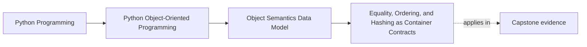

# Equality, Ordering, and Hashing as Container Contracts

<!-- page-maps:start -->
## Page Maps




<!-- page-maps:end -->

Read the first diagram as a placement map: this page is one concept inside its parent
module, not a detached essay, and the capstone is the pressure test for whether the
idea holds. Read the second diagram as the working rhythm for the page: name the
problem, study the example, identify the boundary, then carry one review question
forward.

## Why this lesson matters

Equality and hashing stop being "just operator behavior" the moment an object enters a
set, becomes a dictionary key, or participates in deduplication logic.

This lesson exists because many bugs come from half-made decisions:

- value equality is implemented, but hashing is forgotten
- ordering is added because sorting seems convenient, not because the type has a real order
- mutable objects are treated as stable keys
- identity-based and value-based reasoning are mixed without being named

## Start with the real question

Before writing `__eq__`, ask:

> When should two instances count as the same for the purposes of this program?

That answer should come from meaning, not from convenience.

## Identity equality versus value equality

### Identity-oriented equality

This is right when continuity matters more than current field values.

Examples:

- active sessions
- tracked alerts
- workflow objects with lifecycle

In these cases, two objects that look similar may still be different things.

### Value-oriented equality

This is right when content is the meaning.

Examples:

- coordinates
- thresholds
- units or names
- immutable configuration fragments

In these cases, equal content usually means interchangeable values.

## The hashing rule that must stay true

If two objects compare equal and are hashable, they must produce the same hash.

That is the contract container code is relying on.

You do not need a mathematical lecture here. You need one durable rule:

- if equality changes, hashing must be reviewed too

And one strong warning:

- if equality depends on mutable state, hashing is usually a trap

## Ordering is optional, not a badge of completeness

Do not add ordering because the type "might be sortable."

Add ordering only when the type has a natural and reviewable order.

Good candidates:

- timestamps
- semantic version pieces with clear rules
- value types where less-than has obvious meaning

Bad candidates:

- rich entities whose lifecycle matters more than field comparison
- objects where several orderings are plausible
- domain objects where sorting is only a UI convenience

If a type has no obvious single order, use an explicit sort key at the call site.

## A small example with good value semantics

```python
from dataclasses import dataclass


@dataclass(frozen=True)
class Threshold:
    metric_name: str
    limit: int
```

This is value-oriented:

- two thresholds with the same fields mean the same thing
- hashability is safe because the fields are frozen
- set membership or deduplication becomes predictable

## A small example where identity should stay primary

```python
class Alert:
    def __init__(self, alert_id: str, threshold):
        self.alert_id = alert_id
        self.threshold = threshold
        self.active = False
```

If `Alert` is a tracked workflow object, forcing value equality on its fields may be a
mistake. Two alerts can look similar and still represent different lifecycles.

That is why this lesson begins with meaning, not with dunder methods.

## Review checklist for equality and hashing

| Question | Good sign | Warning sign |
| --- | --- | --- |
| What does equality mean? | one clear domain story | "it depends on context" but nothing is modeled |
| Should the type be hashable? | stable value semantics | mutable fields participate in equality |
| Does ordering exist naturally? | a reviewer can explain the less-than meaning | ordering added only because sorting felt useful |
| Will a set or dict rely on this type? | semantics are explicit and tested | container use is accidental |

## Common mistakes

| Mistake | Why it fails |
| --- | --- |
| overriding `__eq__` without thinking about hashability | container behavior becomes unsafe or surprising |
| keeping hashability on a mutable value-like object | the object can drift after insertion into a set or dict |
| implementing ordering for a type with no natural order | code becomes readable only to the original author |
| using equality to model lifecycle identity | distinct entities collapse into one semantic bucket |

## Practical rules for this course

- Prefer value equality for small immutable meaning-carrying types.
- Prefer identity-based behavior for lifecycle-bearing entities unless you have a very strong reason not to.
- Make mutable equality-bearing types unhashable unless the design story is exceptionally clear.
- Use explicit sort keys instead of fake total ordering when the type has several plausible orderings.

## Capstone connection

This lesson underpins questions like:

- should rule definitions compare by content?
- should workflow objects keep identity semantics?
- can this type safely be deduplicated or used in set membership?

If those answers are fuzzy, the later architecture will inherit the fuzziness.

## Exit check

Leave this lesson only when you can do all of these:

- explain whether one type should compare by identity or by value
- say whether that type should be hashable and why
- reject one case where adding ordering would only create false precision
