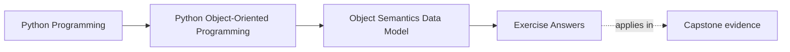
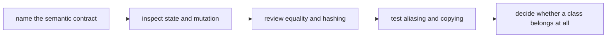

# Exercise Answers

<!-- page-maps:start -->
## Page Maps

<!-- page-maps:end -->

These answers are model reasoning, not the only acceptable wording. A strong answer
should sound like a review comment or design note, not like a memorized definition.

## How to use the answer page

Read your own answer first. Then compare it against this page by asking:

- Did I name the object kind clearly?
- Did I name the owner of mutable state?
- Did I explain the first proof route, not only the final opinion?
- Did I make the contract visible enough for another reviewer to follow?

If your answer reaches the same verdict but hides the reasoning, it is still weaker than
it should be.

## Answer 1: Classify one object honestly

A strong answer names the type as value-like, entity-like, or not worth keeping as a
class and then justifies that label with continuity and meaning.

Good signals:

- a value-like object is equal by content and carries no meaningful lifecycle
- an entity-like object stays distinct even when fields happen to match
- an unnecessary class protects no invariant and owns no important state

Weak answer pattern:

- "it is a class because it has fields"

## Answer 2: Explain one attribute lookup surprise

A strong answer distinguishes:

- class state
- instance state
- computed access through a property

It also explains shadowing clearly. If the answer says only "Python checks the object,"
it is still too vague.

## Answer 3: Repair a weak constructor

A good redesign does three things:

- makes truly required inputs explicit
- removes defaults that only stand in for missing lifecycle
- blocks invalid states at creation time instead of later repair time

The key teaching point is not nicer syntax. It is a more honest object boundary.

## Answer 4: Draw a public-surface boundary

A strong answer names:

- which names are intentionally public
- which names are internal support detail
- what the representation should emphasize

The best answers explain why exposing less can make debugging clearer, not harder.

## Answer 5: Make an equality decision

A good answer starts from meaning:

- value-like objects usually justify value equality and often hashability
- entity-like objects usually keep identity-centered reasoning
- mutable equality-bearing objects are often poor key candidates

The most important thing the answer should show is that equality and hashing were
considered together.

## Answer 6: Find one aliasing hazard

A strong answer does not stop at "mutable defaults are bad." It explains:

- who unintentionally became a co-owner
- how the bug would appear in ordinary maintenance work
- what boundary repair fixes it

That turns a Python trick into a design lesson.

## Answer 7: Choose a copy strategy

A good answer explains what should stay shared and what should become independent.

Good reasoning often sounds like this:

- no copy because sharing is intentional and safe
- shallow copy because only outer structure should separate
- deep copy because nested mutable state must not remain shared
- redesign because repeated copying is masking broken ownership

The best answer names why the chosen strategy matches the object's contract.

## Answer 8: Reject one unnecessary class

A strong answer names the simpler replacement and explains what the class was pretending
to protect.

Good replacements are often:

- a plain function for direct transformation
- a small value object for honest data meaning
- a module-level namespace for grouped helpers

The key point is that fewer classes can mean clearer design, not weaker design.

## Answer 9: Mini review memo

A good memo should read like a real code review:

- object kind
- mutable-state owner
- supported public surface
- equality and hashing story
- shared-state risk
- copy decision

If the memo sounds like a glossary summary, it is not yet doing review work.

## Answer 10: Capstone transfer

The strongest final answer shows that Module 01 decisions shape later modules.

Good signs:

- the learner can explain why a capstone type is value-like, entity-like, or simpler than a class
- the learner can name which later boundary would suffer if the object semantics were wrong
- the learner can connect identity, mutation, and public surface to later architectural clarity

## What a strong packet looks like overall

Across the whole exercise day, strong answers usually show all of these:

- explicit naming of object kind
- explicit ownership language for mutable state
- one clear explanation of lookup or representation behavior
- one equality-and-hashing judgment tied to container use
- one aliasing or copy decision tied to boundary meaning
- one explicit rejection of unnecessary class form

## Exit check

Leave this answer page only when you can say:

> My answers now sound like design reviews: I can classify the object, name the owner,
> describe the contract, and choose the first proof route without relying on vague OOP language.
