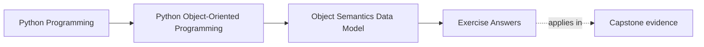
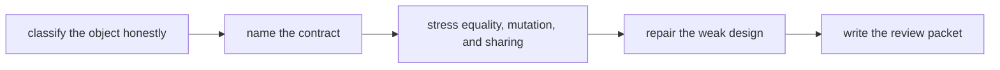

# Exercise Answers

<!-- page-maps:start -->
## Page Maps

<!-- page-maps:end -->

These answers are model reasoning, not magic wording. The important question is not
"did I match the sentence?" but "did I make the contract visible enough that another
maintainer could trust my judgment?"

## How to use this page well

Read your own packet first. Then compare it against this page using four checks:

- did I classify the object clearly?
- did I name the owner of mutable state?
- did I explain what could go wrong, not just what I prefer?
- did I make the first proof route visible?

If your answer reaches the same verdict but hides the reasoning, it is still weaker than
it should be.

## What strong Module 01 answers have in common

Across the whole exercise day, strong answers usually show all of these:

- explicit naming of object kind
- explicit ownership language for mutable state
- a clear distinction between public contract and internal representation
- equality and hashing considered together
- aliasing and copy decisions tied to meaning, not to superstition
- one explicit willingness to remove a class when the class protects nothing

If your packet sounds like glossary definitions pasted together, the understanding is not
deep enough yet.

## Answer 1: Classify one object honestly

A strong answer names the object as value-like, entity-like, or not worth keeping as a
class and then justifies that label with continuity and meaning.

Good signals:

- a value-like object compares by content and carries no meaningful lifecycle
- an entity-like object stays distinct even when some fields happen to match
- an unnecessary class owns no important state and protects no real invariant

Weak answer pattern:

- "it is a class because it has fields"

Better answer pattern:

- "it is value-like because the meaningful question is whether two instances mean the same thing, not whether they are the same occurrence over time"

## Answer 2: Explain one attribute lookup path

A strong answer distinguishes:

- class-level state
- instance-owned state
- computed access through a property
- the specific place where shadowing could confuse the reader

Weak answer pattern:

- "Python checks the object and then the class"

Better answer pattern:

- "this name looks like stored state but is actually computed, so a casual reader could assume mutability or persistence that the contract does not promise"

## Answer 3: Repair a weak constructor

A strong redesign does three things:

- makes truly required inputs explicit
- separates real defaults from convenience defaults
- blocks invalid states at creation time instead of promising they will be fixed later

The key teaching point is not prettier syntax. It is a more honest boundary between
"this object may exist" and "this object should still be built differently."

## Answer 4: Draw a public-surface boundary

A strong answer names:

- which names are intentionally public
- which names are internal support detail
- what the representation should teach a debugger or reviewer
- what another module should refuse to depend on

The best answers also explain why exposing less can make debugging clearer, not harder.
If a representation leaks internal structure that callers must ignore, the surface is
still too noisy.

## Answer 5: Make an equality and hashing decision

A good answer starts from meaning:

- value-like objects often justify value equality and sometimes hashability
- identity-bearing objects often keep identity-centered reasoning
- mutable equality-bearing objects are dangerous key candidates unless their contract is very tight

The most important thing the answer should show is that equality and hashing were
considered together. If they are separated, the design is still one bug away from
container confusion.

## Answer 6: Find one aliasing hazard

A strong answer does not stop at "mutable defaults are bad." It explains:

- who unintentionally became a co-owner
- what the first maintenance symptom would look like
- whether the right fix is copying, encapsulation, immutability, or redesign

That turns a Python gotcha into a design lesson about ownership.

## Answer 7: Choose a copy strategy

A strong answer explains what should stay shared and what should become independent.

Good reasoning often sounds like this:

- no copy because sharing is intentional and safe
- shallow copy because only the outer container should separate
- deep copy because nested mutable state must not remain shared
- redesign because repeated copying is masking broken ownership

The answer is strong only when the copy choice flows from the object's contract.

## Answer 8: Reject one unnecessary class

A strong answer names the simpler replacement and explains what the class was pretending
to protect.

Good replacements are often:

- a plain function for direct transformation
- a small value object for honest data meaning
- a module-level surface for grouped helpers
- plain structured data plus one validating boundary

The important lesson is that fewer classes can mean clearer design, not weaker design.

## Answer 9: Mini review memo

A good memo should sound like a real review comment, not like a lesson summary.

It should let another engineer answer:

- what kind of object this is
- what continuity it has
- who owns mutable state
- what callers may safely rely on
- where equality, sharing, or copying could go wrong

If the memo sounds polite but noncommittal, the reasoning is still too soft.

## Answer 10: Capstone transfer

The strongest final answer shows that Module 01 decisions shape later modules.

Good signs:

- you can explain why a capstone type is value-like, entity-like, or simpler than a class
- you can name which later boundary would suffer if the semantics were wrong
- you can say which proof route would expose the weakness first

This is the point where object semantics stops being theory and starts becoming
architecture support.

## What a strong packet sounds like overall

A strong final packet usually sounds like this:

> This object is value-like because continuity does not matter outside its content.
> Mutable state is either absent or tightly owned. Equality and hashing are aligned with
> container use. Sharing is intentional. Class form is justified because the object
> protects real meaning rather than merely grouping fields.

If your packet cannot produce that level of explicitness for at least one object, stay in
the module longer.

## Exit check

Leave this answer page only when you can say:

> My answers now sound like design reviews: I can classify the object, name the owner,
> describe the contract, explain the likely bug, and choose the first proof route without
> relying on vague OOP language.
