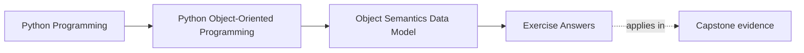
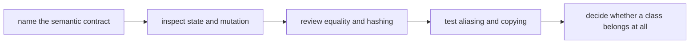

# Exercise Answers

<!-- page-maps:start -->
## Page Maps

<!-- page-maps:end -->

These answers are model explanations, not the only acceptable wording.

## How to use the answer page well

Do not read the model answer first and then reduce the module to "use dataclasses for
values and regular classes for objects."

A better rhythm is:

1. finish the exercise with your own semantics packet
2. name the identity model, mutation rule, and proof test
3. compare your reasoning with the model answer
4. revise anywhere your answer still hides aliasing, fuzzy equality, or accidental class
   usage

What matters is whether the reasoning makes object contracts explicit and reviewable.

Strong Module 01 answers usually do five things:

- they distinguish identity from value semantics clearly
- they explain who owns mutable state
- they treat equality and hashing as container contracts
- they describe attribute lookup and representation honestly
- they reject classes that do not protect meaning or invariants

The strongest self-study packets also leave behind six concrete artifacts:

- one identity-versus-value judgment
- one aliasing example
- one representation review
- one equality and hashing rule
- one copying comparison
- one class-rejection decision

If your answers rely only on "this feels object-oriented," the reasoning is still too
thin.

## Answer 1: Name the object contract

A strong answer names:

- whether the object is identity-bearing, value-oriented, or unnecessary as a class
- what continuity matters over time
- which state may change safely
- what equality is supposed to mean

For example, a type like `ThresholdRule` is usually value-oriented because its meaning is
its content. A runtime registry entry or aggregate root may be identity-bearing because
its continuity matters beyond current field values.

## Answer 2: Review shared mutable state

The key distinction:

- aliasing means two names reference one mutable object
- equal-looking independent objects merely start with the same content

The production bug is non-local mutation: code changes one path and silently changes
another consumer's view. A strong prevention route is constructor discipline that copies
or freezes caller-owned mutables when shared ownership is unsafe.

## Answer 3: Draw the public representation boundary

A strong answer identifies:

- which attributes consumers may read or reason about
- which attributes are internal storage or caching detail
- how `repr` supports debugging and review without dumping irrelevant internals

One healthy rule is:

- other modules must not depend on private representation details or incidental field
  names that are not part of the supported surface

## Answer 4: Explain equality, ordering, and hashing

Content-based equality is strongest for value objects. Identity-based equality is often
safer for entities whose continuity matters more than current field equality.

Hashing should exist only when:

- the object is meaningfully hashable
- the equality rule is stable enough to support container use

The classic bug is:

- equality says two objects are the same, but hashing disagrees, so sets or dicts behave
  inconsistently

## Answer 5: Trace attribute lookup honestly

Strong explanation:

- instance attributes are checked before falling back to class-level definitions
- class attributes can provide defaults or shared state
- properties and descriptors can intercept access and compute results

Why "just a field" is weak:

- the observed attribute may actually come from lookup rules, descriptors, inheritance, or
  shadowing, not from a simple stored slot

## Answer 6: Compare shallow and deep copying

The important distinctions:

- assignment creates another name for the same object
- shallow copy duplicates only the outer container or object shell
- deep copy recursively duplicates nested content

What matters is not which tool sounds stronger, but which sharing behavior the contract
actually promises. Unplanned shared nested state is often the real surprise.

## Answer 7: Repair constructor discipline

A strong redesign:

- replaces vague raw primitives with meaningful values or wrapper types
- rejects invalid combinations at construction time
- removes optional values that represent illegal partial states

The proof test should show that invalid state cannot be created silently anymore.

## Answer 8: Review data-model hooks as design decisions

Each hook is a promise:

- `__repr__` promises something about debug visibility
- `__eq__` promises how sameness is judged
- `__hash__` promises container compatibility
- `__bool__` or `__len__` promise truthiness semantics

Abuse happens when a hook hides expensive work, surprising policy, or ambiguous meaning
behind normal Python syntax.

## Answer 9: Decide when a class is the wrong tool

A strong answer shows:

- the current class adds little beyond bundling a few values
- a plain value, function, or small `dataclass` would be clearer
- the class should return only if richer lifecycle, invariants, or collaboration pressure
  appears

The main lesson is that not every grouping deserves long-lived object identity.

## Answer 10: Produce a full semantic review

A good review should name:

- identity model
- mutation policy
- equality and hashing contract
- representation boundary
- copying behavior
- one concrete safety or risk finding

The strongest final paragraph sounds like a review note, not a glossary recap.

## Self-check

If your answers consistently explain:

- what kind of object you are looking at
- who owns mutable state
- what equality means in practice
- how data-model hooks shape the public contract
- when a class helps and when it only adds ceremony

then you are using Module 01 correctly.
