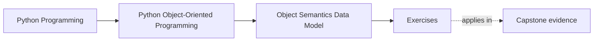
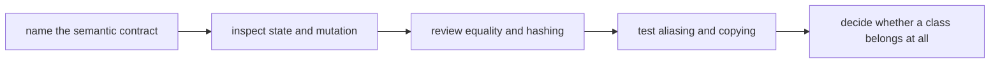
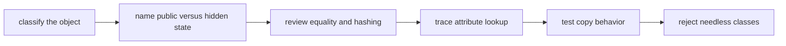

# Exercises


<!-- page-maps:start -->
## Page Maps




<!-- page-maps:end -->

Use these exercises to practice object-semantics judgment, not only class syntax.

The goal of the day is to make object meaning explicit. By the end, identity, state,
equality, mutation, copying, and representation should feel like reviewable contracts
rather than background Python behavior.

## How to work through this set

Treat the ten exercises as one full lab day on semantic contracts.

Before each answer:

1. name whether the object should behave like an identity-bearing entity, a value object,
   or a plain helper
2. name which mutation or lookup rule could surprise another maintainer
3. say what test or example would prove the contract

Do the exercises in order. The day is one progression:

- Exercises 1-3 define identity, state, and representation boundaries
- Exercises 4-5 review equality, hashing, and attribute layout
- Exercises 6-8 pressure-test aliasing, copying, and constructor discipline
- Exercises 9-10 decide whether a class helps at all and package the full semantic review

Keep one semantics packet as you go. By the end of the day it should contain:

- one identity-versus-value judgment
- one state-sharing hazard note
- one equality and hashing review
- one attribute layout explanation
- one copying and aliasing example
- one class-versus-plain-value design decision

If those six artifacts are missing, you are probably still naming classes instead of
governing their behavior.

## Recommended working layout

If you want one lab tree that can support the whole day, use something like:

```text
module01-lab/
├── artifacts/
├── notes/
├── scratch/
└── tests/
```

Keep one contract table while you work:

| Object | Identity-bearing or value-oriented | Dangerous mutation surface | Test that proves the contract |
| --- | --- | --- | --- |

Also keep one copying table:

| Operation | Aliases original state? | Safe for nested mutables? | When it is misleading |
| --- | --- | --- | --- |



Use that route on purpose. It keeps the day centered on meaning and coupling instead of on
surface-level Python familiarity.

## Exercise 1: Name the object contract

Take one class from the capstone and explain whether it should be:

- an identity-bearing entity
- a value object
- a plain helper that does not need class form

Your answer should explain:

- what continuity matters, if any
- which state is allowed to change
- what two equal instances should mean

Study note:
Most later OOP mistakes begin with the wrong answer here.

## Exercise 2: Review shared mutable state

Write a small example that distinguishes:

- two names pointing at one mutable object
- two independent objects with the same content

Then explain:

- which production bug the confusion causes
- what design or constructor choice would prevent it

Study note:
This exercise matters because aliasing bugs often look like "random mutation" until you
state the ownership boundary clearly.

## Exercise 3: Draw the public representation boundary

Review one class and explain:

- which attributes belong to the supported public surface
- which attributes are implementation detail
- how `repr` should help a reviewer without leaking internal clutter
- one sentence naming what another module should never rely on

Study note:
Representation is part of the contract whenever humans debug, log, or review the object.

## Exercise 4: Explain equality, ordering, and hashing

Pick one object that might be used in a set or dict key and explain:

- when equality should be content-based
- when identity-based equality is safer
- whether hashing should exist at all
- one bug that appears when equality and hashing disagree

Study note:
Container behavior is not a convenience detail. It is a correctness contract.

## Exercise 5: Trace attribute lookup honestly

Create a class with:

- one class attribute
- one instance attribute
- one property or descriptor-like computed attribute

Explain:

- where lookup checks first
- what can shadow what
- why "it is just a field" is often the wrong explanation

Study note:
This is where Python's object model stops looking like folklore and starts looking like a
real design surface.

## Midday self-check

Before you move into copying, constructor discipline, and class rejection, make sure your
packet can already answer these questions clearly:

- whether a given object is identity-bearing or value-oriented
- how shared mutable state can leak through constructors or defaults
- when equality and hashing are safe or dangerous
- why attribute lookup is more than "find the field"

If you cannot answer those four questions in plain language, return to Exercises 1-5 and
make the packet more explicit before continuing.

## Exercise 6: Compare shallow and deep copying

Use one object with nested mutable state and compare:

- assignment
- shallow copy
- deep copy

Then explain:

- which state stays shared
- which behavior would surprise a reviewer
- which copy strategy belongs in the real contract, if any

Study note:
The point is not to memorize copy functions. The point is to stop promising isolation you
did not actually create.

## Exercise 7: Repair constructor discipline

Take a constructor that accepts too many raw primitives or optional values and redesign it
so invariants are clearer at creation time.

Explain:

- what ambiguity the old constructor allowed
- what invalid state the redesign prevents
- what test would prove the invariant

Study note:
Object safety often starts before the first method call.

## Exercise 8: Review data-model hooks as design decisions

Pick at least two hooks such as:

- `__repr__`
- `__eq__`
- `__hash__`
- `__bool__`
- `__len__`

Explain what promise each hook makes and what abuse would make the object harder to trust.

Study note:
Magic methods are not magic. They are public behavioral promises.

## Exercise 9: Decide when a class is the wrong tool

Choose one example where a class could be replaced by:

- a plain value
- a function
- a small `dataclass`

Explain:

- why the class version adds noise
- what the simpler alternative clarifies
- what behavior would have to appear before you reintroduce the class

Study note:
Good OOP in Python includes knowing when not to reach for OOP.

## Exercise 10: Produce a full semantic review

Take one object from the capstone or a small lab example and produce a short review that
names:

- identity model
- mutation policy
- equality and hashing contract
- representation boundary
- copying semantics
- one reason the current design is safe or unsafe

Study note:
This final exercise matters because semantic review is the real exit skill of the module.

## Mastery check

You have a strong grasp of this module if your answers consistently keep five ideas
visible:

- identity and value semantics are different contracts
- mutable state needs an ownership story
- equality and hashing must agree with container use
- attribute lookup and representation choices affect real design behavior
- classes should exist only when they clarify meaning or protect invariants
