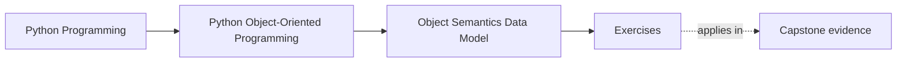
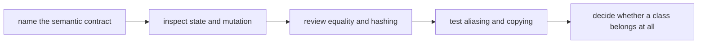

# Exercises

<!-- page-maps:start -->
## Page Maps

<!-- page-maps:end -->

Use these exercises as one full lab day on object meaning. The goal is not to prove that
you recognize Python syntax. The goal is to prove that you can inspect a type and say
what it is promising.

## How to use this exercise day

Do the exercises in order. Each one builds a piece of the same review packet.

Before answering any exercise, write these three lines:

1. `This object is...`
2. `The owner of this mutable state is...`
3. `The first proof I would run is...`

If you skip those lines, the answers often drift back into vague opinions.

## What you should produce by the end

By the end of the exercise day, you should have a packet containing:

- one identity-versus-value judgment
- one attribute-layout explanation
- one constructor invariant review
- one public-surface judgment
- one equality-and-hashing judgment
- one aliasing or shared-state hazard note
- one copying decision
- one class-versus-function decision

That packet is more important than any individual sentence.

## Exercise 1: Classify one object honestly

Choose one type from the capstone or from your own work. Decide whether it is:

- value-like
- entity-like
- not worth keeping as a class

Write:

- what gives it continuity, if anything
- what would make two instances meaningfully the same
- whether lifecycle matters

## Exercise 2: Explain one attribute lookup surprise

Create a tiny example with:

- one class attribute
- one instance attribute
- one property

Then explain:

- where each visible value comes from
- which access is stored state
- which access is computed
- which name can be shadowed

## Exercise 3: Repair a weak constructor

Take a constructor that accepts too many nullable or ambiguous inputs and redesign it.

Explain:

- which inputs are truly required
- which defaults are real domain defaults
- which invalid state should become impossible to construct

## Exercise 4: Draw a public-surface boundary

Choose one object and decide:

- which names are intentionally public
- which names are internal support detail
- what the `__repr__` should emphasize
- what another module should never rely on

## Exercise 5: Make an equality decision

Choose one type and decide whether equality should be:

- identity-based
- value-based
- intentionally absent from normal comparison work

Then explain:

- whether hashing should exist
- whether the object is safe in a set or as a dictionary key
- what could go wrong if the equality story drifted

## Exercise 6: Find one aliasing hazard

Show one example of accidental sharing through:

- a mutable default
- a mutable class attribute
- direct storage of caller-owned mutable state

Then explain:

- who incorrectly became a co-owner
- how the hazard would appear in a real code review
- what boundary repair would fix it

## Exercise 7: Choose a copy strategy

Pick one mutable object graph and decide whether you need:

- no copy
- a shallow copy
- a deep copy
- a redesign that removes the copying need

Explain what should stay shared and what should become independent.

## Exercise 8: Reject one unnecessary class

Find one design that is better as:

- a plain function
- a small value object
- a module-level surface

Then explain what the class was pretending to protect and why that protection was not
real.

## Exercise 9: Mini review memo

Write a short review memo for one type using this structure:

- object kind
- state owner
- public surface
- equality and hashing story
- aliasing risk
- copy decision

Keep it to one focused page. The aim is clarity, not length.

## Exercise 10: Capstone transfer

Choose one capstone type and answer:

- why it is a class, value object, or simpler surface
- what invariant or meaning it protects
- how a weak object-semantics decision here would damage later modules

This exercise closes the loop between Module 01 and the rest of the course.

## Exit check

Leave the exercise day only when you can say:

> I can now inspect one object and explain its identity model, ownership boundary,
> public surface, equality story, shared-state risk, and whether class form is justified.
