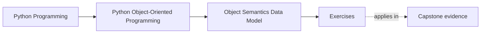
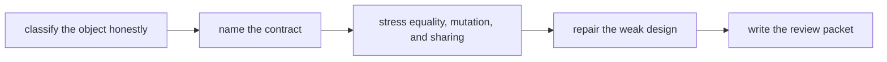

# Exercises

<!-- page-maps:start -->
## Page Maps

<!-- page-maps:end -->

Use these exercises as one full lab day on object meaning. The aim is not to prove that
you recognize Python syntax. The aim is to prove that you can inspect a type and explain
what it promises, what could break that promise, and whether the class form is justified
at all.

## Running lab rule

Use one small cluster of examples throughout the day instead of resetting your brain on
every exercise. Good candidates:

- one capstone type plus one helper type beside it
- one object from your own codebase that already feels slightly suspicious
- one tiny toy design that includes mutable state, equality pressure, and representation pressure

If you switch objects every exercise, you will practice explanation fragments instead of
building one coherent semantics packet.

## What to keep in front of you

Before answering any exercise, fill in this header:

1. `This object is...`
2. `The owner of mutable state is...`
3. `The first thing another maintainer could misunderstand is...`
4. `The first proof I would run is...`

Keep one packet for the whole day. By the end it should contain:

- one object-classification judgment
- one attribute-lookup explanation
- one constructor-boundary repair
- one public-surface note
- one equality-and-hashing judgment
- one aliasing hazard analysis
- one copying decision
- one class-versus-function decision
- one review memo
- one capstone transfer note

## Exercise 1: Classify one object honestly

Choose one type and decide whether it is:

- value-like
- entity-like
- not worth keeping as a class

Write:

- what gives it continuity, if anything
- what would make two instances meaningfully the same
- whether lifecycle matters
- one sentence explaining why the wrong classification would hurt later modules

Good answer shape:
`This type is value-like because...`

## Exercise 2: Explain one attribute lookup path

Create a tiny example with:

- one class attribute
- one instance attribute
- one property
- one attribute name that can be shadowed

Then explain:

- where each visible value comes from
- which access is stored state
- which access is computed
- which name a maintainer could misread

Do not stop at "Python looks on the instance first." Say why that matters for object contracts.

## Exercise 3: Repair a weak constructor

Take a constructor that accepts too many nullable, optional, or ambiguous inputs and
redesign it.

Produce:

- a new constructor contract
- a short note separating true defaults from convenience defaults
- one example of an invalid state that should become impossible at creation time
- one case that should become a later transition instead of a constructor argument

## Exercise 4: Draw a public-surface boundary

Choose one object and decide:

- which names are intentionally public
- which names are internal support detail
- what the representation should emphasize
- what another module should never rely on

Then write a two-column note:

| Safe to depend on | Unsafe to depend on |
| --- | --- |

The goal is to practice saying "no" to accidental public contracts.

## Exercise 5: Make an equality and hashing decision

Choose one type and decide whether equality should be:

- identity-based
- value-based
- intentionally absent from ordinary comparison work

Then explain:

- whether hashing should exist
- whether the object is safe in a set or as a dictionary key
- what bug would appear first if the equality story drifted

Keep equality and hashing in the same answer. Separating them is how many weak designs begin.

## Exercise 6: Find one aliasing hazard

Show one example of accidental sharing through:

- a mutable default
- a mutable class attribute
- direct storage of caller-owned mutable state
- a shallow copy that keeps the dangerous part shared

Then explain:

- who incorrectly became a co-owner
- what symptom a maintainer would see first
- whether the fix is copying, encapsulation, immutability, or redesign

## Exercise 7: Choose a copy strategy

Pick one mutable object graph and decide whether you need:

- no copy
- a shallow copy
- a deep copy
- a redesign that removes the need for copying

Explain what should stay shared, what should become independent, and why the object's
contract makes that choice honest.

## Exercise 8: Reject one unnecessary class

Find one design that is better as:

- a plain function
- a small value object
- a module-level surface
- plain structured data plus one validating boundary

Then explain:

- what the class was pretending to protect
- why that protection was not real
- what got clearer after removing the class

## Exercise 9: Write a mini review memo

Write a one-page review memo for one type using this structure:

- object kind
- continuity story
- mutable-state owner
- public surface
- equality and hashing story
- aliasing risk
- copy decision
- final recommendation

Write it as if another engineer will decide whether to trust the type based on your memo.

## Exercise 10: Transfer the lesson into the capstone

Choose one capstone type and answer:

- why it is a class, value object, or simpler surface
- what invariant or meaning it protects
- how a weak object-semantics decision here would damage later layers
- what proof route would expose that weakness first

This closes the loop between Module 01 and the rest of the course.

## Done means reviewable

You are done with the exercise day only when another reader could open your packet and
answer:

- what the object is
- what it promises
- what would break that promise
- whether the class form is justified

If those answers are still fuzzy, keep tightening the packet before you open the answer page.
