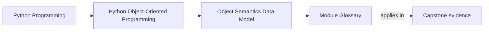

# Module Glossary

<!-- page-maps:start -->
## Page Maps

<!-- page-maps:end -->

This glossary belongs to **Module 01: Object Semantics and the Python Data Model** in
**Python Object-Oriented Programming**. Use it to keep the module's language stable
while moving between lessons, exercises, and capstone review.

## How to use this glossary

Return here when two semantic ideas start sounding similar even though they should lead
to different design choices.

Examples:

- identity versus equality
- representation detail versus real state
- safe sharing versus aliasing
- class form versus plain data and functions

If those distinctions blur, later modules become harder for the wrong reason.

## Terms in this module

| Term | Meaning in this module | Why it matters |
| --- | --- | --- |
| aliasing | two names or containers referring to the same mutable object | creates non-local bugs when one update surprises distant code |
| attribute lookup | the path Python follows when resolving `obj.name`, including instance state, class state, descriptors, and fallback rules | shapes what another maintainer thinks an object is actually exposing |
| class attribute | state stored on the class object and shared unless shadowed | can create accidental shared state if mistaken for instance state |
| entity | an object whose continuity and lifecycle matter over time | usually should not pretend to be a plain interchangeable value |
| equality contract | the rule for when two objects count as equal | affects sets, dict keys, tests, and review reasoning |
| half-baked object | an object that exists before its required truth is established | makes later failure and invalid state much harder to control |
| hash contract | the promise that objects used in hashed collections keep equality and hash behavior aligned | prevents subtle container corruption |
| identity | the question of whether this specific object instance matters as itself | separates entities from value-like objects |
| immutable value | a value-oriented object whose content does not change after construction | enables safe sharing and predictable hashing |
| public surface | the fields, methods, and representations another part of the code is supposed to rely on | should be deliberate, not accidental |
| representation detail | data or structure used internally to implement an object | should not be confused with the object's real meaning |
| semantic type | a small class or object that gives explicit meaning to data that would otherwise be raw primitives | makes later design and validation more readable |
| shallow copy | a copy that duplicates the outer container but still shares nested mutable members | often preserves aliasing risk |
| value object | an object defined primarily by its content rather than by continuity over time | usually wants clear equality and often wants immutability |

## Fast contrasts

| Do not confuse | With | Better distinction |
| --- | --- | --- |
| identity | equality | identity is about this specific instance; equality is about whether two instances count as the same by contract |
| class attribute | instance attribute | class attributes are shared at the class level; instance attributes belong to one object |
| representation detail | real state | representation detail is an implementation choice; real state is part of the object's contract |
| shallow copy | independent state | shallow copies often still share nested mutable objects |
| class form | good design | a class is only justified when it protects meaning or ownership better than plainer tools |

## Review prompts

- Which current types in the capstone are values, which are entities, and which should never have become classes?
- Where could aliasing or shallow copying still surprise a reader?
- Which object surface would be misread if someone confused representation detail with real semantic state?

## Exit check

Leave this glossary only when you can do all of these:

- explain the difference between identity and equality
- explain why aliasing can survive a refactor into prettier-looking classes
- identify one capstone type whose meaning depends on clear value semantics
