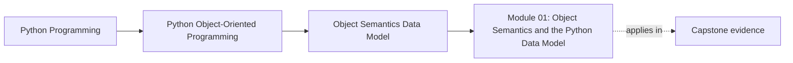

# Module 01: Object Semantics and the Python Data Model

<!-- page-maps:start -->
## Page Maps

<!-- page-maps:end -->

Read the first diagram as a placement map: this page sits between the course promise, the lesson pages listed below, and the capstone surfaces that pressure-test the module. Read the second diagram as the study route for this page, so the diagrams point you toward the `Lesson map`, `Exercises`, and `Closing criteria` instead of acting like decoration.

This module is the semantic floor for the whole course. Before architecture, layering,
or extension points, you need to know what a Python object is promising through its
identity, state, mutation rules, equality, representation, and copy behavior.

Keep one question in view while reading:

> What contract does this object actually expose to other code?

If that question still produces vague answers, later modules will feel advanced for the
wrong reason.

## What this module is really teaching

Module 01 is not only "intro OOP in Python." It is the part of the course where you
stop talking about classes as containers of methods and start talking about objects as
contracts.

By the end of the module, you should be able to look at one type and answer all of
these without guesswork:

- Is it identity-bearing, value-oriented, or not worth modeling as a class at all?
- Which state is real meaning, and which state is only representation detail?
- Which mutations are legal, and which ones quietly break the contract?
- What does equality mean, and should hashing exist?
- What sharing, copying, or attribute-lookup behavior could surprise another maintainer?

## Who should slow down here

Slow down and work this module carefully if any of these still feel unstable:

- `is` versus `==`
- mutable default values
- why a `dict` key can become dangerous
- why `obj.name` is not always a plain field lookup
- whether a small group of values really needs class form

This module should feel slower and more deliberate than a syntax tutorial. That is the
right pace.

## What a strong pass through the module looks like

| Stage | What you should be doing | What you should be producing |
| --- | --- | --- |
| early lessons | build a vocabulary for identity, state, lookup, and invariants | short notes that name the contract of one object clearly |
| middle lessons | pressure-test representation, equality, and shared state | one or two tiny examples that show the bug before the rule |
| late lessons | decide how copying, data-model hooks, and class choice affect design | one review-style paragraph that sounds like an architecture comment |
| practice day | integrate all of the above on one coherent exercise route | a semantics packet you could hand to another learner |

## Reading path

Use this route unless you already know exactly what you are diagnosing:

1. [Object Identity, State, and Behavior](object-identity-state-and-behavior.md)
2. [Attribute Layout, Class and Instance State](attribute-layout-class-and-instance-state.md)
3. [Construction Discipline and Invariants](construction-discipline-and-invariants.md)
4. [Encapsulation and Public Surface](encapsulation-public-surface-and-representation.md)
5. [Equality, Ordering, and Hashing](equality-ordering-and-hashing.md)
6. [Collections Hazards: Aliasing, Mutable Keys, and Shared State](aliasing-mutable-keys-and-shared-state.md)
7. [Copying and Cloning](copying-cloning-and-custom-semantics.md)
8. [Python Data Model as Design Surface](python-data-model-as-design-surface.md)
9. [When OOP Is the Wrong Tool in Python](when-classes-are-the-wrong-tool.md)
10. [Refactor 0: Script to Object Model](refactor-script-to-object-model.md)

Do not skip from identity to refactoring. The middle lessons are where most hidden bugs
become visible.

## Lesson map by teaching pressure

| If your current question is... | Start here |
| --- | --- |
| "What kind of object am I looking at?" | object identity, state, and behavior |
| "Why did this attribute access behave that way?" | attribute layout, class and instance state |
| "How do I stop invalid objects from existing?" | construction discipline and invariants |
| "What should stay public and what should stay hidden?" | encapsulation and public surface |
| "Can this object live in a set or dict safely?" | equality, ordering, and hashing |
| "Why did changing one value affect something far away?" | collections hazards |
| "Do I need a copy, a clone, or a redesign?" | copying and cloning |
| "Should this be a class at all?" | when OOP is the wrong tool |

## Capstone connection

This module is the justification for the capstone's early type choices. Types such as
`MetricName`, `Severity`, `MetricSample`, and `ThresholdRule` only stay trustworthy
because their semantics are explicit. `MonitoringPolicy` only stays readable because the
course distinguishes value-like rule definitions from identity-bearing workflow objects.

Read the capstone through this lens:

- value-oriented types should compare by meaning
- identity-bearing workflow objects should not pretend to be plain values
- copied or shared state should be intentional, not accidental

## Exercises and support surfaces

Treat the exercise set as the second half of the module, not as optional homework:

- [Exercises](exercises.md)
- [Exercise Answers](exercise-answers.md)

Keep these surfaces nearby when you need them:

- `../guides/proof-matrix.md` for matching claims to proof routes
- `../guides/module-promise-map.md` for the module's teaching contract
- `../reference/self-review-prompts.md` when you want review-style retrieval practice
- [Glossary](glossary.md) when the language starts drifting

## Common failure modes

- treating identity and equality as interchangeable
- hiding invalid state behind optional fields or late mutation
- leaking shared mutable state through defaults, aliases, or shallow copies
- assuming attribute access is always a simple field read
- adding a class before proving the class protects meaning

## Closing criteria

You are ready to leave this module when you can do all of these in plain language:

- explain what one object promises through identity, equality, and mutation
- name one shared-state hazard and how to neutralize it
- justify one public surface and one hidden surface
- say whether a small design should stay a class, become a value object, or go back to functions and plain data
