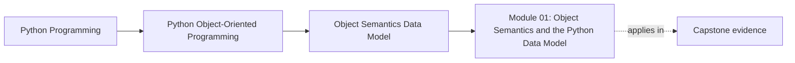
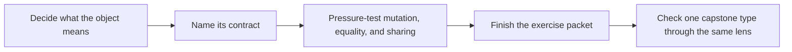

# Module 01: Object Semantics and the Python Data Model

<!-- page-maps:start -->
## Page Maps

<!-- page-maps:end -->

This module is the semantic floor of the whole course. Before layering, policies,
aggregates, or extension points, you need a reliable answer to one question:

> What contract does this object expose to other code?

If that answer is vague, everything later becomes harder for the wrong reason. Learners
often think they are blocked by architecture when they are really blocked by object
meaning: identity, equality, mutation, representation, aliasing, and copying are still
unclear.

## What this module must settle

By the end of the module, you should be able to inspect one type and answer all of these
without hedging:

- is it value-like, entity-like, or not worth keeping as a class?
- which state is real meaning, and which state is merely representation detail?
- which mutations are legal, and which ones silently damage the contract?
- what does equality mean here, and should hashing exist at all?
- which sharing or copying choices could surprise another maintainer?

That is the real work of Module 01. Syntax familiarity is not enough.

## Who should slow down here

Slow down and study this module carefully if any of these still feel unstable:

- `is` versus `==`
- mutable default values
- why a `dict` key can become dangerous
- why `obj.name` is not always a plain field read
- whether a small cluster of values needs class form at all
- why a "simple" copy bug can really be an ownership bug

If two or more items on that list still feel fuzzy, treat this module as a full-day
session, not as an introduction you can skim.

## Session outcome

Treat this module as one serious session with four stages.

| Stage | Main question | What you should produce |
| --- | --- | --- |
| orientation | what kind of object am I even looking at | one sentence beginning with `This object is...` |
| contract building | what behavior and representation can other code rely on | short notes about identity, public surface, and mutation |
| pressure testing | what breaks if equality, sharing, or copying are wrong | one or two tiny bug examples with explanation |
| transfer | how this affects the capstone | one paragraph about a capstone type and why its semantics matter |

If you finish reading but cannot produce those artifacts, the module is not done.

## Recommended study route

Use this route unless you are returning to one narrow problem:

1. [Object Identity, State, and Behavior](object-identity-state-and-behavior.md)
2. [Attribute Layout, Class and Instance State](attribute-layout-class-and-instance-state.md)
3. [Construction Discipline and Invariants](construction-discipline-and-invariants.md)
4. [Encapsulation and Public Surface](encapsulation-public-surface-and-representation.md)
5. [Equality, Ordering, and Hashing](equality-ordering-and-hashing.md)
6. [Collections Hazards: Aliasing, Mutable Keys, and Shared State](aliasing-mutable-keys-and-shared-state.md)
7. [Copying and Cloning](copying-cloning-and-custom-semantics.md)
8. [Python Data Model as Design Surface](python-data-model-as-design-surface.md)
9. [When OOP Is the Wrong Tool in Python](when-classes-are-the-wrong-tool.md)
10. [Refactor 0: Script to Object Model](refactor-script-to-object-model.md)

Do not jump from the opening lesson to the refactor. The middle lessons are where the
most expensive misunderstandings become visible.

## Lesson map by pressure

| If your current question is... | Start here | Then do this |
| --- | --- | --- |
| what kind of object is this | object identity, state, and behavior | classify one capstone type as value, entity, or simpler surface |
| why did this attribute access behave that way | attribute layout, class and instance state | build one shadowing example by hand |
| how do I stop invalid objects from existing | construction discipline and invariants | redesign one weak constructor |
| what should stay public and what should stay hidden | encapsulation and public surface | write one public-surface note |
| can this type live safely in a set or dict | equality, ordering, and hashing | explain hashing and equality together |
| why did one change affect far-away code | collections hazards | trace the aliasing path explicitly |
| do I need a copy, a clone, or a redesign | copying and cloning | say what should stay shared and why |
| should this stay a class at all | when OOP is the wrong tool | rewrite one design using simpler structure |

## What a missed-class learner should do

If you are studying alone and do not have the classroom demos, use this rhythm:

1. read one lesson
2. write one short example or review note from memory
3. compare it with the lesson
4. move to the next lesson only after the current object contract sounds explicit
5. end the day with the exercise packet and one capstone transfer note

This rhythm is slower than casual reading, but it replaces the missing classroom back and
forth with visible output.

## Capstone transfer for this module

Use the capstone's early types to test whether Module 01 is really landing. Look at:

- value-oriented types such as names, severities, rule definitions, or samples
- identity-bearing workflow objects such as the policy aggregate
- places where copying or shared state would quietly damage later lifecycle reasoning

Questions to carry into the capstone:

- which types compare by meaning?
- which types should not pretend to be plain values?
- where would an aliasing bug become an architecture bug later?

## Support surfaces

Treat the practice pages as the second half of the module:

- [Exercises](exercises.md)
- [Exercise Answers](exercise-answers.md)

Keep these nearby when useful:

- `../guides/proof-matrix.md`
- `../guides/module-promise-map.md`
- `../reference/self-review-prompts.md`
- [Glossary](glossary.md)

## Common ways learners leave too early

- recognizing the syntax of `__eq__` without being able to defend the equality contract
- saying "it is just data" without checking whether lifecycle or identity really exists
- treating aliasing as a Python trick instead of as an ownership boundary problem
- adding a class because it feels more object-oriented, not because meaning became clearer

## Closing criteria

You are ready to leave Module 01 only when you can do all of these in plain language:

- explain what one object promises through identity, equality, and mutation
- name one shared-state hazard and how to neutralize it
- justify one public surface and one hidden surface
- decide whether one design should stay a class, become a value object, or go back to functions and plain data
