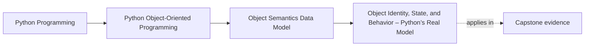

# Object Identity, State, and Behavior – Python’s Real Model


<!-- page-maps:start -->
## Page Maps




<!-- page-maps:end -->

Read the first diagram as a placement map: this page is one concept inside its parent module, not a detached essay, and the capstone is the pressure test for whether the idea holds. Read the second diagram as the working rhythm for the page: name the problem, study the example, identify the boundary, then carry one review question forward.

## Why this lesson matters

Most later OOP mistakes start here, not in inheritance or architecture:

- a thing that should behave like a value gets treated like a long-lived entity
- a mutable object is shared as if it were isolated
- an identity check is used where semantic equality was intended, or the reverse
- a class is introduced before anyone has named what kind of continuity the object needs

This lesson gives you a vocabulary for those decisions before the codebase gets larger.

## The three questions behind every object

When you meet a Python object, ask these in order:

1. What makes this object the same object over time?
2. What state does it carry, and who is allowed to change that state?
3. What behavior does it expose because of its type?

If you cannot answer those questions clearly, you are not ready to reason about the
object's equality, hashing, lifecycle, or architectural role.

## Identity: the object itself

Identity answers a narrow question:

> Is this literally the same runtime object?

That is what `is` checks. Identity matters for:

- singletons such as `None`
- explicit sentinels
- caches or registries that track one live object
- true entities whose continuity matters beyond current field values

Identity does **not** mean "these two things seem equivalent." That is an equality
question, not an identity question.

```python
missing = object()

def parse_limit(raw):
    if raw is None:
        return missing
    return int(raw)
```

In that example, `None` and `missing` are about identity, not value similarity.

## State: the data the object is carrying

State is whatever information an object is currently holding or exposing. The important
question is not only what the fields are. The important question is what changes are
allowed.

Use this table as a first filter:

| Object style | What usually matters most |
| --- | --- |
| value-like object | its content and whether equal content means the same thing |
| entity-like object | its continuity over time, even as fields change |
| helper or service object | the behavior it offers, not rich object identity |

When state is mutable, ask immediately:

- who owns the right to mutate it?
- could another reference still be pointing at the same state?
- would changing this state change equality or hashing?

Those questions prevent the most common "how did that value change over there?" bugs.

## Behavior: what the type makes possible

Behavior is not only named methods. In Python it also includes the protocols the object
participates in:

- iteration
- numeric operators
- truthiness
- comparison
- context management
- attribute access rules

That is why "everything is an object" is useful but incomplete. The useful part is that
many things follow common protocols. The incomplete part is that not every object
deserves the same design treatment.

## A practical design lens: value, entity, or not-a-class

Python does not label your types as values or entities for you. You have to decide.

### Value-like object

Use this lens when:

- content is the meaning
- equal content should usually mean interchangeable values
- mutation should be rare or forbidden
- hashing may be useful

Examples: measurement units, coordinates, thresholds, names, immutable configuration fragments.

### Entity-like object

Use this lens when:

- continuity matters beyond current field values
- lifecycle matters
- mutation is part of the job
- identity should usually not be replaced by content equality

Examples: sessions, open workflows, long-lived policies, tracked alerts.

### Not-a-class

Use this lens when:

- there is no meaningful identity
- the behavior is a simple transformation
- state does not need protection
- plain data plus functions would be clearer

This third option matters as much as the first two.

## A worked contrast

```python
from dataclasses import dataclass

@dataclass(frozen=True)
class Threshold:
    limit: int


class Alert:
    def __init__(self, alert_id: str, threshold: Threshold):
        self.alert_id = alert_id
        self.threshold = threshold
        self.active = False
```

`Threshold` is value-like. If two thresholds both mean "limit 10", interchangeability is
the point.

`Alert` is entity-like. Two alerts with the same field values may still represent
different tracked things. Their lifecycle matters.

That distinction is the start of good design judgment in this course.

## Rules that will save you work later

- Use `is` for `None` and other intentional identity checks.
- Use `==` only after deciding what equality should mean.
- Never assume mutable state is isolated unless you created that isolation deliberately.
- Treat "mutable and hashable by mutable fields" as a design warning.
- Do not introduce a class until you can say what kind of object it is.

## Common beginner-to-intermediate confusions

| Confusion | Better interpretation |
| --- | --- |
| "Two objects with the same fields are the same object." | They may be equal by content, but identity is a different question. |
| "Everything being an object means classes are always the right tool." | Python supports several styles; object semantics help you decide when class form is justified. |
| "If I mutate it in one place, other code will not see it." | Other references may still point to the same mutable state. |
| "Equality is just convenience for tests." | Equality becomes a real contract as soon as containers or comparisons rely on it. |

## Capstone connection

Keep an eye on this distinction as you read the capstone:

- `MetricName` or `Severity` should behave like meaning-carrying values
- workflow or runtime coordination objects should not pretend to be plain interchangeable values

If the course later talks about aggregates, repositories, or extension points, it is
still building on this lesson's first decision: what kind of object are we dealing with?

## Exit check

Leave this lesson only when you can do all three:

- explain the difference between identity and equality without using vague synonyms
- classify one capstone type as value-like, entity-like, or not worth modeling as a class
- name one mutation risk that would matter if the object were shared
