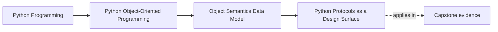

# Python Protocols as a Design Surface

<!-- page-maps:start -->
## Page Maps

<!-- page-maps:end -->

Read the first diagram as a placement map: this page is one concept inside its parent
module, not a detached essay, and the capstone is the pressure test for whether the
idea holds. Read the second diagram as the working rhythm for the page: name the
problem, study the example, identify the boundary, then carry one review question
forward.

## Why this lesson matters

Python lets your objects participate in familiar protocols:

- iteration
- containment
- indexing
- truthiness
- context management
- numeric operators

That power is useful, but it is also a place where many objects become too clever. This
lesson is not mainly about memorizing dunder names. It is about deciding when a protocol
makes the object easier to understand and when it only makes the API more magical.

## The key question

Before implementing a protocol, ask:

> If another engineer used this object through that protocol, would the meaning feel
> natural or misleading?

That question is the real design surface.

## Good protocol adoption

A protocol is a good fit when it matches the object's real meaning.

Examples:

- iterable history or window objects can support `for item in window`
- bounded collections can support `len(window)`
- resource owners can support `with resource:`
- value-like numeric quantities can support arithmetic when the result is meaningful

In those cases, the protocol reduces friction without hiding the truth.

## Misleading protocol adoption

A protocol is a bad fit when it makes the object look simpler, cheaper, or safer than it
really is.

Examples:

- making a remote or streaming boundary look like an ordinary in-memory container
- giving a rich workflow object a fake ordering only because sorting is convenient
- using truthiness to hide a nuanced lifecycle question
- adding iterable behavior when callers should really make an explicit method choice

The lesson is simple: fluency is not automatically clarity.

## Protocols worth understanding in Module 01

### Iteration and containment

Use these when the object is genuinely collection-like.

If iteration would leak internal traversal rules or make a boundary look cheaper than it
is, prefer an explicit method such as `.items()` or `.events()`.

### `len()` and truthiness

These are convenient only when size or emptiness is part of the honest meaning.

If the object represents a session, a live connection, or a workflow, `bool(obj)` may
say less than you think.

### Indexing

Indexing fits when the object really behaves like a stable sequence or mapping. It is a
bad fit when the object only exposes one arbitrary view over richer behavior.

### Context management

`with` fits best when the object owns setup and cleanup. It should signal real resource
discipline, not cosmetic style.

### Numeric operators

Arithmetic should exist only when the domain meaning stays obvious under those
operations. If the result type or semantic rule is ambiguous, explicit methods are
usually clearer.

## Review checklist for protocol decisions

| Question | Good sign | Warning sign |
| --- | --- | --- |
| Does this protocol match the object's meaning? | yes, and a reader would expect it | it is mainly added for convenience |
| Does the protocol hide cost or side effects? | no, behavior is unsurprising | access looks cheap but triggers heavy work |
| Would an explicit method be clearer? | no, the protocol is the natural surface | yes, but protocol syntax looks nicer |
| Is the object now pretending to be a collection or number? | only when that is truly what it is | yes, without matching semantics |

## Practical rules for this course

- Implement protocols that make the object easier to reason about, not only easier to type.
- Prefer explicit methods when the operation is expensive, stateful, or ambiguous.
- Do not overload truthiness, ordering, or arithmetic unless the meaning is stable and reviewable.
- Treat context management as resource ownership, not as decoration.

## Capstone connection

This lesson matters whenever the capstone needs to decide:

- whether a surface should behave like a collection
- whether a rule or value should support comparison or arithmetic
- whether a runtime or resource boundary should support `with`

If protocol adoption would blur the domain meaning, the better design is usually the
explicit one.

## Exit check

Leave this lesson only when you can do all of these:

- name one object that should adopt a Python protocol and explain why
- reject one protocol addition because it would make the object more magical than honest
- explain when an explicit method is clearer than protocol fluency
