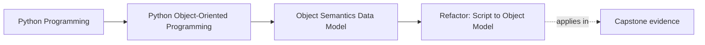

# Refactor: Script to Object Model

<!-- page-maps:start -->
## Page Maps

<!-- page-maps:end -->

Read the first diagram as a placement map: this page is one concept inside its parent
module, not a detached essay, and the capstone is the pressure test for whether the
idea holds. Read the second diagram as the working rhythm for the page: name the
problem, study the example, identify the boundary, then carry one review question
forward.

## Why this refactor matters

The first mistake many learners make is turning a working script into classes before
they know what those classes are supposed to mean.

That usually creates:

- bags of fields with no contract
- identity where value semantics were needed
- mutation where construction should have settled the state
- copy and aliasing bugs that the original script hid

This refactor exists to slow that move down. The goal is not "object-oriented style."
The goal is to turn raw script data into types whose identity, equality, mutation, and
representation rules are understandable.

## Start by finding the meanings that already exist

A script often contains several different kinds of things mixed together:

- raw input records
- stable values
- evolving workflow state
- temporary derived data

Before creating classes, ask:

- which pieces are really values?
- which pieces need continuity over time?
- which pieces are just temporary helper structures?

If you cannot answer those questions, the refactor is not ready yet.

## Step 1: convert obvious values first

Strong early candidates for class form are values with clear meaning, such as:

- metric names
- timestamps
- threshold definitions
- small immutable record-like inputs

These types benefit from:

- explicit validation
- clear equality
- predictable representation
- safe sharing

They are usually much safer to introduce first than large mutable coordinators.

## Step 2: delay entity identity until continuity is real

Not every record needs to become an identity-bearing object.

If two instances should be treated as the same because their content is the same, that
is usually a value-type signal, not an entity signal.

Only introduce identity-bearing objects when the system genuinely needs to track:

- lifecycle
- continuity
- state transitions
- distinct instances over time

Premature entities make later equality, hashing, and mutation rules much harder to
review.

## Step 3: let construction settle required truth

One of the quickest ways to create weak objects is to construct them half-empty and fill
them later through ad hoc mutation.

Prefer constructors that establish:

- required fields
- validity checks
- clear starting state

That reduces the number of places where another reader has to wonder whether an object is
already safe to use.

## Step 4: replace shared mutable containers with owned values or owned mutation points

Scripts often pass around:

- shared lists
- reused dictionaries
- nested mutable structures

When those become objects, you need to decide:

- which values are safe to share because they are immutable?
- which mutable structures need one clear owner?
- where copying or defensive wrapping is required?

This is where many "working" refactors still fail, because the code now looks cleaner
while the aliasing hazards remain.

## Step 5: define equality and representation on purpose

Once a value object exists, ask:

- what makes two instances equal?
- should it be hashable?
- what should its `repr` teach a reader?

Once an entity exists, ask:

- should equality stay by identity?
- should it be excluded from hashed collections?
- what representation helps debugging without pretending it is a plain value?

These are design decisions, not afterthoughts.

## A worked refactor route

Imagine a script that uses dictionaries for:

- metric samples
- threshold configuration
- alert rows

An honest refactor route could be:

1. turn threshold configuration into a small validated value type
2. turn metric samples into a value type with explicit representation and equality
3. keep alert rows as temporary derived data unless lifecycle pressure proves they need identity
4. identify the first object that truly owns mutation and make that ownership explicit
5. remove shared mutable container reuse by copying or encapsulating the mutable boundary

Notice what does **not** happen first:

- no giant manager class
- no framework-style hierarchy
- no premature entity identity everywhere

The refactor starts from semantics, not from class count.

## Common mistakes

- turning every dictionary into a class without deciding whether it is a value, entity, or temporary shape
- giving identity to objects that only need content semantics
- leaving required state unset until long after construction
- preserving shared mutable containers inside prettier-looking classes
- ignoring equality, hashing, and `repr` until the bugs appear later

## Review checklist

| Question | Good sign |
| --- | --- |
| does each new class have a clear semantic reason to exist? | yes |
| are value types and entity types being separated honestly? | yes |
| is required truth established at construction time? | yes |
| have aliasing and copy hazards been reduced, not merely hidden? | yes |

## Capstone connection

Use the capstone’s early value and rule types to ask:

- which parts became trustworthy because they were modeled as values first?
- which types would become less clear if they were given identity too early?
- where would a shared mutable script structure have created later design trouble if it had not been cleaned up early?

This is the first refactor discipline of the course: class form should follow meaning.

## Exit check

Leave this refactor page only when you can do all of these:

- explain how you would decide whether script data should become a value object, an entity, or stay plain data
- identify one aliasing hazard that a naive script-to-class refactor could preserve
- state one reason a value-first refactor is safer than building a large mutable manager class
