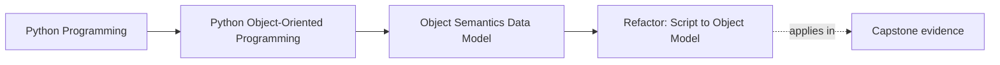
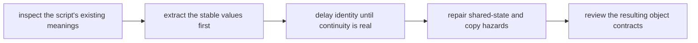

# Refactor: Script to Object Model

<!-- page-maps:start -->
## Page Maps

<!-- page-maps:end -->

This refactor matters because the first mistake many learners make is turning a working
script into classes before they know what those classes are supposed to mean. The result
often looks more object-oriented while becoming less trustworthy:

- bags of fields with no contract
- identity where value semantics were needed
- mutation where construction should have settled the truth
- aliasing and copy bugs that the original script hid

The goal of this refactor is not "object-oriented style." The goal is to turn raw script
data into types whose identity, equality, mutation, and representation rules are
understandable.

## Start by naming the meanings already present

A script often contains several kinds of things mixed together:

- raw input records
- stable values
- evolving workflow state
- temporary derived data
- convenience caches or formatting helpers

Before creating any class, ask:

- which pieces are really values?
- which pieces need continuity over time?
- which pieces are just temporary helper structures?
- which pieces should stay plain data until later pressure proves otherwise?

If you cannot answer those questions, the refactor is not ready yet.

## A safer refactor order

Use this order on purpose:

1. identify the stable values
2. extract the smallest validated value types
3. keep temporary derived data plain until a real contract appears
4. introduce identity-bearing objects only where lifecycle or continuity is real
5. repair shared mutable structures before they disappear inside prettier classes
6. decide equality, hashing, and representation on purpose

This order keeps semantics in front of style.

## Step 1: convert obvious values first

Strong early candidates for object form are small values with clear meaning, such as:

- metric names
- timestamps
- threshold definitions
- validated inputs that should compare by content

These types benefit from:

- explicit validation
- predictable equality
- clear representation
- safe sharing

They are usually much safer to introduce first than a large mutable coordinator.

## Step 2: delay identity until continuity is real

Not every record should become an identity-bearing object.

Introduce identity only when the system genuinely needs to track:

- lifecycle
- continuity across time
- distinct instances even when fields match
- transitions that should not collapse into plain value equality

Premature entities make later decisions about equality, hashing, mutation, and review
much harder.

## Step 3: let construction settle required truth

Weak refactors often create objects half-empty and repair them later through ad hoc
mutation. A stronger refactor asks:

- what must be true at birth?
- what should become a later transition instead?
- which constructor arguments are real requirements and which are placeholders for weak design?

Prefer constructors that establish:

- required fields
- validation
- clear starting state

That reduces the number of places where another maintainer must guess whether the object
is already safe to use.

## Step 4: repair shared-state hazards before they hide inside classes

Scripts often pass around:

- shared lists
- reused dictionaries
- caller-owned mutable structures
- nested mutable graphs that nobody clearly owns

When these become objects, decide:

- which values are safe to share because they are immutable?
- which mutable structures need one clear owner?
- where copying is honest and where redesign is safer?

This is where many "successful" refactors still fail, because the code now looks cleaner
while the ownership bug survives untouched.

## Step 5: define equality and representation deliberately

Once a value object exists, ask:

- what makes two instances equal?
- should it be hashable?
- what should the representation teach a reader?

Once an entity exists, ask:

- should equality stay by identity?
- should it stay out of hashed collections?
- what representation helps debugging without pretending it is a plain value?

These are design decisions, not cleanup steps.

## Worked refactor route

Imagine a script that uses dictionaries for:

- metric samples
- threshold configuration
- alert rows

A safer refactor route could be:

1. turn threshold configuration into a validated value type
2. turn metric samples into a small value type with explicit equality and representation
3. keep alert rows as temporary derived data unless lifecycle pressure proves otherwise
4. identify the first object that truly owns mutation and make that ownership explicit
5. remove shared mutable container reuse by copying, freezing, or encapsulating the mutable boundary

Notice what does not happen first:

- no giant manager class
- no framework-style hierarchy
- no entity identity everywhere

The refactor begins with meaning, not with class count.

## Before-and-after review lens

| Question | Weak script-to-class refactor | Stronger Module 01 refactor |
| --- | --- | --- |
| why does this class exist | because the script had a dictionary | because it protects a real contract |
| how is equality decided | whatever the default gives me | by the meaning of the object |
| who owns mutable state | unclear, often shared | explicit and reviewable |
| when is the object valid | after callers finish setting fields | at construction or through named transitions |
| what does the representation teach | incidental internal structure | the part of meaning a reader actually needs |

## Common mistakes

- turning every dictionary into a class without deciding whether it is a value, entity, or temporary shape
- giving identity to objects that only need content semantics
- leaving required state unset until long after construction
- preserving shared mutable containers inside prettier-looking classes
- ignoring equality, hashing, and `repr` until the bugs appear later

## Capstone transfer

Use the capstone's early value and rule types to ask:

- which parts became trustworthy because they were modeled as values first?
- which types would become less clear if they were given identity too early?
- where would a shared mutable script structure have created later lifecycle trouble?

This is the first refactor discipline of the course: class form should follow meaning.

## Exit check

Leave this refactor page only when you can do all of these:

- explain how you would decide whether script data should become a value object, an entity, or stay plain data
- identify one aliasing hazard that a naive script-to-class refactor could preserve
- state one reason a value-first refactor is safer than building a large mutable manager class
