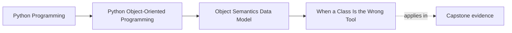

# When a Class Is the Wrong Tool

<!-- page-maps:start -->
## Page Maps




<!-- page-maps:end -->

Read the first diagram as a placement map: this page is one concept inside its parent
module, not a detached essay, and the capstone is the pressure test for whether the
idea holds. Read the second diagram as the working rhythm for the page: name the
problem, study the example, identify the boundary, then carry one review question
forward.

## Why this lesson matters

One of the most expensive beginner-to-intermediate habits in Python is adding classes
before proving that class form protects any real meaning.

This page exists to make restraint teachable. The course is about object-oriented
design, but good object-oriented design includes knowing when not to build another
object boundary.

## The core question

Before adding a class, ask:

> What meaning, invariant, lifecycle, or collaboration does this class protect that a
> plain value, function, or module-level surface would not?

If you cannot answer that clearly, you probably do not want the class yet.

## Good reasons to keep a class

Keep a class when at least one of these is true:

- the object has a meaningful lifecycle
- the object owns invariants that must be preserved over time
- the object collaborates with other objects through a stable role
- the object needs a clear long-lived identity
- the class is the simplest place to keep mutation safe and local

Those are durable reasons. "It might be cleaner later" is not.

## Good reasons to stay simpler

Prefer plain functions, values, or a small dataclass when:

- the work is a straightforward transformation
- there is no meaningful identity
- the object would mostly forward to one other structure
- the state has no real invariant beyond "these fields exist"
- the class would mainly group helper functions that never use `self`

In these cases, class form usually adds ceremony faster than it adds clarity.

## Common bad class shapes

| Shape | Why it is weak |
| --- | --- |
| utility class full of `@staticmethod` helpers | the module is the real namespace |
| one-shot runner class used only in `main()` | functions would express the flow more directly |
| thin wrapper around one dict or list | representation changed, meaning did not |
| fake hierarchy with no real polymorphic call site | inheritance cost exists without design payoff |
| config class that only stores fields and nothing else | often a plain value or dataclass is enough |

## A practical comparison

### Class form that is probably unnecessary

```python
class MetricFormatter:
    def format(self, metric):
        return f"{metric.name}:{metric.value}"
```

If there is no stored state, no lifecycle, and no collaboration role, this is usually
just a function in disguise.

### Simpler form

```python
def format_metric(metric):
    return f"{metric.name}:{metric.value}"
```

The simpler version says exactly what is happening and carries less conceptual cost.

## A better class candidate

```python
class Alert:
    def __init__(self, alert_id, threshold):
        self.alert_id = alert_id
        self.threshold = threshold
        self.active = False

    def activate(self):
        self.active = True
```

Here class form may be justified because:

- the object has identity
- the object has lifecycle
- mutation must stay controlled

That is the kind of reasoning this course wants you to practice.

## Review checklist before adding a class

1. What state does the class own?
2. Which invariants does it protect?
3. What lifecycle or collaboration would be harder to express without it?
4. If the class disappeared, what simpler form would replace it?
5. Would that simpler form actually be clearer?

If question 5 keeps producing "yes," the class is probably premature.

## Practical rules for this course

- Do not add a class just to look object-oriented.
- Modules and functions are first-class design tools in Python.
- Prefer small value objects for real meaning and functions for direct transformations.
- Add classes when they reduce ambiguity, not when they merely repackage it.

## Capstone connection

This lesson matters because the capstone should not become a showroom of unnecessary
objects. Its classes should exist for reasons you can defend:

- value objects where meaning lives in content
- workflow objects where identity and lifecycle matter
- explicit boundaries where collaboration needs a durable owner

If a class cannot be defended that way, the simpler surface is usually the better
teaching choice.

## Exit check

Leave this lesson only when you can do all of these:

- reject one unnecessary class and name the simpler replacement
- defend one class because it protects a real lifecycle, invariant, or collaboration role
- explain why Python being object-capable does not mean class form is always the right default
