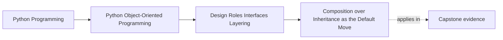

# Composition over Inheritance as the Default Move

<!-- page-maps:start -->
## Page Maps

<!-- page-maps:end -->

Read the first diagram as a placement map: this page is one concept inside its parent
module, not a detached essay, and the capstone is the pressure test for whether the
idea holds. Read the second diagram as the working rhythm for the page: name the
problem, study the example, identify the boundary, then carry one review question
forward.

## Why this lesson matters

When learners first discover reuse, inheritance often feels like the obvious tool. It
looks compact, and Python makes it easy to write. But in everyday design work,
composition is the safer default because it keeps roles narrower and change more local.

This lesson is not saying inheritance is always wrong. It is teaching a better starting
question:

> Do I need a new subtype, or do I need one object to use another object?

## What composition is buying you

Composition means one object has or uses another object to get work done.

That usually buys you:

- clearer role boundaries
- easier swapping of behavior
- less dependence on hidden base-class rules
- fewer accidental promises to subclasses

Composition is especially strong when the behavior you want to vary is only one part of
the object's job.

## What inheritance is asking from you

Inheritance is a stronger promise than many beginners realize. A subclass is not only
reusing code. It is telling the reader:

- this is a real kind of the base type
- the base lifecycle and contract still make sense here
- callers can substitute this subtype where the base is expected

That is a high bar. When the only goal is "reuse some logic," composition is often the
honester move.

## A good practical contrast

### Composition-shaped design

An evaluator uses a policy object:

- one object owns orchestration
- another object owns the comparison rule
- the rule can change without pretending to be a subtype of the evaluator

### Inheritance-shaped design

A subclass overrides pieces of a base evaluator:

- base order starts to matter
- override points become implicit contract
- new variants inherit responsibilities they may not fully want

When the varying part is narrow, composition usually keeps the story cleaner.

## Signals that composition is the better default

Choose composition first when:

- only one slice of behavior varies
- the rest of the object's role should remain stable
- you want to swap behavior at runtime or by configuration
- the "is-a" sentence sounds weak but the "uses-a" sentence sounds natural

Examples:

- an alerting workflow uses a retry policy
- a use case uses a repository and notifier
- a rule engine uses one of several evaluation strategies

## Signals that inheritance may be legitimate

Inheritance may still be right when:

- the subtype truly satisfies the same role contract
- shared algorithm structure matters more than runtime swapping
- callers benefit from treating the objects through one common abstraction
- the hierarchy can stay small and explainable

Even then, start skeptical. You are taking on a stronger coupling shape.

## Common composition mistakes

| Mistake | Why it hurts |
| --- | --- |
| wrapping everything in many tiny delegates without role clarity | ceremony rises without cleaner ownership |
| composing objects but still letting one reach deep into the other's internals | coupling remains hidden, not removed |
| calling something composition while one object still configures and controls every detail of the other | the boundary is not really honest |

## Common inheritance mistakes that composition avoids

| Mistake | Why composition helps |
| --- | --- |
| subclass only wants one method, but inherits a whole lifecycle | composition isolates the varying part |
| base class changes ripple into many subclasses | composed collaborator contracts are usually narrower |
| behavior needs runtime swapping | composition can inject the collaborator directly |
| override rules become folklore | delegation is usually easier to inspect than override chains |

## Review checklist

Ask these before choosing inheritance:

1. Does the subtype really satisfy the same role?
2. Which base assumptions would the subtype inherit?
3. Could the variation instead be modeled as a collaborator?
4. Would runtime swapping or configuration matter later?

If question 3 keeps returning "yes," composition should stay the default.

## Capstone connection

This lesson matters whenever the capstone needs to vary one part of a workflow without
turning the whole workflow into a subclass hierarchy. Composition is usually the clearer
way to attach:

- policies
- repositories
- notifiers
- strategies
- adapters

If the variation is local, the object boundary should usually stay local too.

## Exit check

Leave this lesson only when you can do all of these:

- explain one case where composition is clearly better than inheritance
- explain one case where inheritance might still be justified
- identify one design where "uses-a" is honest and "is-a" would be misleading
