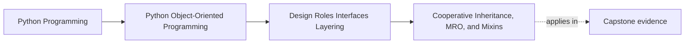

# Cooperative Inheritance, MRO, and Mixins

<!-- page-maps:start -->
## Page Maps

<!-- page-maps:end -->

Read the first diagram as a placement map: this page is one concept inside its parent
module, not a detached essay, and the capstone is the pressure test for whether the
idea holds. Read the second diagram as the working rhythm for the page: name the
problem, study the example, identify the boundary, then carry one review question
forward.

## Why this lesson matters

Python makes multiple inheritance possible. That does not make it cheap.

The real cost appears when a reviewer cannot answer:

- which implementation runs next?
- which constructor is responsible for what?
- which mixin owns real state, and which only adds one narrow behavior?

If the method resolution order is mysterious, the hierarchy is already more expensive
than it looks.

## `super()` is not "call the parent"

The core runtime fact is simple:

- `super()` means "call the next implementation in Python's method resolution order"

That matters because cooperative inheritance works only when every participating class is
designed for that chain.

One class that:

- skips `super()`
- hard-codes a direct base call
- consumes arguments inconsistently

can make the whole chain misleading or broken.

## Mixins should add one narrow role

A mixin is safest when it contributes:

- one small behavior
- little or no authoritative state
- a clear requirement on the receiving class

Bad mixins quietly depend on:

- hidden constructor order
- internal instance layout
- private state they do not own

At that point they stop being reusable roles and start becoming partial subclasses with
unclear authority.

## Use cooperative inheritance only when the review cost stays low

Good use cases usually share these traits:

- the hierarchy is shallow
- the cooperation rule is explicit
- each class adds one understandable step
- composition would be materially more awkward

If you need a whiteboard to explain the chain every time, the design is already too
expensive for the value it provides.

## Capstone connection

Use the capstone to ask:

- which behaviors are better expressed as composed collaborators instead of mixins?
- where would a mixin stay narrow enough to be honest?
- which future extension idea would become brittle if it depended on a hard-to-explain MRO?

## Exit check

Leave this lesson only when you can do all of these:

- explain what `super()` really means in a multiple-inheritance chain
- identify one sign that a mixin is taking on too much authority
- explain when composition is clearer than cooperative inheritance
