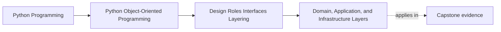

# Domain, Application, and Infrastructure Layers

<!-- page-maps:start -->
## Page Maps

<!-- page-maps:end -->

Read the first diagram as a placement map: this page is one concept inside its parent
module, not a detached essay, and the capstone is the pressure test for whether the
idea holds. Read the second diagram as the working rhythm for the page: name the
problem, study the example, identify the boundary, then carry one review question
forward.

## Why this lesson matters

Many learners hear "use layers" and then memorize three labels without understanding
what problem the separation is solving.

The real problem is dependency confusion:

- domain rules start calling HTTP clients
- orchestration logic leaks into entities
- infrastructure choices spread through the whole program
- tests become expensive because every path touches real outer systems

Layering is a way to assign responsibility by direction, not a way to draw boxes for a
slide deck.

## The shortest honest model

### Domain layer

The domain layer answers:

- what objects exist here?
- what rules and invariants do they carry?
- what decisions are valid or invalid?

It should speak in domain language, not delivery technology.

### Application layer

The application layer answers:

- what use case is happening?
- in what order should collaborators be invoked?
- which domain objects need to participate?

It coordinates. It does not become the home of every business rule.

### Infrastructure layer

The infrastructure layer answers:

- how do we talk to the database, filesystem, network, queue, or process environment?
- how do we satisfy ports required by the application?

It handles technical delivery details and adapter work.

## What each layer should know

The simplest durable rule is this:

- the domain should not depend on infrastructure details
- the application may depend on domain concepts
- infrastructure may depend on application and domain contracts in order to implement them

The deeper layers should stay stable even if outer mechanisms change.

## A practical ownership test

Ask:

1. Is this rule about domain meaning?
2. Is this behavior coordinating a use case?
3. Is this code mainly adapting to an external system or framework?

If the answer is:

- rule meaning: domain
- use-case sequencing: application
- external mechanism: infrastructure

That is the basic split.

## Common mistakes

### Mistake 1: the domain imports adapters

If a domain object directly knows which HTTP client, ORM session, or repository class to
construct, the layer boundary has already collapsed.

### Mistake 2: the application becomes a second domain

If every real rule is moved into handlers and coordinators, the application layer turns
into a procedural blob and the domain becomes weak.

### Mistake 3: infrastructure names dominate the design

If package structure is organized only around frameworks or databases, readers cannot
easily tell where the domain decisions actually live.

## What good layering feels like

Good layering usually creates these benefits:

- domain rules can be read without scanning adapter code
- use cases can be tested with narrow substitutes
- infrastructure can change without rewriting domain language
- ownership discussions become clearer during review

The point is not purity for its own sake. The point is to make change more local and
meaning more visible.

## When layers get too heavy

Layering can also be overdone.

Warning signs:

- every tiny script gets enterprise-style package ceremony
- indirection appears before a real boundary exists
- readers must jump through many files to understand one small behavior

Use layers where the system actually has different kinds of responsibility. Do not build
a cathedral around a two-function toy.

## Review checklist

| Question | Domain | Application | Infrastructure |
| --- | --- | --- | --- |
| owns rules and invariants? | yes | sometimes coordinates them | no |
| sequences a use case? | rarely | yes | no |
| talks to external systems directly? | no | sometimes through ports only | yes |
| should change when the database or transport changes? | no | ideally little | yes |

## Capstone connection

In the capstone, this lesson matters wherever you are deciding:

- where policy objects and invariants live
- where commands or workflows should be coordinated
- where repositories, gateways, and delivery adapters should sit

If the capstone still feels like one large mixed module, this page names the next
structural cleanup.

## Exit check

Leave this lesson only when you can do all of these:

- classify one capstone file or object as domain, application, or infrastructure
- explain why a domain object should not construct its own outer adapters
- explain how layering reduces change ripples and test friction
