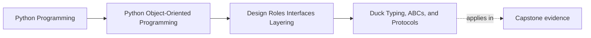

# Duck Typing, ABCs, and Protocols

<!-- page-maps:start -->
## Page Maps

<!-- page-maps:end -->

Read the first diagram as a placement map: this page is one concept inside its parent
module, not a detached essay, and the capstone is the pressure test for whether the
idea holds. Read the second diagram as the working rhythm for the page: name the
problem, study the example, identify the boundary, then carry one review question
forward.

## Why this lesson matters

Python gives you several ways to express collaboration contracts, and learners often mix
them without understanding the trade-off.

The result is usually one of two problems:

- no contract at all, so callers just hope an object has the right methods
- too much machinery, so a simple collaboration becomes harder to teach than the work itself

This lesson is about choosing the lightest mechanism that still makes the contract clear.

## The three tools

### Duck typing

Duck typing means you care about usable behavior, not declared ancestry.

It works well when:

- the collaboration is local
- the required shape is small and obvious
- runtime failure would be easy to understand and fix

### ABCs

Abstract base classes are useful when you want an explicit runtime-oriented contract.

They help when:

- a framework or plugin point should advertise required methods
- shared default behavior belongs with the abstract surface
- subclass registration is part of the design story

### Protocols

Protocols express structural contracts for typing and design communication without
forcing inheritance.

They help when:

- callers need a clear shape
- implementations should remain loosely coupled
- static checking can catch mismatches earlier

## A practical selection rule

Choose the smallest tool that makes the collaboration legible.

- use duck typing for simple local interactions
- use a protocol when you want a named structural contract without inheritance pressure
- use an ABC when the design truly needs explicit runtime abstraction or shared abstract behavior

Do not escalate just because the project is growing. Escalate because the contract needs
clearer expression.

## What learners get wrong

Common mistakes:

- using an ABC where a protocol or plain duck typing would be clearer
- forcing inheritance only to satisfy a type story
- treating protocols as magical runtime validation
- using `Any` and calling that flexibility

The important question is not "which feature is more advanced?" It is "what is the
clearest contract for this collaboration?"

## A decision checklist

Ask:

1. Is this collaboration small and local enough for plain duck typing?
2. Do I want structural compatibility without forcing shared ancestry?
3. Do I need explicit runtime abstraction, registration, or shared abstract behavior?

Those questions usually point to:

- yes to 1: duck typing
- yes to 2: protocol
- yes to 3: ABC

## What to avoid

- do not use inheritance just to get the comfort of a named interface
- do not hide unclear contracts behind vague typing
- do not introduce several interface mechanisms for the same tiny collaboration without a reason

One role should usually have one clear contract story.

## Review table

| Need | Duck typing | Protocol | ABC |
| --- | --- | --- | --- |
| simple local collaboration | strong fit | sometimes | often too heavy |
| structural static contract | weak | strong | possible but indirect |
| explicit runtime abstraction | weak | weak | strong |
| forced inheritance | no | no | yes for normal subclassing |

## Capstone connection

In the capstone, this lesson matters wherever one object depends on another by role:

- repositories
- evaluators
- adapters
- extension points

If the contract is still informal, decide whether that role needs plain behavior, a
protocol, or an ABC. Do not let all three appear by accident.

## Exit check

Leave this lesson only when you can do all of these:

- explain the difference between duck typing, protocols, and ABCs
- choose one of the three for a capstone collaboration and justify it
- explain why forcing inheritance is often the wrong interface default in Python
