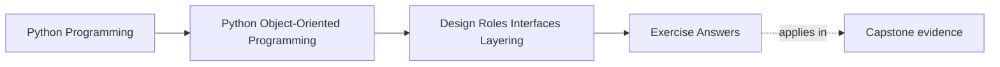
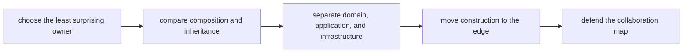

# Exercise Answers

<!-- page-maps:start -->
## Page Maps

<!-- page-maps:end -->

These answers are model reasoning, not a fixed script. The most important question is not
"did I name the same role?" It is "did I make the placement decision and the rejected
alternatives visible enough that another maintainer could challenge them?"

## How to use this page well

Compare your own packet against this answer page using four checks:

- did I name the chosen owner and the most tempting wrong owner?
- did I explain why the wrong owner is tempting?
- did I make the boundary effect visible, not only the pattern name?
- did I leave behind a map another engineer could review?

If your answer reaches the same verdict but does not survive challenge, it is still too weak.

## What strong Module 02 answers have in common

Across the whole packet, strong answers usually show all of these:

- behavior placed in the least surprising owner
- cohesion discussed as responsibility pressure, not as line count
- composition treated as the default and inheritance justified case by case
- interface choices tied to collaboration pressure rather than preference
- layers treated as ownership boundaries, not folder names
- construction isolated at a visible composition edge

If your packet sounds like architecture slogans without contested decisions, the module
has not landed deeply enough yet.

## Answer 1: Choose the least surprising owner

A strong answer names:

- the behavior under review
- the chosen owner
- the nearby wrong owner
- the confusion created by the wrong placement

Good answer pattern:

- "the policy object owns the rule because the decision varies by evaluation strategy, while the runtime facade should only coordinate execution after the rule is chosen"

Weak answer pattern:

- "put business logic in the domain layer"

The second sentence is not false, but it is too generic to guide real design work.

## Answer 2: Review cohesion and object smells

The key question is not whether an object is long. The key question is whether it owns
one coherent kind of pressure.

Strong smell signals include:

- an entity that also formats output, fetches data, and applies policy
- a service that grows because no one will decide a better owner
- utility modules that collect behavior belonging to meaningful objects

A strong redesign note names one boundary to split and one test or review question that
would prove the split improved cohesion.

## Answer 3: Replace raw primitives with semantic roles

Good semantic-role answers make domain meaning harder to ignore. They often:

- remove unit confusion
- make wrong argument order harder to write
- stop hidden meaning from leaking through raw dictionaries or strings

The answer is strongest when it also says what would become over-engineering. Not every
primitive needs a type; the type must earn its existence by reducing ambiguity.

## Answer 4: Compare composition and inheritance honestly

Composition is safer by default because:

- reuse stays explicit
- coupling stays local
- change pressure does not spread silently across a base class

Small inheritance is still acceptable when:

- the specialization is semantically real
- the call chain is understandable
- the base contract is narrow and stable

Fragile-base-class risk appears when subclasses depend on hidden sequencing, incidental
state, or partial overrides no one can explain cleanly.

## Answer 5: Review interfaces, ABCs, and protocols

Strong answer pattern:

- use duck typing when collaboration is light and explicit nominal control adds little
- use an ABC when shared behavior and explicit inheritance contract really matter
- use a protocol when structural compatibility is what the design wants

The choice is correct only when it answers real collaboration pressure without making the
boundary either too loose to review or too rigid to evolve.

## Answer 6: Draw a layered boundary

A strong layer map shows:

- domain owning core meaning and invariants
- application owning use-case sequencing
- infrastructure owning external systems and persistence mechanics
- composition root owning object assembly

The best maps also say what each layer must not own. Exclusion sharpens boundary
reasoning faster than inclusion alone.

## Answer 7: Design a composition root

A composition root matters because:

- object assembly becomes visible
- dependencies remain legible
- lower layers stop constructing collaborators ad hoc

A strong answer names what is injected, what stays configurable at the edge, and why the
rest of the system should not assemble the graph itself.

Weak answer pattern:

- "dependency injection improves testability"

Better answer pattern:

- "the composition root keeps construction policy from leaking into the domain and makes outer substitutions visible in one place"

## Answer 8: Repair a service-versus-entity mistake

The repair depends on what kind of decision the behavior really is:

- entity if it depends on owned state and invariants
- policy if it is a replaceable rule
- application service if it sequences a use case
- adapter if it translates to an external system

The danger of a broad service layer is that it becomes the place where behavior goes
when ownership was never actually decided.

## Answer 9: Review a full collaboration surface

A strong subsystem review names:

- the major roles
- how data and decisions cross boundaries
- where the design is stable
- where one object or layer is still doing too much
- which next refactor would buy clarity rather than ceremony

The best closing sentence sounds like a real architecture finding, not like a pattern catalog.

## Answer 10: Produce the full owner packet

The packet should let another maintainer challenge the design directly:

- why this owner
- why not the nearby one
- what layer each concern belongs to
- where the graph is assembled
- what proof would expose boundary drift first

If another reader cannot meaningfully disagree with the packet because it is too vague,
the packet is not yet useful.

## What a strong packet sounds like overall

A strong final packet usually sounds like this:

> This behavior belongs in the policy object because the rule itself varies while the
> application service only sequences the workflow. Composition keeps reuse local. The
> domain owns meaning, the application layer owns orchestration, infrastructure owns
> external translation, and the composition root owns assembly.

That is the level of explicitness a missed-class learner should be aiming for.

## Exit check

Leave this answer page only when you can say:

> My answers now survive challenge: I can defend the chosen owner, reject the nearby
> wrong owner, explain the layer boundary, and say where construction belongs without
> hiding behind pattern vocabulary.
