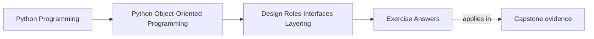
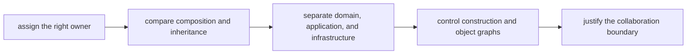

# Exercise Answers

<!-- page-maps:start -->
## Page Maps

<!-- page-maps:end -->

These answers are model explanations, not the only acceptable wording.

## How to use the answer page well

Do not read the model answer first and then reduce the module to "put business logic in
the domain layer."

A better rhythm is:

1. finish the exercise with your own role packet
2. name the behavior, best owner, and tempting wrong owner
3. compare your reasoning with the model answer
4. revise anywhere your answer still hides coupling behind generic service or layer names

What matters is whether the reasoning makes ownership and collaboration boundaries
explicit.

Strong Module 02 answers usually do five things:

- they choose the least surprising owner for each behavior
- they explain cohesion problems in terms of responsibility pressure
- they treat composition as the default and justify exceptions carefully
- they keep layers tied to ownership instead of folder naming
- they isolate construction in a visible composition root

The strongest self-study packets also leave behind six concrete artifacts:

- one owner-selection note
- one cohesion review
- one composition-versus-inheritance decision
- one layering map
- one composition-root sketch
- one full collaboration review

If your answers rely only on "this follows clean architecture," the reasoning is still too
thin.

## Answer 1: Choose the right owner

A strong answer names:

- the behavior under review
- the object or role that is the least surprising owner
- a nearby wrong owner that tempts people because it is already "in the area"

For example, a policy decision usually belongs in a policy object rather than in a runtime
facade, because the runtime facade should coordinate rather than absorb domain rules.

## Answer 2: Review cohesion and object smells

The key question is not whether an object is long, but whether it owns one coherent kind
of decision pressure.

Strong smell signals include:

- an entity that also formats output, fetches data, and applies policy
- a service that grows because no one wants to decide a better owner
- utility modules collecting behavior that actually belongs to meaningful objects

A strong redesign note names one boundary to split and one test that proves the split
clarified behavior.

## Answer 3: Replace raw primitives with semantic types

Good semantic types:

- make domain meaning explicit
- reject invalid combinations earlier
- reduce argument confusion and unit mistakes

Over-engineering begins when the type adds ceremony without protecting meaning, invariants,
or review clarity.

## Answer 4: Compare composition and inheritance honestly

Composition is safer by default because:

- it keeps reuse local and explicit
- it avoids surprising base-class coupling
- it allows behavior substitution without committing to one fragile hierarchy

Small inheritance remains acceptable when:

- the hierarchy expresses real semantic specialization
- the call chain is understandable
- the base class contract is stable and reviewable

Fragile-base-class risk appears when:

- subclasses depend on hidden sequencing, partial overrides, or incidental base behavior

## Answer 5: Review interfaces, ABCs, and protocols

Strong answer pattern:

- use duck typing when the collaboration pressure is light and explicit nominal control is
  unnecessary
- use an ABC when shared behavior and explicit inheritance contract matter
- use a protocol when structural compatibility is what the design really wants

What matters is not which term sounds more advanced, but which one matches the real
collaboration constraint without overspecifying the design.

## Answer 6: Draw a layered boundary

A strong map shows:

- domain owns core meaning and invariants
- application owns use-case orchestration
- infrastructure owns external systems and persistence mechanics
- composition root owns object assembly

Each layer should also name one thing it must not own, because boundaries become clearer
when exclusion is explicit.

## Answer 7: Design a composition root

A composition root is the one place where the object graph is assembled deliberately.

Why it matters:

- the rest of the system can stay focused on behavior rather than assembly
- dependencies remain visible
- construction policy does not leak across modules

A strong answer names injected collaborators and explains why lower layers should not
construct them ad hoc.

## Answer 8: Repair a service-versus-entity mistake

The repair usually depends on what kind of decision the behavior really is:

- entity if it depends on owned state and invariants
- policy if it is a replaceable rule
- application service if it coordinates a use case
- adapter if it translates to an external system

What goes wrong with a broad service layer:

- it becomes a second god object that owns behavior simply because no one chose a better
  place

## Answer 9: Review a full collaboration surface

A strong subsystem review names:

- the major roles
- how data and decisions cross boundaries
- where the design is stable
- where one object or layer is still doing too much

The best closing sentence sounds like an architecture review finding, not like a pattern
catalog entry.

## Answer 10: Produce a role-and-layer decision packet

The packet should let another maintainer challenge a placement decision directly:

- why this owner
- why not the nearby one
- what evidence proves the boundary works

If another learner cannot challenge the packet meaningfully, the explanation is probably
too generic to be useful.

## Self-check

If your answers consistently explain:

- why one owner is the least surprising place for the behavior
- what cohesion failure you are preventing
- when inheritance is justified instead of merely convenient
- how layers protect ownership boundaries
- why the composition root keeps construction from leaking

then you are using Module 02 correctly.
