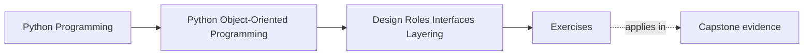
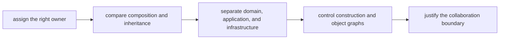
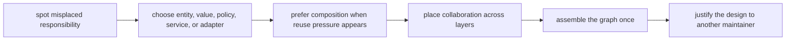

# Exercises


<!-- page-maps:start -->
## Page Maps




<!-- page-maps:end -->

Use these exercises to practice role-assignment judgment, not only design vocabulary.

The goal of the day is to make responsibility placement explicit. By the end, you should
be able to say not only that a behavior belongs somewhere, but also why nearby objects,
services, mixins, or layers should not own it instead.

## How to work through this set

Treat the ten exercises as one full lab day on collaboration boundaries.

Before each answer:

1. name the behavior under review
2. name the object or layer that should own it
3. say what coupling or confusion appears if you place it somewhere else

Do the exercises in order. The day is one progression:

- Exercises 1-3 classify roles, cohesion, and semantic types
- Exercises 4-5 compare inheritance, composition, and interface choices
- Exercises 6-8 design layering and composition-root discipline
- Exercises 9-10 review the whole collaboration boundary as a defendable design

Keep one role packet as you go. By the end of the day it should contain:

- one owner-selection judgment
- one cohesion or object-smell review
- one composition-versus-inheritance decision
- one layering map
- one composition-root design
- one full collaboration review note

If those six artifacts are missing, you are probably still naming patterns instead of
governing responsibilities.

## Recommended working layout

If you want one lab tree that can support the whole day, use something like:

```text
module02-lab/
├── artifacts/
├── notes/
├── scratch/
└── tests/
```

Keep one ownership table while you work:

| Behavior | Best owner | Nearby wrong owner | Why the wrong owner is tempting | Why it stays wrong |
| --- | --- | --- | --- | --- |

Also keep one layering table:

| Concern | Domain | Application | Infrastructure | Composition root |
| --- | --- | --- | --- | --- |



Use that route on purpose. It keeps the day centered on ownership and coupling rather
than on directory naming or pattern recall.

## Exercise 1: Choose the right owner

Take one behavior from the capstone and justify why it belongs in:

- a domain object
- a policy object
- a runtime facade
- or another clearly named role

Your answer should explain:

- why this owner is the least surprising place
- which nearby role would be a tempting wrong owner
- what confusion that wrong placement would create

Study note:
Correct behavior in the wrong owner is still bad design.

## Exercise 2: Review cohesion and object smells

Pick one object and explain whether it shows signs of:

- mixed responsibilities
- accidental god-object growth
- utility dumping
- role confusion

Then state:

- what boundary you would split or reinforce
- what single test would prove the redesign improved cohesion

Study note:
Cohesion gets clearer when you describe pressure, not just size.

## Exercise 3: Replace raw primitives with semantic types

Take one area where raw strings, ints, or dicts carry domain meaning. Redesign it using a
small semantic type or value object.

Explain:

- what mistake the primitive version invites
- what the semantic type makes explicit
- what would be over-engineering in this redesign

Study note:
The best semantic types reduce ambiguity without inventing ceremony.

## Exercise 4: Compare composition and inheritance honestly

Choose one example where inheritance seems convenient. Explain:

- what reuse pressure makes it tempting
- whether composition is the safer default
- when a small inheritance hierarchy would still be acceptable
- one sentence naming the fragile-base-class risk if the hierarchy grows

Study note:
This exercise matters because "prefer composition" is useless unless you can justify it
case by case.

## Exercise 5: Review interfaces, ABCs, and protocols

Take one collaborator boundary and explain whether it is best modeled with:

- duck typing alone
- an abstract base class
- a protocol

Explain:

- what pressure each option addresses
- what would be over-specified
- what would be too loose for safe review

Study note:
Interface choices should answer design pressure, not taste.

## Midday self-check

Before you move into layering and composition-root work, make sure your packet can
already answer these questions clearly:

- why one owner is better than a tempting nearby owner
- what cohesion failure you are trying to prevent
- when composition is safer than inheritance
- how interface choices relate to real collaboration pressure

If you cannot answer those four questions in plain language, return to Exercises 1-5 and
make the packet more explicit before continuing.

## Exercise 6: Draw a layered boundary

Map one workflow into:

- domain
- application
- infrastructure
- composition root

For each layer, name one thing it must own and one thing it must not own.

Study note:
Layering is useful only when it changes ownership, not when it merely changes folders.

## Exercise 7: Design a composition root

Sketch a composition root for one capstone workflow and explain:

- where objects are assembled
- what dependencies are injected
- why the rest of the system should not assemble the graph itself

Study note:
Construction discipline is one of the fastest ways to stop architecture from leaking
everywhere.

## Exercise 8: Repair a service-versus-entity mistake

Take one behavior that currently looks like it could live in a broad service object.
Decide whether it belongs in:

- an entity
- a policy
- an application service
- or an adapter

Then explain what would go wrong if the service layer absorbed it by default.

Study note:
This is where students often discover that "service" can become a trash can role.

## Exercise 9: Review a full collaboration surface

Take a small subsystem and write a short review that names:

- each major role
- how they collaborate
- where data crosses layer boundaries
- where the design is safe
- where the boundary is still too fuzzy

Study note:
This final review should sound like architecture review language, not pattern vocabulary.

## Exercise 10: Produce a role-and-layer decision packet

Assemble:

- one owner table
- one layering table
- one composition-root sketch
- one paragraph defending the overall design

Ask another learner to challenge one placement decision and revise the packet if needed.

Study note:
This exercise matters because role assignment is only durable when it survives review
pressure from another maintainer.

## Mastery check

You have a strong grasp of this module if your answers consistently keep five ideas
visible:

- behavior should live in the least surprising owner
- cohesion matters more than style labels
- composition is the default when inheritance adds coupling risk
- layers are ownership boundaries, not folder names
- construction should be visible in one assembly boundary instead of leaking across the system
