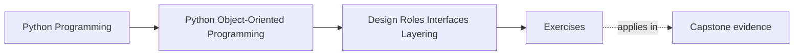
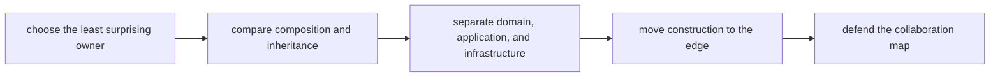

# Exercises

<!-- page-maps:start -->
## Page Maps

<!-- page-maps:end -->

Use these exercises as one full lab day on role assignment, collaboration boundaries, and
assembly discipline. The goal is not to collect pattern names. The goal is to make each
responsibility placement explicit enough that another maintainer could challenge it.

## Running lab rule

Use one workflow or subsystem throughout the day instead of changing examples constantly.
Good choices:

- one capstone workflow such as rule evaluation, incident publication, or persistence coordination
- one subsystem from your own code where ownership already feels blurry
- one toy workflow with domain decisions, orchestration, and external I/O

If you reset the example every time, you will practice labels rather than design
governance.

## What to keep open while you work

Maintain one ownership packet from the start. By the end it should contain:

- one owner-selection table
- one cohesion or object-smell review
- one composition-versus-inheritance decision
- one interface-choice note
- one layer map
- one composition-root sketch
- one collaboration review memo

Use these tables directly:

| Behavior | Best owner | Nearby wrong owner | Why the wrong owner is tempting | Why it stays wrong |
| --- | --- | --- | --- | --- |

| Concern | Domain | Application | Infrastructure | Composition root |
| --- | --- | --- | --- | --- |

## Exercise 1: Choose the least surprising owner

Take one behavior from the running example and decide whether it belongs in:

- a domain object
- a value or policy object
- an application service
- an adapter or runtime facade
- another clearly named role

Write:

- why this owner is the least surprising place
- which nearby role is the most tempting wrong owner
- what confusion that wrong placement would create
- what proof route would show the boundary more clearly

## Exercise 2: Review cohesion and object smells

Pick one object or service and explain whether it shows signs of:

- mixed responsibilities
- accidental god-object growth
- utility dumping
- role confusion

Then state:

- what boundary you would split or reinforce
- what one test or review question would prove the redesign improved cohesion

Do not answer only with "the class is too big." Name the pressure it is mixing.

## Exercise 3: Replace raw primitives with semantic roles

Take one place where raw strings, ints, dicts, or untyped callables are carrying domain
meaning. Redesign it using a semantic type, value object, or clearer collaborator.

Explain:

- what mistake the primitive version invites
- what the semantic role makes explicit
- what would become over-engineering if you went too far

This exercise is about role clarity, not ceremony.

## Exercise 4: Compare composition and inheritance honestly

Choose one example where inheritance feels convenient. Explain:

- what reuse pressure makes it tempting
- whether composition is the safer default here
- when a small inheritance hierarchy would still be acceptable
- one sentence naming the fragile-base-class risk if the hierarchy grew

The important thing is not the slogan "prefer composition." It is the case-by-case
judgment.

## Exercise 5: Review interfaces, ABCs, and protocols

Take one collaborator boundary and decide whether it is best modeled with:

- duck typing alone
- an abstract base class
- a protocol

Explain:

- what collaboration pressure each option answers
- what would be too loose
- what would be too rigid
- what another maintainer would need to understand to use the boundary safely

## Exercise 6: Draw a layered boundary

Map one workflow into:

- domain
- application
- infrastructure
- composition root

For each layer, name:

- one thing it must own
- one thing it must not own
- one leak that would tell you the boundary is failing

Layering is only useful when it changes ownership, not when it only changes folders.

## Exercise 7: Design a composition root

Sketch a composition root for the running example and explain:

- where objects are assembled
- what dependencies are injected
- what should stay configurable at the edge
- why the rest of the system should not assemble the graph itself

If your sketch can be scattered across multiple inner modules without any pain, the
composition edge is still too blurry.

## Exercise 8: Repair a service-versus-entity mistake

Take one behavior that currently looks like it might live in a broad service object.
Decide whether it actually belongs in:

- an entity
- a policy
- an application service
- or an adapter

Then explain what goes wrong if the service layer absorbs it by default.

This is where many learners discover that "service" can become a trash can role.

## Exercise 9: Review a full collaboration surface

Take a small subsystem and write a short review that names:

- the major roles
- how they collaborate
- where data crosses layer boundaries
- where the design is safe
- where the boundary is still too fuzzy
- which next refactor would give the biggest clarity gain

Write this as if it were an architecture review note, not a module summary.

## Exercise 10: Produce the full owner packet

Assemble:

- one owner-selection table
- one layer map
- one interface-choice note
- one composition-root sketch
- one paragraph defending the overall collaboration design

Then challenge one placement yourself:

- what if that behavior moved one role outward?
- what if that behavior moved one role inward?

Revise the packet only if the challenge reveals a real weakness.

## Done means defendable

You are done with the exercise day only when another reader could answer:

- why this role owns that behavior
- why the nearby role does not
- where the workflow crosses layers
- where the object graph is assembled

If those answers are still vague, the packet needs more work before you open the answer page.
