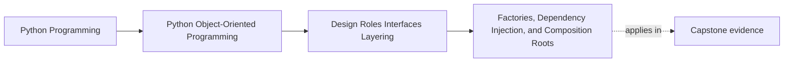

# Factories, Dependency Injection, and Composition Roots

<!-- page-maps:start -->
## Page Maps

<!-- page-maps:end -->

Read the first diagram as a placement map: this page is one concept inside its parent
module, not a detached essay, and the capstone is the pressure test for whether the
idea holds. Read the second diagram as the working rhythm for the page: name the
problem, study the example, identify the boundary, then carry one review question
forward.

## Why this lesson matters

Many designs look clean until object construction starts spreading everywhere.

Then the system begins to rot:

- domain objects start reading configuration
- application code chooses concrete adapters in random places
- tests patch hidden globals instead of supplying collaborators directly
- construction logic gets duplicated because nobody owns the assembly boundary

This lesson is about giving construction a clear home.

## Three concepts that should not be blurred

### Factory

A factory is a named construction step.

Use it when creation has enough logic that a raw constructor call hides important intent
or invariants.

### Dependency injection

Dependency injection means collaborators are provided from outside rather than created
secretly inside the object that uses them.

The point is not a framework. The point is explicit ownership.

### Composition root

The composition root is the outer place where the application decides:

- which concrete implementations to use
- how configuration is read
- how the object graph is wired together

This is where assembly belongs.

## The basic ownership rule

- domain objects should express behavior and invariants
- factories may help create valid domain objects or useful collaborator bundles
- application code should receive its collaborators rather than discovering them ad hoc
- the composition root should assemble the whole outer graph

If every layer tries to construct the next layer on demand, the design becomes hard to
test and hard to reason about.

## What should stay out of inner code

Inner code should usually not:

- read environment variables directly
- import a concrete database client just to do its job
- decide which adapter implementation the whole program should use
- open files or sockets as a surprise side effect of ordinary construction

Those choices belong farther out.

## When a factory is useful

A factory often helps when:

- a valid object needs several coordinated inputs
- normalization or validation belongs in one named place
- callers should not repeat a multi-step assembly ritual

Do not create factories just to hide a trivial constructor.

## Why dependency injection helps learners

Dependency injection improves teaching as well as design:

- call sites show what an object needs
- tests can provide narrow substitutes
- the reader can see the collaboration graph instead of guessing it

Hidden construction removes information right when a learner most needs it.

## What a composition root protects

The composition root protects the rest of the system from scattered assembly choices.

It answers:

- which repository implementation are we using today?
- which notifier or gateway is wired for this run?
- where does configuration become concrete runtime objects?

That keeps the domain and application layers from becoming configuration cemeteries.

## Common mistakes

- creating a "factory" that is just a renamed constructor with no added clarity
- using dependency injection language while still constructing hidden globals inside methods
- letting several modules each become their own mini composition root
- pushing assembly concerns inward until every class chooses its own infrastructure

These mistakes are really ownership mistakes.

## Review checklist

| Question | Factory | Dependency injection | Composition root |
| --- | --- | --- | --- |
| solves named construction? | yes | sometimes | no |
| makes collaborators explicit? | sometimes | yes | yes |
| chooses concrete implementations for the app? | rarely | no | yes |
| belongs near the program edge? | sometimes | often at boundaries | yes |

## Capstone connection

In the capstone, this lesson matters anywhere construction is becoming noisy:

- repository wiring
- gateway and notifier setup
- command handler assembly
- creation of valid domain objects from raw outer inputs

If assembly logic is scattered across the codebase, the next cleanup move is to gather it
into factories where needed and one clear composition root at the edge.

## Exit check

Leave this lesson only when you can do all of these:

- explain the difference between a factory and a composition root
- explain why dependency injection does not require a framework
- name one capstone construction path that should move outward toward the edge
