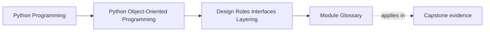

# Module Glossary

<!-- page-maps:start -->
## Page Maps

<!-- page-maps:end -->

This glossary belongs to **Module 02: Design Roles, Interfaces, and Layering** in
**Python Object-Oriented Programming**. Use it to keep the course language sharp while
you decide what kind of object you are looking at, why it exists, and where it should
live.

## How to use this glossary

Return here when an object feels busy, a hierarchy feels suspicious, or a module seems
to be mixing unrelated concerns. The point is not to memorize jargon. The point is to
recover good design questions.

## Terms that matter in this module

| Term | Meaning in this module | Review question |
| --- | --- | --- |
| Responsibility | The reason an object exists and the decision it is allowed to own. | Can you describe the object's job in one sentence without listing three unrelated verbs? |
| Cohesion | The degree to which an object's methods and state support the same purpose. | If you remove one method, does the rest of the object still feel like the same thing? |
| Value object | An object defined by its meaning rather than by long-lived identity. | Would replacing this instance with an equal one change the business meaning? |
| Entity | An object whose identity matters across time, even when attributes change. | Do callers care which specific instance this is, or only what data it holds today? |
| Semantic type | A small, named type that carries domain meaning better than a raw `str`, `int`, or `dict`. | Does this value deserve a domain name because mistakes around it are expensive? |
| Service object | An object that coordinates work or policy without pretending to be an entity with a lifecycle. | Is this object mostly organizing an operation rather than modeling domain identity? |
| Interface | The behavior other code is allowed to rely on, whether expressed informally or with `Protocol` or `ABC`. | What can callers count on here without knowing the implementation class? |
| Protocol | A structural contract in Python that says "anything with these methods fits". | Would structural compatibility help here more than forcing one inheritance tree? |
| Composition root | The boundary where concrete implementations are wired together. | Have you kept construction decisions near the edge instead of leaking them everywhere? |
| Layer | A boundary that protects one kind of concern from another, such as domain, application, and infrastructure. | Is this code crossing a boundary because it must, or because responsibilities were never separated? |
| Mixin | A small reusable behavior unit that assumes a narrow contract and avoids owning the full object story. | Is this reuse focused and cooperative, or is it hiding a second class hierarchy? |
| Template method | A base-class algorithm skeleton with a few controlled variation points. | Is the shared workflow truly stable, or are subclasses patching different business rules into it? |

## Fast distinctions

- Prefer **composition** when the variation owns state, policy, or external dependencies.
- Prefer **inheritance** only when subclasses are honest specializations of one stable idea.
- Prefer **semantic types** when raw primitives let invalid or confusing values flow too far.
- Prefer **protocols** when behavior matters more than ancestry.

## Exit check

Leave this glossary only when you can do all of these:

- explain the difference between a value object and an entity without talking about Python syntax
- identify one sign that a service object is a better fit than a stateful entity
- explain why a mixin should stay small and why a composition root belongs near the edge
