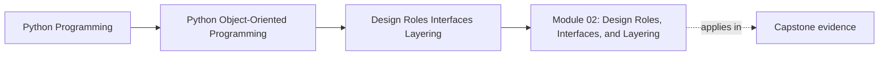
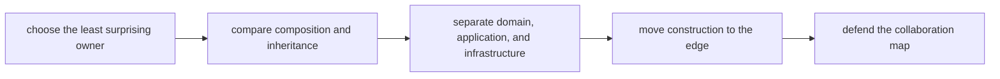

# Module 02: Design Roles, Interfaces, and Layering

<!-- page-maps:start -->
## Page Maps

<!-- page-maps:end -->

Once object meaning is clear, the next problem is assignment of responsibility. This
module moves from isolated objects to collaborating roles and asks one hard question over
and over:

> Which role should own this behavior, and which nearby role should stay simpler because
> of that choice?

Bad layering usually begins with a behavior that is correct in content but misplaced in
ownership. This module exists to make that mistake visible early.

## What this module must settle

By the end of the module, you should be able to do all of these with reasons:

- assign behavior to entities, values, policies, services, adapters, or factories
- explain why composition is the default and why inheritance sometimes remains justified
- decide when protocols, ABCs, or plain duck typing fit the actual collaboration pressure
- draw a boundary between domain, application, infrastructure, and composition root
- explain where object construction should happen so it does not leak across the system

If those choices still sound like taste, not judgment, stay here longer.

## Session outcome

Treat Module 02 as one serious study day with four stages.

| Stage | Main pressure | What you should produce |
| --- | --- | --- |
| role selection | who should own the behavior | one sentence beginning with `The least surprising owner is...` |
| shape selection | should this be composed, inherited, wrapped, or simplified | one short comparison note |
| boundary design | where does each concern belong | one layer map |
| assembly discipline | where should the graph be built | one composition-root sketch |

The module is not complete if you only remember the terms. It is complete when you can
defend one ownership map.

## Recommended study route

Use this route unless you are returning to one narrow boundary question:

1. [Responsibilities, Cohesion, and Object Smells](responsibilities-cohesion-and-object-smells.md)
2. [Value Objects versus Entities](value-objects-versus-entities.md)
3. [Service Objects versus Stateful Entities](services-versus-stateful-entities.md)
4. [Composition over Inheritance as Default](composition-over-inheritance.md)
5. [Inheritance and the Fragile Base Class Problem](inheritance-and-fragile-base-classes.md)
6. [Cooperative Inheritance, MRO, and Mixins](cooperative-inheritance-mro-and-mixins.md)
7. [Template Method and Small Hierarchies](template-method-and-small-hierarchies.md)
8. [Factories, Dependency Injection, and Composition Roots](factories-dependency-injection-and-composition-roots.md)
9. [Semantic Types over Raw Primitives](semantic-types-over-raw-primitives.md)
10. [Duck Typing, ABCs, and Protocols](duck-typing-abcs-and-protocols.md)
11. [Domain, Application, and Infrastructure Layers](domain-application-and-infrastructure-layers.md)
12. [Refactor 1: Thin Layered Architecture](refactor-layered-design-with-small-hierarchies.md)

Do not start with layering before you can justify ownership. Folder names are not a
substitute for role clarity.

## Lesson map by pressure

| If your current question is... | Start here | Then do this |
| --- | --- | --- |
| who should own this decision | responsibilities, cohesion, and object smells | compare the chosen owner with the most tempting wrong one |
| is this a value, entity, policy, service, or adapter | value objects versus entities; services versus stateful entities | write one role note before moving on |
| should this reuse be composed or inherited | composition over inheritance | test whether a small hierarchy is still reviewable |
| do I need a protocol, ABC, or nothing extra | duck typing, ABCs, and protocols | explain what collaboration pressure the interface is answering |
| where should object assembly live | factories, dependency injection, and composition roots | draw the composition edge explicitly |
| how should the system be layered | domain, application, and infrastructure layers | map one workflow across the layers |

## What a missed-class learner should do

If you are studying alone, use this rhythm:

1. read one lesson
2. name the owner of the behavior under discussion
3. name the closest tempting wrong owner
4. explain what confusion that wrong owner would create
5. move on only after the ownership difference is explicit

This replaces the classroom challenge question: "why not put it there instead?"

## Capstone transfer for this module

The capstone splits domain objects, evaluation policies, runtime orchestration,
repositories, and adapters on purpose. This module gives the reasoning for that split.

Use the capstone to test yourself:

- why should `MonitoringPolicy` not fetch metrics?
- why should evaluation variability live in policy-like collaborators?
- why should runtime coordinate without absorbing domain rules?
- where should persistence mechanics stop and domain meaning continue?

If you can answer those, Module 02 is landing.

## Support surfaces

Use the practice pages as the second half of the module:

- [Exercises](exercises.md)
- [Exercise Answers](exercise-answers.md)

Keep these nearby when useful:

- `../guides/proof-matrix.md`
- `../guides/pressure-routes.md`
- `../reference/self-review-prompts.md`
- [Glossary](glossary.md)

## Common ways learners leave too early

- placing behavior wherever the current edit happens to be
- saying "use composition" without explaining the concrete coupling risk
- using mixins or `super()` without being able to explain the call chain
- introducing a service layer so broad that it becomes a second god object
- drawing layers by folders while ownership is still blurry

## Closing criteria

You are ready to leave Module 02 only when you can do all of these in plain language:

- choose the least surprising owner for one behavior and reject a nearby wrong owner
- explain when composition is safer than inheritance in one concrete case
- draw one role-and-layer map that another maintainer could review
- state where object construction belongs and why it should not leak inward
