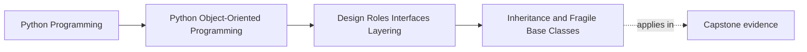

# Inheritance and Fragile Base Classes

<!-- page-maps:start -->
## Page Maps

<!-- page-maps:end -->

Read the first diagram as a placement map: this page is one concept inside its parent
module, not a detached essay, and the capstone is the pressure test for whether the
idea holds. Read the second diagram as the working rhythm for the page: name the
problem, study the example, identify the boundary, then carry one review question
forward.

## Why this lesson matters

Inheritance is one of the easiest tools to reach for too early.

It promises reuse, but it also creates hidden dependency:

- subclasses start depending on base-class ordering and side effects
- small changes in shared code break far-away behaviors
- readers cannot tell which method contracts are explicit and which are only implied

This lesson is not "never inherit." It is "inherit only when the substitution story is real
and the shared contract is small enough to defend."

## The core question

Do these types form a real subtype relationship, or are we only trying to reuse code?

If the main answer is "reuse code," composition is usually safer.

If the main answer is "these objects must be treated interchangeably through the same
behavior contract," inheritance may be justified.

## What makes inheritance legitimate

Inheritance becomes more defensible when:

- the base class defines a small, stable contract
- every subtype can honestly stand in for the base
- subclasses do not need to weaken preconditions or break expectations
- the shared behavior is meaningful, not merely convenient

Small hierarchies with one clear abstraction can work well.

Large, convenience-driven hierarchies usually rot.

## What the fragile base class problem means

A base class is fragile when subclasses rely on details the base did not clearly promise.

Typical examples:

- the base used to call hooks in one order and now calls them in another
- the base used to preserve a list shape and now normalizes it differently
- the base adds a helper side effect that changes subclass assumptions

The subclass did not necessarily do anything strange. The contract was just never made
explicit enough.

## Warning signs you should see early

- protected methods exist mainly so subclasses can patch around base behavior
- subclasses need to read base internals to stay correct
- tests assert a lot of sequencing details instead of only results and promises
- adding one new subtype requires touching many old classes
- the hierarchy grows because "it is already there"

These are not small smells. They usually mean the hierarchy is carrying the wrong kind
of coupling.

## Composition is often the better default

Composition is safer when you need:

- shared helpers without subtype promises
- pluggable behavior pieces
- different combinations of capability
- easier local testing and replacement

Composition forces you to make collaboration explicit instead of smuggling it through a
base class.

## When a small hierarchy still helps

A small hierarchy can still be useful when:

- one algorithm skeleton is genuinely shared
- variants differ only in a narrow step
- callers should not care which concrete subtype they receive
- the contract can be explained in a short checklist

That is a much higher bar than "these classes look related."

## A review checklist for inheritance

Ask:

1. Can every subtype satisfy the same public expectations?
2. Is the base contract small enough to describe clearly?
3. Would composition remove most of the coupling with similar clarity?
4. Are subclasses depending on hidden ordering, mutation, or internal hooks?

If the last answer is yes, the design is already drifting toward fragility.

## Review table

| Question | Healthier sign | Fragile sign |
| --- | --- | --- |
| why does inheritance exist? | real subtype contract | code reuse only |
| what do subclasses rely on? | explicit promises | hidden internals |
| how many moving parts are shared? | small stable surface | large change-prone surface |
| can callers ignore the concrete subtype? | usually yes | often no |

## Capstone connection

In the capstone, inheritance should be rare and justified.

Use it only where:

- a stable abstraction really exists
- substitutability matters to callers
- the shared behavior is narrow and reviewable

If the capstone starts growing a class tree mainly to avoid duplication, this lesson is
the warning light.

## Exit check

Leave this lesson only when you can do all of these:

- explain the fragile base class problem in plain language
- name one case where composition is safer than inheritance
- name one narrow case where a small hierarchy could still be justified
