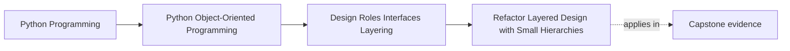

# Refactor Layered Design with Small Hierarchies

<!-- page-maps:start -->
## Page Maps

<!-- page-maps:end -->

Read the first diagram as a placement map: this page is one concept inside its parent
module, not a detached essay, and the capstone is the pressure test for whether the
idea holds. Read the second diagram as the working rhythm for the page: name the
problem, study the example, identify the boundary, then carry one review question
forward.

## Why this refactor matters

This module has introduced several design tools:

- role ownership
- composition
- value objects and entities
- semantic types
- services
- layers
- careful use of interfaces
- narrow justification for inheritance
- composition-root thinking

If those ideas stay separate in the learner's head, the module still feels like a pile of
topics. This refactor page exists to show how they combine into one readable design
direction.

## The starting problem

A weak Module 02 design usually looks like this:

- one large coordinator knows every detail
- domain objects are either too weak or too overloaded
- raw primitives leak everywhere
- infrastructure choices appear in inner code
- abstractions exist, but nobody can explain why they are there

The goal of the refactor is not maximum abstraction. The goal is a design where
responsibility is visible and reviewable.

## The target shape

The target shape for this module is simple:

- domain objects own meaning and invariants
- services coordinate outer work that does not belong on one entity
- application flows sequence the use case
- infrastructure adapts to outside systems
- semantic types appear where raw primitives create confusion
- inheritance, if present at all, stays small and justified
- construction logic gathers at the edge

This is not a pattern museum. It is a readable ownership map.

## A practical refactor order

When improving an existing design, use this order:

1. clarify the domain nouns and their responsibilities
2. separate values from entities
3. remove raw-primitive confusion where it blocks understanding
4. move orchestration out of overloaded entities
5. separate application sequencing from infrastructure mechanics
6. gather construction logic at the composition edge
7. only then decide whether any interface or hierarchy is still justified

This order matters because abstraction added too early usually hides the real mess
instead of cleaning it.

## How to judge whether the refactor helped

Ask whether the new shape makes these questions easier:

- where does this rule live?
- who is allowed to change this state?
- where does this dependency come from?
- what can be swapped for testing?
- what should stay stable if the outer adapter changes?

If the refactor added indirection but did not improve those answers, it probably did not
help enough.

## What not to preserve

Do not preserve weak structure merely because it already exists.

Refactoring this module sometimes means:

- removing unnecessary inheritance
- collapsing fake service layers
- renaming abstractions that only describe implementation history
- moving construction code outward
- merging or simplifying role boundaries that were split for no educational reason

The lesson is not "respect existing files at all costs." The lesson is "respect clarity,
teaching value, and durable ownership."

## A refactor review checklist

| Question | Better answer after refactor |
| --- | --- |
| can I tell domain code from application and infrastructure code? | yes |
| do entities and services have distinct jobs? | yes |
| are semantic types used where they reduce confusion? | yes |
| is inheritance narrow and justified, not decorative? | yes |
| does object construction have a clear edge? | yes |

## Capstone connection

This page is the bridge between the module and the capstone.

Use it as a checklist when the capstone starts to sprawl:

- identify blurred responsibilities
- redraw the inner and outer boundaries
- remove accidental construction logic from inner code
- justify every abstraction by what it teaches or protects

If a capstone design cannot survive this review, Module 02 was not absorbed deeply
enough yet.

## Exit check

Leave this lesson only when you can do all of these:

- describe the target Module 02 design shape in your own words
- explain an order for refactoring a mixed design into clearer layers and roles
- identify one capstone surface that still needs this refactor thinking
