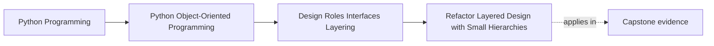
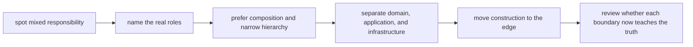

# Refactor Layered Design with Small Hierarchies

<!-- page-maps:start -->
## Page Maps

<!-- page-maps:end -->

This refactor matters because Module 02 can still remain theoretical after a learner
finishes the lessons. They may know the words:

- entity
- service
- policy
- composition root
- protocol
- layer

and still be unable to improve a messy design. This page exists to turn those ideas into
one safe refactor route.

## The weak starting shape

A weak Module 02 design often looks like this:

- one broad coordinator knows too much
- entities are either too thin or too overloaded
- raw primitives leak through every boundary
- infrastructure choices appear in inner code
- abstractions exist, but nobody can explain why they are there

This design may work on the happy path. It usually fails under review because a new
maintainer cannot tell where the next behavior belongs.

## The stronger target shape

The target is not "more abstractions." The target is readable ownership:

- domain objects own meaning and invariants
- application services sequence use cases
- infrastructure adapts to outer systems
- semantic types reduce ambiguity where raw primitives blur meaning
- inheritance stays small, justified, and optional
- construction gathers at a visible composition edge

The final question is simple:

> Can another maintainer look at the new shape and predict where the next change belongs?

## Use this refactor order

Follow this order on purpose:

1. identify the domain nouns and the decisions attached to them
2. separate values from entities
3. replace raw-primitive confusion where it blocks understanding
4. move orchestration out of overloaded entities
5. separate application sequencing from infrastructure mechanics
6. gather construction at the composition edge
7. only then decide whether any interface or hierarchy is still justified

This order matters because abstraction added too early usually hides the real mess
instead of cleaning it.

## Step 1: name the roles before moving code

Start with a table.

| Current object or module | What it is doing now | What role it should really play |
| --- | --- | --- |
| broad coordinator | sequencing, validation, I/O, and state mutation | probably several roles mixed together |
| domain type | holding data plus orchestration plus formatting | meaning owner, not every other role |
| utility module | policy and conversion logic with no owner | likely value, policy, adapter, or helper split |

If you move code before naming the roles, the refactor becomes a file shuffle.

## Step 2: separate values from entities

This is usually the first clarity gain.

Ask:

- which objects compare by content?
- which objects carry lifecycle or continuity?
- which raw values deserve semantic type names?

Good result:

- entities become easier to read because they stop carrying primitive confusion
- values become safer to pass around because their meaning is sharper

## Step 3: move orchestration outward

A common smell is an entity that:

- decides domain rules
- loads collaborators
- calls infrastructure
- logs or publishes side effects

The refactor should split that pressure:

- domain object keeps local meaning and invariants
- application boundary sequences the use case
- infrastructure adapter owns external translation

This is often where a design first stops feeling like a disguised script.

## Step 4: keep inheritance narrow and earned

If inheritance still remains after the role split, it should answer one honest question:

> Does this hierarchy express real specialization, or is it just sharing code under pressure?

Good signs:

- the call chain is understandable
- the base contract is narrow
- composition would be more awkward than illuminating

Bad signs:

- the hierarchy grew because a helper method already existed in a base class
- subclasses depend on hidden sequencing
- mixins are being used to avoid deciding a clearer owner

## Step 5: redraw the layers

Once roles are clearer, redraw the layers around ownership:

| Layer | Should own | Must not own |
| --- | --- | --- |
| domain | meaning and invariants | transport, persistence mechanics, assembly |
| application | use-case sequencing | raw infrastructure protocol details |
| infrastructure | external systems and translation | domain truth |
| composition root | object graph assembly | day-to-day business decisions |

If a directory name claims a layer but the ownership table contradicts it, trust the
ownership table.

## Step 6: move construction to the edge

Construction becomes a teaching surface in this refactor.

Questions to ask:

- where are collaborators assembled today?
- which inner objects are constructing dependencies they should only receive?
- what configuration should stay visible at the edge?

The goal is one visible assembly boundary, not construction scattered across the model.

## A worked refactor route

Imagine a system with:

- one `Processor` class loading config
- validating requests
- choosing strategies
- calling a repository
- logging failures
- formatting output

A safer Module 02 refactor route is:

1. split semantic types out of raw config and request values
2. identify the domain object or policy that really owns the rule decision
3. move request sequencing into an application service
4. move repository and logging details behind infrastructure adapters
5. build the object graph in one composition root
6. keep any remaining hierarchy tiny and justified

The success signal is not "more files." It is "less confusion about who owns what."

## How to review the result

After refactoring, ask:

- where does this rule live now?
- who is allowed to change this state?
- where does this dependency come from?
- what can be swapped for testing or integration change?
- what would break first if the outer adapter changed?

If those answers are still vague, the refactor is not finished.

## Capstone transfer

Use the capstone as the immediate pressure test:

- where is the domain owner?
- where is the application sequencing?
- where do policy objects vary behavior without stealing authority?
- where does runtime or persistence stop being allowed to redefine meaning?

This page should make the capstone easier to read, not just more abstract to talk about.

## Exit check

Leave this lesson only when you can do all of these:

- describe the target Module 02 design shape in your own words
- explain an order for refactoring a mixed design into clearer roles and layers
- identify one capstone boundary that would become clearer if you applied this route
