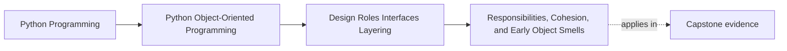

# Responsibilities, Cohesion, and Early Object Smells

<!-- page-maps:start -->
## Page Maps

<!-- page-maps:end -->

Read the first diagram as a placement map: this page is one concept inside its parent
module, not a detached essay, and the capstone is the pressure test for whether the
idea holds. Read the second diagram as the working rhythm for the page: name the
problem, study the example, identify the boundary, then carry one review question
forward.

## Why this lesson matters

Module 01 taught you what an object promises. Module 02 begins by asking a harder
question:

> Which object should carry which promise?

That is the beginning of design roles. When responsibilities are assigned badly, the
code may still run, but review gets harder, change spreads too far, and object
boundaries stop teaching the reader anything useful.

## Responsibility is not the same as implementation location

A method living on a class does not automatically mean that class is the right owner.
Responsibility is about who should be authoritative for a decision, rule, or mutation.

A healthy responsibility assignment usually means:

- one object can explain why the rule lives there
- neighboring objects do not need to know private details to do their own work
- a change lands mostly where the rule already lives

If a change always spills into three or four classes, the role boundaries are probably
too blurry.

## Cohesion is about whether a boundary hangs together

A cohesive object has responsibilities that reinforce one another.

Good signs:

- its methods talk about the same core concept
- its fields support one clear role
- another engineer can describe the object in one sentence without hedging

Low cohesion often sounds like this:

- "this class kind of manages several related things"
- "it owns data, logging, validation, notifications, and some reporting"
- "we put the logic here because this object already existed"

That language is usually the smell before the refactor.

## The three early smells worth learning first

### God object

One boundary collects too many unrelated concerns:

- domain rules
- orchestration
- persistence decisions
- formatting
- notification or transport logic

The problem is not only size. The problem is that no single role explains the object
cleanly anymore.

### Feature envy

A method lives on one object but mostly reads or manipulates another object's state.

That usually means the real owner of the behavior is elsewhere.

### Low cohesion

One object contains methods that do not belong to one stable role. The class becomes a
container for convenient proximity instead of meaningful ownership.

## A better review question than "single responsibility"

Instead of repeating "single responsibility" mechanically, ask:

- Which object should answer this question?
- Which object should reject this invalid move?
- Which object should remain authoritative if the data format, transport, or storage changes?

Those questions lead to better refactors than generic advice about keeping classes small.

## A quick role map you can use

| Role | What it should usually own |
| --- | --- |
| value object | stable meaning, validation of its own content, comparison semantics |
| entity | identity, lifecycle-relevant mutation, local invariants |
| service or policy | cross-object decision logic that does not belong to one entity |
| adapter | translation to or from an external boundary |
| application/use-case object | sequencing of collaborators, not domain truth |

You do not need to force every class into one label instantly, but you do need to ask
which label is closest. If none fits, the boundary may still be under-designed.

## Common early refactor moves

| Smell | Likely repair |
| --- | --- |
| one object owns unrelated decisions and side effects | split into domain owner plus coordinator or adapter |
| method knows too much about a neighbor's fields | move the behavior toward the envied object |
| validation and persistence live together | keep validation near the domain and move persistence out |
| object mostly routes work elsewhere | either tighten its role or remove it |

## Capstone connection

This lesson matters when deciding whether a capstone boundary should be:

- a true domain owner
- a coordination surface
- a reporting or infrastructure adapter

If you cannot tell which role a boundary is playing, later layering and interface
choices will stay vague too.

## Exit check

Leave this lesson only when you can do all of these:

- name one object smell as an ownership problem instead of a style problem
- explain what cohesion means without reducing it to class size
- identify one behavior that should move because its current class is only a convenient host
