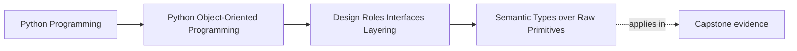

# Semantic Types over Raw Primitives

<!-- page-maps:start -->
## Page Maps

<!-- page-maps:end -->

Read the first diagram as a placement map: this page is one concept inside its parent
module, not a detached essay, and the capstone is the pressure test for whether the
idea holds. Read the second diagram as the working rhythm for the page: name the
problem, study the example, identify the boundary, then carry one review question
forward.

## Why this lesson matters

Many weak object models are not broken because they lack classes. They are broken
because all meaning is still carried by raw `str`, `int`, and `float` values.

That problem shows up when:

- one string can mean several different things depending on context
- a number looks valid to Python but invalid to the domain
- readers must remember hidden assumptions instead of seeing them in the type
- call sites become easy to mix up because several parameters share the same primitive type

This lesson is about using semantic types when they remove ambiguity, not creating
wrappers everywhere for style points.

## The core idea

A raw primitive tells you storage shape.

A semantic type tells you domain meaning.

`0.85` only tells you "floating-point number."

`Threshold(0.85)` tells you:

- this value represents a threshold
- validation probably belongs here
- comparisons should follow threshold rules
- logs and review discussions can name the concept directly

The goal is not decoration. The goal is to make misuse harder and intent easier to see.

## When raw primitives are still fine

Not every primitive deserves a wrapper.

Raw primitives are usually fine when:

- the value is local and short-lived
- the meaning is obvious from tight context
- there is no special validation, formatting, or comparison rule
- mixing it up with another value would be difficult

Examples:

- a loop counter inside one function
- a local slice limit in a tiny helper
- a boolean used only inside one short branch

Do not introduce ceremony where the reader is already safe.

## When semantic types pay for themselves

Semantic types usually earn their place when at least one of these is true:

- the same primitive shape appears in several roles
- domain validation should happen once and early
- the concept appears in many function signatures
- review comments keep saying "which string is this?"
- logs, errors, and debugging benefit from a named concept

Common course examples:

- `MetricName`
- `Threshold`
- `RuleName`
- `AlertId`
- `StatusCode`

These are not "advanced patterns." They are disciplined naming and boundary control.

## What problem they solve in object design

Semantic types help object design in three ways.

### They protect boundaries

If a constructor expects `Threshold` rather than `float`, the boundary is explicit.
Callers must decide whether they truly hold a threshold or only some number.

### They centralize validation

If a metric name must be normalized, checked, or restricted, the rule should not be
copied into ten service methods. The type can own that entry rule once.

### They reduce role confusion

Objects become easier to read when their fields state domain meaning directly instead of
asking the reader to infer it from comments or surrounding prose.

## Where learners overdo it

The mistake is not only "using primitives too much." The opposite mistake is also common:
wrapping everything until the model becomes noisy.

Warning signs:

- wrappers exist but carry no rule, no clarity, and no protection
- every tiny number gets its own class even when no confusion exists
- conversion code spreads everywhere because the types are fighting the actual workflow
- the model becomes harder to teach than the domain itself

If a wrapper adds no real distinction, it is probably not helping.

## A practical decision test

Ask these questions:

1. Could this primitive be confused with another value of the same shape?
2. Does the domain impose validation or normalization rules here?
3. Would a named type make function signatures or reviews easier to understand?
4. Does this concept appear in enough places that repeated explanation is becoming noise?

If the answer is mostly no, keep the primitive.

If the answer is mostly yes, a semantic type is probably the cleaner design.

## Examples that justify semantic types

These are good candidates:

- a threshold that must stay inside a domain-specific range
- an identifier that should not be confused with a label
- a rule name with a controlled vocabulary
- a unit-bearing number whose meaning matters in comparisons

These are weak candidates:

- a one-off timeout literal used in one private helper
- a local integer used only to index a list
- a string that never crosses a meaningful boundary

The point is not "more objects." The point is "clearer responsibility."

## Review checklist

| Question | Keep the primitive | Introduce a semantic type |
| --- | --- | --- |
| is the meaning obvious in tight local context? | usually yes | usually no |
| is there domain validation to centralize? | usually no | usually yes |
| can this value be confused with another of the same shape? | rarely | often |
| will named semantics help signatures and reviews? | maybe not | often yes |

## Capstone connection

In the capstone, semantic types matter wherever the design is starting to hide domain
rules inside bare values.

Typical pressure points:

- policy thresholds
- object identifiers
- state or rule labels
- values that cross application and infrastructure boundaries

If the capstone model keeps asking the reader to remember what a raw primitive "really"
means, this lesson applies immediately.

## Exit check

Leave this lesson only when you can do all of these:

- name one primitive in the capstone that should stay raw and explain why
- name one primitive that should become a semantic type and explain why
- explain how a semantic type improves either validation, readability, or boundary safety
