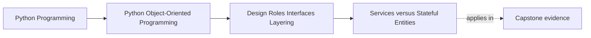

# Services versus Stateful Entities

<!-- page-maps:start -->
## Page Maps

<!-- page-maps:end -->

Read the first diagram as a placement map: this page is one concept inside its parent
module, not a detached essay, and the capstone is the pressure test for whether the
idea holds. Read the second diagram as the working rhythm for the page: name the
problem, study the example, identify the boundary, then carry one review question
forward.

## Why this lesson matters

One of the most common design mistakes is putting every important action into an
entity just because the entity is central to the story.

That creates objects that:

- hold state
- enforce rules
- open gateways to external systems
- coordinate multi-object workflows
- become impossible to reason about locally

The fix is not "move everything into services." The fix is to distinguish what an entity
should own from what a coordinating service should own.

## The shortest honest distinction

### Stateful entity

A stateful entity is a continuing domain thing.

It usually owns:

- identity
- lifecycle state
- invariants about its own transitions
- decisions that only require its own state and closely related values

### Service

A service coordinates work that does not belong naturally inside one entity.

It usually owns:

- multi-object orchestration
- boundary crossing to repositories, queues, notifiers, or clocks
- application sequencing
- policies that combine several collaborators

If the action requires a network client, repository, or several domain objects, that is a
strong sign you are leaving entity territory.

## What should stay on the entity

Good entity responsibilities usually sound like:

- "can this transition happen?"
- "apply this state change if the rule allows it"
- "is this object still valid after the change?"
- "does this object accept or reject this request based on its own rules?"

These are close to the entity's own meaning and lifecycle.

## What should move to a service

Good service responsibilities usually sound like:

- "load the right objects, then coordinate a use case"
- "persist the result after domain decisions finish"
- "notify external systems after the state change"
- "combine several collaborators into one application flow"

The service does not replace domain thinking. It provides the outer coordination that
the entity should not absorb.

## A practical test

Ask these questions:

1. Could this decision happen with only the entity's own state and nearby value objects?
2. Does this behavior require external collaborators?
3. Does it coordinate more than one meaningful object or boundary?
4. Would putting it on the entity force infrastructure knowledge into the domain model?

If the first answer is yes and the rest are mostly no, keep it near the entity.

If external coordination appears, a service is probably the cleaner home.

## The failure mode to avoid

The classic failure mode is the "fat entity with hidden infrastructure":

- `alert.acknowledge()` writes to storage
- sends notifications
- records metrics
- maybe retries network work

That method feels convenient at first, but it quietly mixes domain rules with delivery
mechanics and operational concerns.

The opposite failure mode also exists:

- an anemic entity that stores fields only
- every real decision moves into a giant service layer

That is not better. It throws away the domain object's authority.

## A better split

A healthier design often looks like this:

- the entity decides whether a transition is allowed
- the entity applies the transition
- a service coordinates loading, calling, saving, and external follow-up

This keeps rule ownership inside the domain object while keeping sequencing and
infrastructure outside it.

## Review checklist

| Question | Entity responsibility | Service responsibility |
| --- | --- | --- |
| does it depend mainly on this object's own lifecycle? | usually yes | usually no |
| does it need repositories or network calls? | usually no | usually yes |
| does it coordinate several collaborators? | rarely | often |
| would moving it out weaken domain authority? | maybe | usually not |

## Capstone connection

In the capstone, this distinction matters anywhere a tracked object changes state while
the application also needs persistence, logging, notifications, or policy coordination.

Typical pressure points:

- approval and rejection flows
- status transitions
- command handlers
- workflows that update several objects together

If those boundaries stay blurry, the capstone will feel harder to extend and harder to
test than it should.

## Exit check

Leave this lesson only when you can do all of these:

- name one behavior that belongs on an entity and explain why
- name one behavior that belongs in a service and explain why
- explain how to avoid both the fat-entity and anemic-entity failure modes
