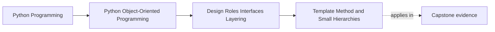

# Template Method and Small Hierarchies

<!-- page-maps:start -->
## Page Maps

<!-- page-maps:end -->

Read the first diagram as a placement map: this page is one concept inside its parent
module, not a detached essay, and the capstone is the pressure test for whether the
idea holds. Read the second diagram as the working rhythm for the page: name the
problem, study the example, identify the boundary, then carry one review question
forward.

## Why this lesson matters

Template method can look elegant because it removes repeated orchestration steps.

It becomes dangerous when it grows into:

- deep hierarchies
- too many hooks
- override rules nobody can explain

That is why this pattern is only worth it when the shared algorithm is real and the
variation points stay very small.

## Use template method only for one stable skeleton

A good template-method base class owns:

- one clear algorithm shape
- a small number of overridable steps
- explicit rules for what subclasses may vary

If the base class keeps gaining hooks for every new case, it is no longer protecting one
stable workflow. It is turning into a fragile framework.

## Tiny hierarchies are the safe default

The pattern is easiest to review when the hierarchy stays shallow:

- one base skeleton
- a small number of subclasses
- no stacked abstract layers

Once several layers of template bases appear, maintainers stop reasoning about roles and
start reasoning about hidden call choreography.

## Prefer composition when the variation is large or stateful

Template method works best when:

- most of the algorithm is fixed
- one or two steps vary
- subclass state stays small

If the variation owns lots of state, policy, or external dependencies, that is usually a
sign to move the variation into a composed collaborator instead.

## Capstone connection

Use the capstone to ask:

- where is there one real shared workflow skeleton?
- where would a policy object explain the variation more honestly than a subclass?
- which existing design would become harder to review if it grew one more abstract layer?

## Exit check

Leave this lesson only when you can do all of these:

- explain what makes template method safe only in small hierarchies
- identify one case where composition is clearer than subclass hooks
- explain how too many hooks turn a base class into a fragile mini-framework
