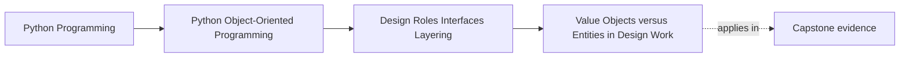

# Value Objects versus Entities in Design Work

<!-- page-maps:start -->
## Page Maps

<!-- page-maps:end -->

Read the first diagram as a placement map: this page is one concept inside its parent
module, not a detached essay, and the capstone is the pressure test for whether the
idea holds. Read the second diagram as the working rhythm for the page: name the
problem, study the example, identify the boundary, then carry one review question
forward.

## Why this lesson matters

Module 01 introduced value-like and entity-like thinking at the object level. Module 02
uses that distinction to place responsibilities correctly across a wider design.

This lesson matters because many role mistakes begin here:

- a value object gets turned into a mini workflow object
- an entity gets compared or copied as if content were all that mattered
- lifecycle logic lands on a value that should stay simple

## The shortest honest distinction

### Value object

A value object is defined by its meaning-bearing content.

Good signs:

- two equal instances are interchangeable
- mutation is rare, forbidden, or modeled by replacement
- copying is either cheap or unnecessary

### Entity

An entity is defined by continuity through time.

Good signs:

- identity matters beyond current field values
- lifecycle changes matter
- the object may be updated while still remaining the "same thing"

This is not a philosophical distinction. It changes where rules should live.

## Design consequences

| Question | Value object | Entity |
| --- | --- | --- |
| what makes it the same? | content | continuity |
| should it usually be immutable? | often yes | not necessarily |
| should equality be content-based? | often yes | often no |
| where do lifecycle transitions belong? | usually nowhere | often here |

If the object needs status transitions, acknowledgements, reassignment, or long-lived
tracking, you are usually no longer looking at a plain value.

## A useful teaching test

Ask:

1. If these two instances had identical fields, could the program still need to keep
   them distinct?
2. If I changed one field, would it still be the same thing?

If the answer to both is yes, the object is probably entity-shaped.

If the answer is no and the content is the meaning, the object is probably value-shaped.

## Where learners go wrong

Common mistakes:

- turning a threshold, code, or label into an entity because it has several fields
- turning an alert, workflow item, or tracked case into a value because its fields happen to match
- placing mutation-heavy logic on a value object because the name sounds central

The object's importance is not the question. The object's continuity is.

## Value objects help simplify the design

Value objects are especially useful for:

- semantic wrappers around raw primitives
- comparison-safe configuration fragments
- rule parameters that should be shared and deduplicated safely
- small concepts that need validation but not lifecycle

Their main benefit is not ceremony. It is dependable meaning.

## Entities help localize change

Entities are useful when:

- the object must survive updates over time
- a stable identifier matters
- domain rules change the object's state
- surrounding services should coordinate around one continuing thing

When an entity is modeled honestly, lifecycle and authority stop leaking into the rest
of the system.

## Review checklist

| Question | Value answer | Entity answer |
| --- | --- | --- |
| can I replace it with equal content? | usually yes | often no |
| can I safely share it widely? | often yes | only with care |
| should updates create a new instance? | often yes | not always |
| does lifecycle meaning live here? | rarely | often |

## Capstone connection

This lesson matters in the capstone whenever you distinguish:

- rule definitions and semantic labels that should behave like values
- tracked workflow or policy objects that should behave like continuing entities

If the distinction is wrong here, later responsibilities will drift too.

## Exit check

Leave this lesson only when you can do all of these:

- classify one capstone type as a value object or entity with reasons
- explain how the equality story changes between the two
- explain where lifecycle logic should and should not live
