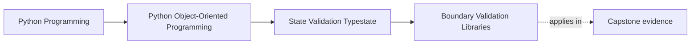

# Boundary Validation Libraries

<!-- page-maps:start -->
## Page Maps

<!-- page-maps:end -->

Read the first diagram as a placement map: this page is one concept inside its parent
module, not a detached essay, and the capstone is the pressure test for whether the
idea holds. Read the second diagram as the working rhythm for the page: name the
problem, study the example, identify the boundary, then carry one review question
forward.

## Why this lesson matters

Validation libraries are useful, but learners often place them in the wrong part of the
system.

That creates two opposite problems:

- boundary input is accepted too loosely and cleaned up too late
- domain objects become tightly coupled to a framework that is really about input parsing

This lesson gives the simple rule: validate raw external input at the boundary, then hand
clean domain-friendly data inward.

## What a boundary is

A boundary is any place where raw outside data enters the program:

- CLI arguments
- HTTP request payloads
- environment variables
- config files
- database rows or message payloads arriving from outside your object model

At a boundary, the system still does not know whether the data is complete, well typed,
or semantically valid enough for the domain.

## Why validation libraries fit well there

Boundary libraries are good at:

- parsing loose input
- coercing formats
- collecting user-facing error messages
- checking shape before domain construction

That is exactly what boundary code needs.

It is not always what domain code needs.

## Why they do not automatically belong in the core domain

The domain layer should usually focus on:

- durable concepts
- invariants
- legal state transitions
- behavior that should remain understandable without a framework-specific mental model

If every domain object becomes a framework model, the boundary tool starts defining the
inner design. That often makes the model heavier than it needs to be.

## A practical split

Use a validation library to turn raw input into a trustworthy input shape.

Then:

- normalize names and formats
- reject obviously invalid payloads
- surface user-facing errors early
- create the real domain object only after boundary validation succeeds

The boundary model is not automatically the domain model.

## What still belongs in the domain

Even after boundary validation, domain rules still matter.

Examples:

- a payload may have the right fields but still describe an illegal transition
- a number may parse correctly but violate a business invariant
- two fields may be individually valid yet invalid in combination

Boundary validation answers "is this well formed enough to enter?"

Domain validation answers "is this object or transition legitimate here?"

## Common mistakes

- treating a parsing model as the final domain object
- letting framework-specific validation rules spread through inner layers
- assuming boundary validation replaces domain invariants
- duplicating the same rule in both places without clarifying why

The main danger is confusing transport correctness with domain correctness.

## Review checklist

| Question | Boundary validation | Domain validation |
| --- | --- | --- |
| parses raw external data? | yes | no |
| reports user-facing input errors early? | yes | sometimes |
| protects business invariants? | partly | yes |
| should remain lightweight and framework-aware? | yes | ideally no |

## Capstone connection

In the capstone, this lesson matters wherever raw input crosses into the object model:

- commands
- config loading
- request payloads
- integration adapters

If the capstone currently mixes parsing, coercion, and domain rules in the same object,
split that boundary first.

## Exit check

Leave this lesson only when you can do all of these:

- name one boundary in the capstone that should use strong input validation
- explain why the boundary model should not automatically become the domain model
- explain one domain rule that still needs enforcement after boundary parsing succeeds
