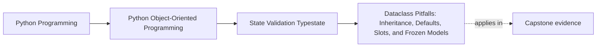

# Dataclass Pitfalls: Inheritance, Defaults, Slots, and Frozen Models

<!-- page-maps:start -->
## Page Maps

<!-- page-maps:end -->

Read the first diagram as a placement map: this page is one concept inside its parent
module, not a detached essay, and the capstone is the pressure test for whether the
idea holds. Read the second diagram as the working rhythm for the page: name the
problem, study the example, identify the boundary, then carry one review question
forward.

## Why this lesson matters

Dataclasses are easy to like when examples stay small. The problems begin when learners
assume every option and combination is automatically safe.

The usual trouble points are:

- inheritance that quietly complicates field order and meaning
- mutable defaults that leak shared state
- `slots` used without understanding the trade-off
- `frozen` used as if it solved every integrity problem by itself

This lesson is about staying honest when dataclasses move beyond the simplest case.

## Mutable defaults are the first trap

The biggest beginner trap is still the easiest one:

- a list or dict is used as a default
- every instance quietly shares it

That is not a dataclass-specific curse, but dataclasses make it easy to write the mistake
quickly. Shared mutable defaults corrupt the object model and confuse every later test.

## Inheritance raises the difficulty quickly

Dataclass inheritance can work, but it stops being "simple shape declaration" very fast.

Why?

- field order matters
- generated methods span parent and child fields
- lifecycle or invariant meaning may become harder to read

If the hierarchy is already subtle, dataclass generation often amplifies the confusion
instead of removing it.

## `slots` is a trade-off, not a badge

`slots` can be useful for:

- memory discipline
- preventing accidental extra attributes

But it also adds design pressure:

- some dynamic behavior becomes less convenient
- debugging or extension expectations may change

Use it when the object model benefits, not because it sounds more advanced.

## `frozen` helps, but only within limits

`frozen` is helpful when you want a value object to resist ordinary mutation.

But it does not magically solve:

- nested mutable contents
- bad invariants
- confused equality choices
- lifecycle models that should not have been immutable in the first place

Freezing the wrong object only makes the wrong design harder to change.

## A practical caution rule

Start simple.

Only add dataclass features when you can explain:

- what problem they solve here
- what new constraint they introduce
- why the trade-off improves this object specifically

If you cannot explain that clearly, the added feature is probably noise.

## Common mistakes

- using inheritance when composition or separate objects would be clearer
- assuming `frozen=True` means the whole structure is deeply immutable
- adding `slots=True` without reviewing how the class is actually used
- fixing one dataclass annoyance by stacking more options instead of rethinking the object

Complex option stacks are often a sign that the model itself wants simplification.

## Review checklist

| Question | Good sign |
| --- | --- |
| are mutable defaults avoided? | yes |
| is inheritance used sparingly and for a clear reason? | yes |
| is `slots` solving a real problem instead of signaling cleverness? | yes |
| is `frozen` aligned with the object’s actual semantics? | yes |

## Capstone connection

In the capstone, review every advanced dataclass option and ask whether it protects a
real design need or merely patches discomfort from an awkward model.

If the capstone needs many option combinations just to stay understandable, the object
boundaries probably need another pass.

## Exit check

Leave this lesson only when you can do all of these:

- explain why mutable defaults are dangerous
- explain one risk dataclass inheritance introduces
- explain why `slots` and `frozen` are trade-offs, not automatic upgrades
