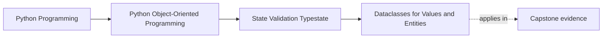

# Dataclasses for Values and Entities

<!-- page-maps:start -->
## Page Maps

<!-- page-maps:end -->

Read the first diagram as a placement map: this page is one concept inside its parent
module, not a detached essay, and the capstone is the pressure test for whether the
idea holds. Read the second diagram as the working rhythm for the page: name the
problem, study the example, identify the boundary, then carry one review question
forward.

## Why this lesson matters

Dataclasses are often taught as a shortcut for "less boilerplate," but that framing is too
shallow for design work.

The real question is:

- when does a dataclass clarify a value object?
- when does it still work for an entity?
- when does it start lying about identity, mutability, or invariants?

This lesson is about using dataclasses honestly, not automatically.

## Where dataclasses help most

Dataclasses are strongest when the object:

- has a clear data shape
- benefits from readable field declarations
- needs predictable construction
- should have straightforward representation support

That makes them especially good for many value objects and some carefully designed
entities.

## Value objects are often the best fit

Dataclasses pair naturally with value objects because value objects usually want:

- explicit fields
- content-based comparison
- easy readability
- controlled immutability

When the object is defined mainly by its content, a dataclass can express that directly.

## Entities need more care

Entities have a different pressure:

- identity matters
- lifecycle usually matters
- mutation rules may matter
- equality may not be simple field equality

That does not forbid dataclasses. It just means you must be deliberate about what the
generated behavior implies.

## The mistake to avoid

The most common dataclass mistake is forgetting that generated defaults are part of the
design.

If you accept every generated behavior without thinking, you may accidentally get:

- equality that compares the wrong fields
- representation that leaks too much
- mutability where you wanted stronger control
- construction that permits half-formed objects

The problem is not the feature. The problem is unreviewed defaults.

## A practical decision test

Ask:

1. Is this object mainly a declared data shape with clear invariants?
2. Should equality follow content or identity?
3. Do generated constructor and representation behavior help or mislead here?
4. Will the class still need custom lifecycle rules that outweigh the convenience?

If the dataclass defaults align with the object’s meaning, use them.

If they fight the meaning, do not force the fit.

## When not to reach for a dataclass

A dataclass is a weaker fit when:

- the object’s behavior is much more important than its declared field shape
- construction is complex and multi-step
- lifecycle transitions dominate the design
- the generated defaults would immediately need heavy correction

In those cases, a hand-written class may be more honest and easier to teach.

## Review checklist

| Question | Value object fit | Entity fit |
| --- | --- | --- |
| explicit field declaration helps? | usually yes | often yes |
| content equality is appropriate? | often yes | often no |
| generated constructor is mostly useful? | often yes | depends |
| lifecycle complexity is low? | often yes | sometimes no |

## Capstone connection

In the capstone, use this lesson when deciding which concepts should become:

- compact value types with clear fields
- entities that still need more deliberate identity and lifecycle handling

If a class is verbose only because it is spelling out a simple data shape, a dataclass may
help. If the class is hard because the domain is hard, a dataclass alone will not rescue it.

## Exit check

Leave this lesson only when you can do all of these:

- name one capstone type that is a strong dataclass candidate
- name one capstone type that needs more care because identity or lifecycle dominates
- explain why "less boilerplate" is not enough reason by itself to choose a dataclass
