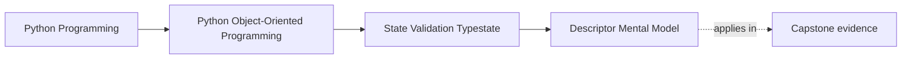

# Descriptor Mental Model

<!-- page-maps:start -->
## Page Maps

<!-- page-maps:end -->

Read the first diagram as a placement map: this page is one concept inside its parent
module, not a detached essay, and the capstone is the pressure test for whether the
idea holds. Read the second diagram as the working rhythm for the page: name the
problem, study the example, identify the boundary, then carry one review question
forward.

## Why this lesson matters

Learners often use properties, methods, and class attributes for a long time without a
clear model of why they behave differently.

Descriptors are the missing mental model behind several ordinary Python features:

- `@property`
- bound methods
- some validation and field-management tools

You do not need to write custom descriptors every day, but you do need a clear model of
what Python is doing when attribute access is no longer just "look in `__dict__`."

## The shortest useful model

A descriptor is an object stored on the class that participates in attribute access.

That means reading `obj.name` is not always a simple field lookup. Sometimes Python
finds a class-level object that controls what the read or write means.

That is why some attributes behave like computed values or bound methods instead of
plain stored data.

## Why this matters for ordinary code

Even if you never define your own descriptor, the concept explains:

- why properties act like attributes with custom logic
- why methods turn into bound methods when accessed from an instance
- why some attribute writes are intercepted instead of simply stored

Without this model, those behaviors feel magical. With it, they become design tools.

## What not to do with the concept

Do not turn "descriptors exist" into a reason to add cleverness.

The teaching goal is:

- understand what Python is already doing
- avoid confusion about attribute behavior
- recognize when a higher-level tool is powered by descriptor machinery

The goal is not to make every learner start inventing custom field systems.

## A practical review question

When an attribute behaves strangely, ask:

- is this plain instance data?
- or is the class defining a descriptor-like object that changes the meaning of access?

That question alone clears up many property, method, and framework-field puzzles.

## Common mistakes

- assuming all attributes are simple stored values
- treating properties as unrelated magic instead of descriptor-based behavior
- writing descriptor-heavy code before the design actually needs it
- forgetting that attribute access can be controlled at the class level

This lesson is about accurate mental models, not metaprogramming ambition.

## Review checklist

| Question | Good sign |
| --- | --- |
| can you explain why a property is different from a plain field? | yes |
| can you explain why methods become bound on instances? | yes |
| can you recognize when class-level machinery is controlling attribute access? | yes |
| are you resisting unnecessary clever descriptor use? | yes |

## Capstone connection

In the capstone, this lesson matters wherever:

- properties are used for derived facts
- framework-backed fields or validation helpers shape attribute behavior
- readers need to understand why attribute access is not plain storage

If attribute behavior is confusing in review, the descriptor model is usually the missing
explanation.

## Exit check

Leave this lesson only when you can do all of these:

- explain descriptors in plain language
- explain why properties and bound methods are not ordinary fields
- explain why understanding descriptors helps even if you never build one yourself
