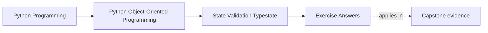
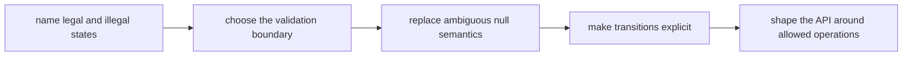

# Exercise Answers

<!-- page-maps:start -->
## Page Maps




<!-- page-maps:end -->

These are model answers for the `ReportDraft` scenario from the exercise page. They are
not the only acceptable answers. They are here to show the level of explicitness a solo
learner should be aiming for.

## Running scenario recap

`ReportDraft` supports four meaningful states:

- `draft`
- `submitted`
- `approved`
- `rejected`

The object must preserve these truths:

- approval never happens before submission
- approved reports are no longer editable
- rejected reports may return to draft only through an explicit reopening decision
- empty sections are acceptable in early drafting but not at submission time

## Answer 1: Legal states

A strong legal-state table looks like this:

| State | What is true | Allowed operations | Forbidden operations |
| --- | --- | --- | --- |
| `draft` | author exists; title may still be blank; sections may still be incomplete | edit title, edit sections, submit | approve, mark approved timestamp |
| `submitted` | title is non-blank; at least one section exists; submitted timestamp exists | approve, reject | edit content directly, resubmit |
| `approved` | submitted timestamp exists; approved timestamp exists; content is frozen | read, publish, archive | edit, reject, resubmit |
| `rejected` | submission exists; rejection reason exists; still not approved | reopen to draft, read review notes | approve without resubmission, edit as if still draft |

The most dangerous illegal state is "approved but still editable," because it lets the
system quietly change something that other actors now trust as final.

## Answer 2: Illegal combinations

Five explicit illegal combinations:

1. `submitted_at is None` while state is `submitted`
2. state is `approved` but `approved_at is None`
3. state is `approved` and `sections` may still be mutated
4. state is `rejected` but `rejection_reason is None`
5. state is `draft` while `approved_at` already exists

Where to reject them:

- constructor or rehydration boundary for combinations that can never exist honestly
- transition methods for combinations created during lifecycle changes
- persistence rehydration tests for historical data that might drift into illegal shape

## Answer 3: Construction boundary

A clean constructor contract is:

- `author_id` must exist
- `state` starts as `draft`
- `submitted_at`, `approved_at`, and `rejection_reason` start absent

The constructor should not accept an arbitrary state enum plus arbitrary timestamps,
because that invites callers to assemble incoherent state manually.

If staged assembly is real, use:

- `ReportDraft.start(author_id=...)` for creating the draft
- explicit transition methods for `submit`, `approve`, `reject`, and `reopen`

That keeps construction honest and moves lifecycle authority into named methods.

## Answer 4: Overloaded `None`

Weak design:

- `reviewed_at: datetime | None`

Possible meanings:

- not submitted yet
- submitted but not yet reviewed
- rejected and reopened
- broken imported state

Sharper design:

- use `state` plus `submitted_at`, `approved_at`, and `rejection_reason`
- avoid one field pretending to encode the whole lifecycle

The bug surface removed is "callers infer state from one nullable field and guess wrong."

## Answer 5: Property review

`ready_for_review` is a good property only if it is:

- cheap
- derived from current in-memory state
- free of hidden I/O

For this scenario it can honestly mean:

- title is non-blank
- at least one section exists
- state is still `draft`

It becomes a bad property if it:

- performs validation against remote services
- mutates internal state
- logs or caches as a side effect

Attribute syntax promises "safe to read casually." The implementation must honor that.

## Answer 6: Dataclass review

Using `@dataclass` is reasonable only if the generated behavior matches the contract.

Good fit:

- small number of fields
- explicit post-init checks
- equality defined deliberately

Danger points:

- auto-generated equality may imply content equality when identity or lifecycle matters
- defaults may let semantically incomplete state slip through
- mutable lists such as `sections` need careful ownership

Recommendation:

- keep a dataclass only if it is treated as a disciplined lifecycle object, not as a bag
  of writable fields

## Answer 7: Lifecycle transitions

A useful transition map:

```text
draft --submit--> submitted
submitted --approve--> approved
submitted --reject--> rejected
rejected --reopen--> draft
```

Forbidden examples:

- `draft -> approved`
- `approved -> draft`
- `rejected -> approved` without resubmission

Each transition should live in one named method so the boundary that changes state also
checks the rules.

## Answer 8: Typestate pressure

A stronger API separates what callers can do by state:

- draft methods: `edit_title`, `replace_sections`, `submit`
- submitted methods: `approve`, `reject`
- approved view: read-only operations only
- rejected methods: `reopen`

Even if the underlying runtime object is one class, the public API should make illegal
operations feel obviously wrong.

## Answer 9: Validation library boundary

A boundary validator may:

- parse raw payloads
- normalize string timestamps
- reject malformed types

It must not decide:

- whether submission is allowed with zero sections
- whether approval may happen before submission
- whether reopening from rejected is legal

That reasoning belongs in the domain model, not in the payload parser.

## Answer 10: Full state packet

A compact review note might read like this:

> `ReportDraft` has four legal states: draft, submitted, approved, and rejected. The
> constructor only creates honest drafts. Submission, approval, rejection, and reopening
> are explicit transitions. Nullable timestamps no longer stand in for lifecycle meaning.
> The main remaining risk is accidental mutable sharing of section content, so tests
> should prove edits cannot leak across versions or reopen paths.

That paragraph is stronger than a feature summary because it names:

- the legal states
- the real boundary for change
- the repaired ambiguity
- the remaining risk

## Self-check

You are using Module 03 correctly when your answer packet makes it easy for another
maintainer to answer:

- when is this object legal
- who may change its state
- what values are absent by meaning instead of by accident
- which operations disappear after transitions
