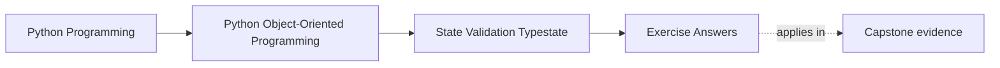
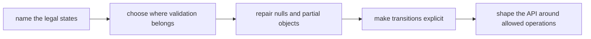

# Exercise Answers

<!-- page-maps:start -->
## Page Maps




<!-- page-maps:end -->

These are model answers for the `ReportDraft` scenario from the exercise page. They are
not the only acceptable answers. They are here to show the level of explicitness a solo
learner should aim for when reasoning about legal state, illegal combinations, and API
truthfulness.

## How to use this page well

Compare your own packet against this answer page using four checks:

- did I name the legal states without hedging?
- did I say where invalid combinations get rejected first?
- did I separate boundary validation from domain validation?
- did I make the allowed operations change with state instead of staying vague?

If your answer reaches the same conclusion but leaves those boundaries fuzzy, it is still
too weak.

## What strong Module 03 answers have in common

Across the whole packet, strong answers usually show all of these:

- a small honest set of legal states
- explicit illegal combinations instead of implied discomfort
- constructor and transition boundaries separated clearly
- absence modeled by meaning rather than by convenience
- an API whose obvious calls match the current lifecycle
- one remaining risk named honestly instead of hidden behind optimism

If your packet sounds like theory without state tables or transition decisions, the
module has not landed deeply enough yet.

## Answer 1: Legal states

A strong legal-state table is small, explicit, and tied to meaning.

For the `ReportDraft` scenario:

| State | What is true | Allowed operations | Forbidden operations |
| --- | --- | --- | --- |
| `draft` | author exists; title may still be blank; sections may still be incomplete | edit title, edit sections, submit | approve, mark approved timestamp |
| `submitted` | title is non-blank; at least one section exists; submission timestamp exists | approve, reject | edit content directly, resubmit |
| `approved` | submission exists; approval timestamp exists; content is frozen | read, publish, archive | edit, reject, reopen |
| `rejected` | submission exists; rejection reason exists; still not approved | reopen to draft, read notes | approve without resubmission, edit as if still draft |

The most dangerous illegal state is "approved but still editable," because it silently
breaks trust in the object's finality.

## Answer 2: Illegal combinations

Strong answers make illegal combinations explicit instead of hoping the reader will infer them.

Examples:

1. `submitted_at is None` while state is `submitted`
2. state is `approved` but `approved_at is None`
3. state is `approved` and content is still mutable
4. state is `rejected` but `rejection_reason is None`
5. state is `draft` while approval evidence already exists

Where to reject them:

- constructor or rehydration boundary for combinations that should never exist honestly
- transition methods for combinations created during lifecycle changes
- persistence checks when historical data could drift into illegal shape

The strongest answers say which rejection point comes first, not just that the state is wrong.

## Answer 3: Construction boundary

A clean constructor contract for this scenario is:

- `author_id` must exist
- state starts as `draft`
- `submitted_at`, `approved_at`, and `rejection_reason` start absent

The constructor should not accept arbitrary state plus arbitrary timestamps, because that
lets callers build incoherent state manually.

If staged assembly is real, a stronger design is:

- `ReportDraft.start(author_id=...)` for honest draft creation
- explicit transition methods for `submit`, `approve`, `reject`, and `reopen`

That keeps construction honest and moves lifecycle authority into named methods.

## Answer 4: Overloaded absence

Weak design:

- `reviewed_at: datetime | None`

Possible meanings:

- not submitted yet
- submitted but not yet reviewed
- rejected and reopened
- broken imported state

Sharper design:

- use `state` plus `submitted_at`, `approved_at`, and `rejection_reason`
- stop asking one nullable field to encode the entire lifecycle story

The improvement is not just cleaner typing. It is clearer meaning.

## Answer 5: Property review

`ready_for_review` is a good property only if it is:

- cheap
- derived from current in-memory state
- free of hidden I/O or mutation

For this scenario it can honestly mean:

- title is non-blank
- at least one section exists
- state is still `draft`

It becomes a bad property if it:

- performs remote checks
- mutates internal state
- logs or caches as a side effect

Attribute syntax promises "safe to read casually." The implementation must honor that.

## Answer 6: Dataclass review

Using `@dataclass` is reasonable only if the generated behavior matches the contract.

Good fit:

- small number of fields
- explicit post-init checks
- equality defined deliberately

Danger points:

- auto-generated equality may imply content equality when lifecycle identity matters
- defaults may let incomplete state slip through
- mutable lists such as `sections` need clear ownership

Recommendation:

- keep a dataclass only if it behaves like a disciplined stateful object, not a writable bag of fields

## Answer 7: Lifecycle transitions

A useful transition map is:

```text
draft --submit--> submitted
submitted --approve--> approved
submitted --reject--> rejected
rejected --reopen--> draft
```

Forbidden examples:

- `draft -> approved`
- `approved -> draft`
- `rejected -> approved` without resubmission

Each transition should live in one named method so the same boundary both changes the
state and checks whether the move is legal.

## Answer 8: Typestate pressure

A stronger API changes what callers can do by state:

- draft methods: `edit_title`, `replace_sections`, `submit`
- submitted methods: `approve`, `reject`
- approved view: read-only operations only
- rejected methods: `reopen`

Even if the runtime object is one class, the public API should make illegal operations
feel obviously wrong. That is the practical meaning of typestate here.

## Answer 9: Validation library boundary

A boundary validator may:

- parse raw payloads
- normalize timestamps
- reject malformed types

It must not decide:

- whether submission is allowed with zero sections
- whether approval may happen before submission
- whether reopening from rejected is legal

That reasoning belongs in the domain model, not in the payload parser. Strong answers
draw that line explicitly.

## Answer 10: Full state packet

A compact review note might sound like this:

> `ReportDraft` has four legal states: draft, submitted, approved, and rejected. The
> constructor only creates honest drafts. Submission, approval, rejection, and reopening
> are explicit transitions. Nullable fields no longer stand in for lifecycle meaning. The
> main remaining risk is accidental mutable sharing of section content, so tests should
> prove edits cannot leak across versions or reopen paths.

That paragraph is strong because it names:

- the legal states
- the real change boundary
- the repaired ambiguity
- the remaining risk

## What a strong packet sounds like overall

A strong final packet usually sounds like this:

> This object is legal only in a small set of named states. Invalid combinations are
> rejected at construction, transition, or rehydration boundaries. Absence has one clear
> meaning in each case. The public API changes as the lifecycle changes.

That is the level of explicitness a missed-class learner should be aiming for.

## Exit check

Leave this answer page only when you can say:

> My answers now make the lifecycle reviewable: I can name the legal states, say where
> invalid state is rejected, explain what absence means, and show how allowed operations
> change after transitions.
