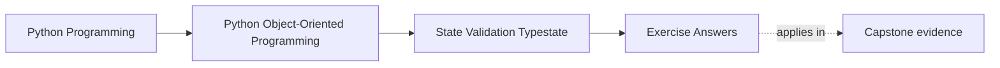
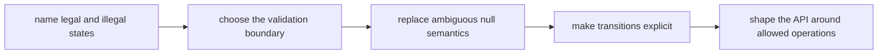

# Exercise Answers

<!-- page-maps:start -->
## Page Maps

<!-- page-maps:end -->

These answers are model explanations, not the only acceptable wording.

## How to use the answer page well

Do not read the model answer first and then reduce the module to "validate in
`__post_init__` and avoid `None`."

A better rhythm is:

1. finish the exercise with your own state packet
2. name the legal states, transition rules, and proof boundary
3. compare your reasoning with the model answer
4. revise anywhere your answer still relies on caller discipline or overloaded meanings

What matters is whether the reasoning makes legal state explicit and reviewable.

Strong Module 03 answers usually do five things:

- they name illegal states explicitly
- they place validation where the contract becomes true
- they treat properties and dataclasses as contract choices
- they give `None` one sharp meaning at a time
- they use lifecycle APIs to narrow what callers can do

The strongest self-study packets also leave behind six concrete artifacts:

- one legal-state table
- one validation-boundary decision
- one nullability repair
- one property or dataclass review
- one transition map
- one full state review

If your answers rely only on "the team knows not to do that," the reasoning is still too
thin.

## Answer 1: Define the legal states

A strong answer:

- names each legal state plainly
- names illegal combinations explicitly
- lists allowed operations by state

The most dangerous confusion is usually the one that lets the object look usable while it
is semantically incomplete or retired.

## Answer 2: Choose the validation boundary

The best validation boundary is where the object or state first becomes semantically real.

Typical pattern:

- constructor for invariants that must always hold
- transition method for lifecycle changes
- property setter only when mutable state genuinely belongs on a supported write surface
- separate boundary validator for external input normalization before domain construction

What matters is to avoid validating too late, after invalid state already exists.

## Answer 3: Repair an ambiguous `None`

The sharp repair usually separates meanings such as:

- absent by design
- not loaded yet
- invalid partial state

with explicit values, variants, factories, or lifecycle states rather than one overloaded
`None`.

The bug surface removed is silent confusion: callers stop guessing which interpretation of
absence is currently in play.

## Answer 4: Review a property honestly

A strong property:

- represents stable, cheap, and conceptually attribute-like state

A weak property:

- hides expensive work
- mutates state invisibly
- conceals I/O or policy that should remain explicit as a method

A reviewer should infer that attribute syntax is safe and unsurprising unless the design
has documented a sharper contract.

## Answer 5: Review a dataclass contract

The important questions are:

- is mutability appropriate for this object
- are defaults semantically honest
- do equality and hashing match intended container use
- do inheritance, `slots`, `frozen`, or defaults create subtle brittleness

`dataclass` is strongest when its generated behavior matches the real value or entity
contract instead of merely saving typing.

## Answer 6: Model lifecycle transitions

A strong transition map:

- shows which moves are legal
- names who enforces them
- rejects illegal jumps explicitly

Caller discipline is too weak when multiple callers, retries, or asynchronous paths can
attempt state changes independently.

## Answer 7: Compare partial objects and explicit builders

The best repair often depends on why the object is partial:

- strict constructor when all required data can be known immediately
- builder or factory when staged assembly is real but should not leak as a half-valid
  object
- typestate split when draft and ready forms have genuinely different allowed operations

The goal is to reduce semantically unusable intermediate objects.

## Answer 8: Design a typestate-inspired API

A strong answer:

- removes or narrows operations after transitions
- makes illegal use harder to express from the call site
- admits that some checks remain runtime checks in Python

The main lesson is not perfection. It is to make the safe path the obvious path.

## Answer 9: Review boundary validation libraries carefully

A validation library is strongest for:

- parsing and normalizing external input
- rejecting malformed payloads at the edge

It should not replace:

- domain-specific invariants
- lifecycle semantics
- aggregate or collaboration rules

The false confidence appears when the team believes "validated input" automatically means
"sound domain state."

## Answer 10: Produce a full state review

A strong final review names:

- legal states
- validation placement
- null semantics
- lifecycle transitions
- one remaining risk
- one defended strength

The best closing paragraph reads like a review note, not a feature summary.

## Self-check

If your answers consistently explain:

- which states are legal and illegal
- where validation becomes authoritative
- when a representation tool helps or hurts
- how transition APIs narrow misuse
- what risk still needs explicit handling

then you are using Module 03 correctly.
