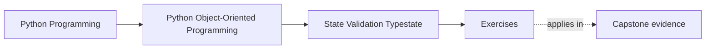
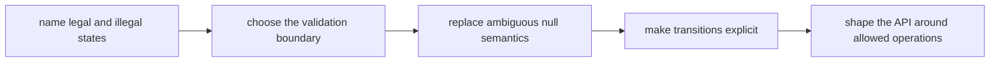
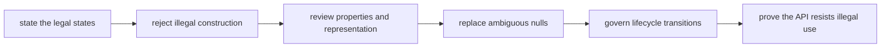

# Exercises


<!-- page-maps:start -->
## Page Maps




<!-- page-maps:end -->

Use these exercises to practice state-contract judgment, not only Python validation
features.

The goal of the day is to make legal and illegal state explicit. By the end, validation,
nullability, partial objects, and lifecycle transitions should read like enforceable
contracts rather than like comments the caller is expected to remember.

## How to work through this set

Treat the ten exercises as one full lab day on state and lifecycle discipline.

Before each answer:

1. name the object state that must be protected
2. name the boundary that should reject invalid state
3. say what API or test would prove illegal operations are harder to express

Do the exercises in order. The day is one progression:

- Exercises 1-3 define legal state and validation boundaries
- Exercises 4-5 review properties, dataclasses, and null semantics
- Exercises 6-8 model transitions and typestate pressure
- Exercises 9-10 package the full lifecycle review into one coherent contract

Keep one state packet as you go. By the end of the day it should contain:

- one legal-versus-illegal state table
- one validation-boundary decision
- one null-semantics repair
- one property or dataclass review
- one lifecycle transition map
- one typestate-style API judgment

If those six artifacts are missing, you are probably still tolerating invalid state
instead of governing it.

## Recommended working layout

If you want one lab tree that can support the whole day, use something like:

```text
module03-lab/
├── artifacts/
├── notes/
├── scratch/
└── tests/
```

Keep one lifecycle table while you work:

| Object | Legal states | Illegal states to block | Transition method or boundary | Proof test |
| --- | --- | --- | --- | --- |

Also keep one nullability table:

| Current representation | What `None` means now | Why that is ambiguous or safe | Sharper alternative |
| --- | --- | --- | --- |



Use that route on purpose. It keeps the day centered on state contracts instead of on
syntax features.

## Exercise 1: Define the legal states

Pick one object lifecycle from the capstone or a small lab example and list:

- the legal states
- the illegal states
- the operations allowed in each legal state

Explain which state confusion would be most dangerous in production.

Study note:
State modeling becomes much easier once illegal states are named explicitly instead of
hand-waved as rare.

## Exercise 2: Choose the validation boundary

Take one invariant and decide whether it should be enforced in:

- the constructor
- a property setter
- a separate validation boundary
- a lifecycle transition method

Explain:

- why that boundary is the least surprising place
- what a weaker placement would miss
- one test that proves the invariant is guarded there

Study note:
Good validation lives where the contract becomes true, not merely where the bug was first
noticed.

## Exercise 3: Repair an ambiguous `None`

Find one place where `None` could mean several different things, such as:

- unknown
- not loaded yet
- absent by design
- invalid partial state

Redesign it with a sharper representation and explain which bug surface disappears.

Study note:
`None` is not evil, but overloaded `None` meanings are.

## Exercise 4: Review a property honestly

Choose one property or computed attribute and explain whether it:

- clarifies the public state contract
- hides expensive or stateful work
- should stay a method instead

Then state what a reviewer should infer when they see attribute syntax in that class.

Study note:
This matters because innocent-looking attribute access can hide surprising work or policy.

## Exercise 5: Review a dataclass contract

Pick one dataclass-shaped object and explain:

- whether mutability is safe
- whether default values are honest
- whether equality and hashing behavior help or hurt the design
- which `dataclass` convenience could become brittle here

Study note:
`dataclass` is useful only when its defaults match the real contract.

## Midday self-check

Before you move into lifecycle transitions and typestate-style APIs, make sure your
packet can already answer these questions clearly:

- which states are legal and illegal
- where validation belongs and why
- when a property clarifies state versus hides work
- why a `None` meaning is either precise or dangerously overloaded

If you cannot answer those four questions in plain language, return to Exercises 1-5 and
make the packet more explicit before continuing.

## Exercise 6: Model lifecycle transitions

Choose one object that changes over time and draw:

- the legal transitions
- the illegal transitions
- the method boundary that should enforce each transition

Then explain one place where caller discipline alone would be too weak.

Study note:
Lifecycle APIs matter because "should never happen" is not an enforcement mechanism.

## Exercise 7: Compare partial objects and explicit builders

Take one construction flow that currently produces a partially usable object. Compare it
with:

- a builder or factory
- a stricter constructor
- a typestate-like split between draft and ready forms

Explain which design best reduces invalid intermediate states.

Study note:
Partial objects are often tolerated long after the team has forgotten why they exist.

## Exercise 8: Design a typestate-inspired API

Choose one workflow and redesign the API so illegal operations are harder to express after
state transitions.

Explain:

- what operations disappear in each state
- what becomes easier to review
- what remains a runtime check rather than a type-level guarantee

Study note:
Python cannot forbid every illegal state statically, but it can still shape safer APIs.

## Exercise 9: Review boundary validation libraries carefully

Take one boundary where a validation library could help and explain:

- what the library should validate
- what must stay as domain logic instead
- what false confidence appears if the team lets the library replace domain design

Study note:
Libraries can guard edges, but they do not absolve the model of its own contract.

## Exercise 10: Produce a full state review

Take one meaningful object and write a short review that names:

- legal states
- validation boundary
- null semantics
- transition rules
- one risk still present
- one reason the design is trustworthy

Study note:
This final exercise matters because the module’s real exit skill is state review, not
feature recall.

## Mastery check

You have a strong grasp of this module if your answers consistently keep five ideas
visible:

- illegal states should be named and resisted explicitly
- validation belongs at the boundary where the contract becomes true
- properties and dataclasses are design tools, not harmless defaults
- nullability needs one meaning per case
- lifecycle APIs should make invalid operations harder to express
