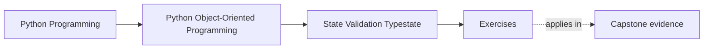
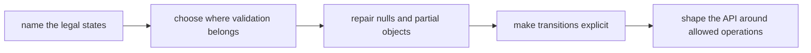

# Exercises

<!-- page-maps:start -->
## Page Maps

<!-- page-maps:end -->

Use these exercises as one full lab day on state discipline. The goal is not to repeat
phrases like "invalid states should be unrepresentable." The goal is to turn one messy
object into a design with legal states, explicit transitions, reviewable validation
boundaries, and an API that tells the truth about what may happen next.

## Running lab rule

Use one object for the whole day so the reasoning compounds instead of resetting every
exercise. If you do not already have a candidate, use this scenario:

`ReportDraft`

- `author_id` must always exist
- `title` may start blank but cannot be blank once submitted
- `sections` may be empty while drafting but not when ready for review
- `submitted_at` exists only after submission
- `approved_at` exists only after approval
- approved reports cannot be edited
- rejected reports may return to draft only through an explicit reopening action

You may replace the scenario with your own object, but keep the same kind of pressure:
drafting, readiness, submission, review, approval, rejection, and controlled reopening.

## What to keep open while you work

Maintain one state packet from the start. By the end it should contain:

- one legal-state table
- one illegal-combination list
- one validation-boundary note
- one nullability repair
- one transition map
- one API review showing how callers are guided toward legal use

Use these tables directly:

| State | Fields that must exist | Fields that must not exist | Allowed operations | Illegal operations |
| --- | --- | --- | --- | --- |

| Ambiguous value today | Meanings currently overloaded | Chosen replacement | Why the replacement is clearer |
| --- | --- | --- | --- |

## Exercise 1: Name the legal states

Using the running scenario, define the smallest honest set of states.

Produce:

- a legal-state table
- one sentence per state explaining what becomes true there
- one sentence naming the most dangerous illegal state

Do not start with field flags. Start with business meaning.

## Exercise 2: Name illegal combinations explicitly

List at least five illegal combinations, such as:

- submitted with no sections
- approved with no submission time
- approved and still editable
- rejected with no rejection reason
- draft that still carries approval evidence

For each one, say:

- why the combination is semantically impossible
- where you want the system to reject it first
- whether that rejection belongs at construction, transition time, or rehydration time

## Exercise 3: Choose the construction boundary

Decide what must be true at construction time and what may wait for a later transition.

Write:

- one constructor contract
- one factory or builder alternative if the constructor would become dishonest
- one test that should fail if construction accepts too little
- one test that should fail if construction accepts too much

If you keep a partially usable object, explain why that is a real state and not an
excuse for unfinished design.

## Exercise 4: Repair one overloaded absence

Find one field whose absence is currently doing too many jobs.

For example:

- `submitted_at is None` might mean draft, rejected, or broken reset
- `reviewer_id is None` might mean unassigned, not loaded, or no review needed

Replace the ambiguity with one of these:

- a clearer state split
- a dedicated value object
- an explicit transition marker
- a smaller set of fields with sharper meaning

Show the before-and-after representation.

## Exercise 5: Review a property as a contract surface

Pick one attribute-like behavior from the running scenario, such as `is_editable`,
`ready_for_review`, or `approval_status`.

Explain:

- whether it should remain a property
- whether it hides surprising work
- what a caller should infer when reading `object.attr`
- what would make it more honest as a method instead

If attribute syntax would mislead a reader, say so directly.

## Exercise 6: Review a dataclass honestly

Pretend the running scenario is implemented with `@dataclass`.

Decide:

- whether mutability is still honest
- whether default values reflect real meaning or only convenience
- whether equality should compare content or identity
- whether `frozen`, `slots`, or post-init checks help or distort the design

End with one recommendation: keep the dataclass, narrow it, or replace it.

## Exercise 7: Draw the lifecycle transitions

Create a transition map with:

- allowed moves
- forbidden moves
- the method or boundary that should enforce each move

Minimum transitions to evaluate:

- `draft -> submitted`
- `submitted -> approved`
- `submitted -> rejected`
- `rejected -> draft`

Add one transition you refuse to support and explain why.

## Exercise 8: Narrow the API with typestate pressure

Redesign the public API so illegal operations become harder to express.

Examples:

- editing methods available only on draft or rejected states
- approval method available only on submitted state
- read-only views for approved state
- reopening available only from rejected state

You do not need static type magic. Runtime-enforced state splits are enough if they make
misuse less natural.

## Exercise 9: Place validation libraries at the boundary

Assume external input for the scenario arrives as JSON or a form payload.

Decide:

- what a boundary validator should parse or normalize
- what must remain domain validation inside the object model
- what false confidence appears if library validation is treated as full correctness

Write one short edge-to-domain flow from raw payload to valid object.

## Exercise 10: Produce the full state packet

Finish the lab by writing a short review note that includes:

- legal states
- illegal combinations
- constructor boundary
- nullability repair
- transition map
- one remaining risk
- one reason the model is now safer to maintain

If another learner cannot tell when the object is legal and who enforces transitions, the
packet is not finished yet.

## Done means reviewable

You are done with the exercise day only when your packet can survive three review questions:

- what are the legal states and why?
- where does invalid state get rejected first?
- which operations disappear once the object changes state?

If those answers are still fuzzy, keep tightening the packet before you open the answer page.
