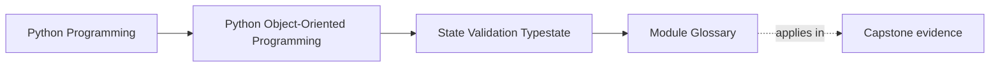

# Module Glossary

<!-- page-maps:start -->
## Page Maps

<!-- page-maps:end -->

This glossary belongs to **Module 03: State, Validation, and Typestate** in **Python
Object-Oriented Programming**. Use it when you need to name what an object is allowed to
be, when it is valid, and how callers should move it from one state to another.

## How to use this glossary

Return here when you catch yourself saying "this field is usually set later" or "that
method only works after setup." Those are state-design problems, and this glossary gives
you language to fix them directly.

## Terms that matter in this module

| Term | Meaning in this module | Review question |
| --- | --- | --- |
| Invariant | A rule that must hold whenever the object is considered valid. | What must always be true after construction and after every public method call? |
| Validation | The act of checking whether incoming or evolving state satisfies the rules. | Are you validating at the boundary, at construction, or too late to stop bad state? |
| Typestate | The idea that different states permit different operations. | Can callers tell which methods are legal in `draft`, `active`, or `retired` state? |
| State transition | A deliberate move from one valid state to another. | Does the code make the transition explicit, or does state drift through field mutation? |
| Partial object | An object that exists before it can honestly satisfy its own contract. | Are you modeling a real early state, or just tolerating incomplete construction? |
| Optional | A value that may be absent by design, not because the model is under-specified. | If `None` is allowed, can you explain the business meaning of absence? |
| Post-init validation | A final construction check that turns raw inputs into a valid object or rejects them. | Does construction end with a clear yes-or-fail point? |
| Dataclass | A Python convenience for declaring state, especially useful when the domain model is already clear. | Is the dataclass clarifying the model, or hiding missing design decisions behind terse syntax? |
| Frozen object | An object whose fields cannot be reassigned after creation, often useful for value objects. | Does immutability help preserve meaning here, or does the object actually need transitions? |
| Property | An attribute-like interface that may compute or guard access behind a field-shaped surface. | Will this still feel obvious to a reader who assumes attribute access is cheap and unsurprising? |
| Descriptor | The protocol that powers properties and other managed attributes in Python. | Do you need to implement one, or do you just need to understand why attribute access behaves this way? |
| Boundary validation | Input validation at the edge of the system before domain objects are created. | Have you separated external shape-checking from internal business rules? |

## Fast distinctions

- Prefer **explicit states** over "this flag plus those nullable fields means maybe-ready."
- Prefer **construct valid objects** over "construct now, fix later."
- Prefer **nullable by meaning** over "nullable because the refactor is incomplete."
- Prefer **simple properties** over hidden work that looks like a plain field.

## Exit check

Leave this glossary only when you can do all of these:

- explain the difference between an invariant and a transition rule
- identify when an object is honestly partial versus simply underdesigned
- explain why typestate is about permitted operations, not just status labels
