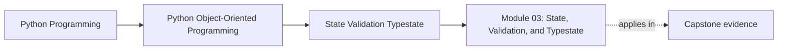
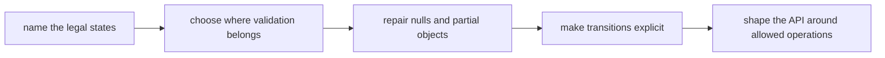

# Module 03: State, Validation, and Typestate

<!-- page-maps:start -->
## Page Maps

<!-- page-maps:end -->

State is where object-oriented systems usually stop feeling clean. A type can look tidy at
the class level while hiding most of its real complexity in optional fields, invalid
combinations, lifecycle drift, and operations that should not be callable in the current
state. This module exists to make those pressures explicit.

Keep one question in view while you study:

> Which states are legal, and how should the object make illegal states difficult to
> construct, preserve, or call through?

That is the shift from "fields on a class" to "state as a contract."

## What this module must settle

By the end of the module, you should be able to do all of these with reasons:

- model legal and illegal states explicitly
- choose between constructor checks, properties, boundary validators, and transition APIs
- represent absence without letting `None` mean five different things
- explain when a dataclass clarifies the model and when it weakens it
- shape the public API so illegal operations become harder to express

If those choices still feel like syntax or library preferences, stay longer.

## Session outcome

Treat Module 03 as one serious study day with four stages.

| Stage | Main pressure | What you should produce |
| --- | --- | --- |
| state naming | which states are legal and illegal | one legal-state table |
| boundary discipline | where invalid input gets rejected | one validation-boundary note |
| absence repair | what `None` really means and whether partial objects are honest | one nullability repair note |
| transition governance | which operations belong to which state | one transition map and one API note |

The module is not complete if you only remember `dataclass`, `property`, or `post_init`.
It is complete when you can explain a legal lifecycle.

## Recommended study route

Use this route unless you are returning to one narrow state problem:

1. [Properties and Computed Attributes](properties-and-computed-attributes.md)
2. [Descriptors Mental Model](descriptor-mental-model.md)
3. [Dataclasses for Values and Entities](dataclasses-for-values-and-entities.md)
4. [Dataclass Inheritance, Defaults, Slots, and Frozen Pitfalls](dataclass-inheritance-defaults-slots-and-frozen-pitfalls.md)
5. [Post-Init Validation and Invariants](post-init-validation-and-invariants.md)
6. [Boundary Validation Libraries](boundary-validation-libraries.md)
7. [Nulls, Optionals, and Partial Objects](null-optionals-and-partial-objects.md)
8. [Lifecycle and Typestate](lifecycle-and-typestate.md)
9. [Typestate in Python APIs](typestate-in-python-apis.md)
10. [Refactor 2: Dataclasses, Null Safety, and Typestate](refactor-dataclasses-null-safety-and-typestate.md)

Do not jump to typestate before you understand the legal states and absence rules the API
is trying to protect.

## Lesson map by pressure

| If your current question is... | Start here | Then do this |
| --- | --- | --- |
| should this stay a property or become a method | properties and computed attributes | explain what casual attribute syntax promises |
| is this dataclass helping or hiding trouble | dataclasses for values and entities | check equality, mutability, and defaults together |
| where should invalid state be rejected | post-init validation and invariants; boundary validation libraries | separate parsing mistakes from domain mistakes |
| why is `None` doing too much work | nulls, optionals, and partial objects | rewrite one overloaded absence case |
| how should lifecycle transitions be enforced | lifecycle and typestate | draw the transition map before touching the API |

## What a missed-class learner should do

If you are studying alone, use this rhythm:

1. read one lesson
2. describe one legal state and one illegal state in your own words
3. explain where the first rejection should happen
4. move on only after the state language sounds explicit
5. end the day with the exercise packet and one capstone transfer note

This replaces the classroom demos with visible design output.

## Capstone transfer for this module

The capstone's lifecycle states, constructor checks, and rule transitions are where this
module becomes real. Use the capstone to test yourself:

- which states are legal for a policy or rule?
- where are invalid inputs rejected first?
- what values are absent by meaning instead of by accident?
- which operations should disappear after activation, retirement, or approval-like transitions?

If you can answer those, Module 03 is landing.

## Support surfaces

Use the practice pages as the second half of the module:

- [Exercises](exercises.md)
- [Exercise Answers](exercise-answers.md)

Keep these nearby when useful:

- `../guides/proof-matrix.md`
- `../guides/module-checkpoints.md`
- `../reference/self-review-prompts.md`
- [Glossary](glossary.md)

## Common ways learners leave too early

- hiding expensive or stateful work behind innocent-looking properties
- treating `dataclass` as a shortcut without checking its semantic consequences
- letting `None` mean draft, missing, broken, and not-yet-loaded all at once
- allowing lifecycle transitions through caller discipline instead of named APIs
- calling an object "valid enough" when it is still only partially honest

## Closing criteria

You are ready to leave Module 03 only when you can do all of these in plain language:

- name the legal states of one object and one illegal combination
- explain where invalid state gets rejected first
- repair one overloaded absence or partial-object design
- show how the API changes once lifecycle transitions become explicit
