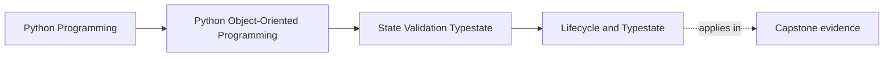

# Lifecycle and Typestate

<!-- page-maps:start -->
## Page Maps

<!-- page-maps:end -->

Read the first diagram as a placement map: this page is one concept inside its parent
module, not a detached essay, and the capstone is the pressure test for whether the
idea holds. Read the second diagram as the working rhythm for the page: name the
problem, study the example, identify the boundary, then carry one review question
forward.

## Why this lesson matters

Many objects are not just "there." They move through stages:

- draft
- active
- paused
- retired
- expired

If the code ignores those stages, operations stay callable long after they should have
become illegal.

Typestate is the design idea that the available operations should depend on the object’s
current state.

## What lifecycle means

Lifecycle means the object’s meaning changes over time in ways the program should care
about.

A draft object and an active object may share many fields, but they do not necessarily
support the same actions.

That difference is not cosmetic. It is a correctness boundary.

## What typestate means

Typestate means state is not only data to inspect. It affects which operations are valid.

Examples:

- a draft can be activated
- an active object can be retired
- a retired object should not accept ordinary updates

If all those actions are available all the time, the model is telling a weaker story than
the domain really needs.

## Why a plain status field is not enough by itself

A status field is useful, but by itself it can still leave the API weak.

Why?

- every method stays visible even when it is illegal in the current state
- callers learn rules only by trial, docs, or runtime errors
- transition discipline gets scattered

A plain field is often the start of lifecycle modeling, not the end of it.

## A good teaching test

Ask:

1. Does this object really have distinct stages with different legal operations?
2. Are callers currently able to ask for nonsense operations too easily?
3. Would clearer states make the code easier to review and teach?

If yes, the lifecycle should become more explicit.

## Common mistakes

- storing a status field but never enforcing transition legality
- allowing impossible transitions because "the caller should know better"
- modeling several lifecycle stages inside one baggy object with many optional fields
- treating typestate as too advanced when the real issue is just unmodeled rules

The important move is not fancy type theory. It is honest state-aware design.

## Practical modeling choices

You can model lifecycle more clearly by:

- guarding transitions centrally
- separating state-specific operations
- using distinct types or wrappers when the difference is strong enough
- removing operations that should not exist in later states

The right level depends on how much misuse risk the state change creates.

## Review checklist

| Question | Good sign |
| --- | --- |
| are lifecycle stages named clearly? | yes |
| are illegal transitions blocked somewhere explicit? | yes |
| do operations reflect state meaning instead of ignoring it? | yes |
| is the model more than a passive status label? | yes |

## Capstone connection

In the capstone, this lesson matters anywhere an object changes phase:

- draft to active
- pending to approved
- scheduled to executed
- open to closed or retired

If the capstone still exposes the same API regardless of state, its lifecycle model is
probably still too weak.

## Exit check

Leave this lesson only when you can do all of these:

- explain typestate in plain language
- name one capstone object whose valid operations should change by state
- explain why a status field alone may be too weak for an honest lifecycle design
