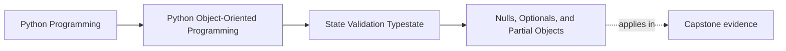

# Nulls, Optionals, and Partial Objects

<!-- page-maps:start -->
## Page Maps

<!-- page-maps:end -->

Read the first diagram as a placement map: this page is one concept inside its parent
module, not a detached essay, and the capstone is the pressure test for whether the
idea holds. Read the second diagram as the working rhythm for the page: name the
problem, study the example, identify the boundary, then carry one review question
forward.

## Why this lesson matters

`None` is useful, but it becomes dangerous when it turns into the default answer for
every absence problem.

That leads to designs where:

- required fields are maybe-present for no strong reason
- objects spend half their life partially initialized
- readers cannot tell whether absence is expected, temporary, or actually invalid

This lesson is about making absence explicit instead of hoping the reader will infer what
each `Optional[...]` really means.

## Not all absence means the same thing

Several very different situations often get collapsed into `None`:

- data has not arrived yet
- data is truly optional in the domain
- data is unknown because the boundary was incomplete
- the object is in an earlier lifecycle state
- the field should never be absent, but the code was written loosely

Those situations should not all share one design move by default.

## The danger of partial objects

A partial object is an object that exists before it has the fields or state it really needs
to make honest promises.

That usually causes:

- repeated `if x is None` checks everywhere
- methods that are only valid "sometimes"
- hard-to-read transition bugs
- objects that should have been separate states pretending to be one type

Partial objects are often a sign that lifecycle or boundary modeling is still too weak.

## When `Optional` is legitimate

`Optional` is reasonable when absence is a real part of the domain meaning.

Examples:

- a note may genuinely be absent
- an archival timestamp may not exist until retirement
- an optional secondary field may be truly optional forever

That is different from "we have not designed the state model carefully enough yet."

## Better alternatives to vague absence

Depending on the situation, clearer options include:

- separate boundary input models from core domain objects
- use distinct lifecycle states instead of one half-ready object
- use sentinels only when they name a real separate meaning
- require the field at construction if it is truly required for a valid instance

The goal is not to ban `Optional`. The goal is to stop using it as design camouflage.

## A practical decision test

Ask:

1. Is absence a permanent legitimate possibility here?
2. Or is it only temporary because the object is not fully ready yet?
3. Would a different state or type make the meaning clearer?

If absence is permanent and meaningful, `Optional` may be right.

If absence only describes an earlier stage, typestate or separate object shapes are often
clearer.

## Common mistakes

- marking almost every field optional to avoid constructor discipline
- storing boundary uncertainty directly in the domain forever
- treating "not loaded yet" as the same thing as "does not exist"
- using `None` where a separate lifecycle state would teach more clearly

These are usually modeling shortcuts, not harmless convenience.

## Review checklist

| Question | Good sign |
| --- | --- |
| does `Optional` represent real domain absence? | yes |
| are partial construction problems kept at the boundary or in state transitions? | yes |
| can readers tell why a field may be absent? | yes |
| are fake maybe-fields avoided for truly required data? | yes |

## Capstone connection

In the capstone, review every optional field and ask whether it means:

- truly optional forever
- unknown at the boundary
- unavailable until a later lifecycle state
- or simply under-modeled design

That audit usually reveals where the object model still needs sharper state boundaries.

## Exit check

Leave this lesson only when you can do all of these:

- explain the difference between real optional data and a partial object
- name one capstone field that should stay optional and one that should not
- explain when typestate is clearer than sprinkling `Optional` everywhere
