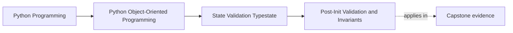

# Post-Init Validation and Invariants

<!-- page-maps:start -->
## Page Maps

<!-- page-maps:end -->

Read the first diagram as a placement map: this page is one concept inside its parent
module, not a detached essay, and the capstone is the pressure test for whether the
idea holds. Read the second diagram as the working rhythm for the page: name the
problem, study the example, identify the boundary, then carry one review question
forward.

## Why this lesson matters

Validation becomes much easier to reason about when objects do not begin life in an
invalid state.

If construction permits broken objects, every later method must become suspicious:

- "did anyone create this correctly?"
- "should I re-check this field here?"
- "can I trust this combination of values?"

That uncertainty spreads everywhere. Construction-time invariant checking prevents that
drift.

## What an invariant is

An invariant is a condition that should always hold for a valid instance.

Examples:

- a threshold stays within an allowed range
- a start time does not come after an end time
- an object marked active must already have required fields populated

If an invariant can be broken silently, the rest of the design becomes harder to trust.

## Why post-init validation matters

Post-init validation is the point where you take raw constructor inputs and confirm that
the instance is legitimate as a whole.

It is useful because some rules depend on combinations of fields, not only one field at a
time.

Single-field checks are not enough when meaning depends on the full object shape.

## The design principle

Prefer this rule:

If an object exists, it should already satisfy its core invariants.

That does not mean every future state is guaranteed forever. It means the object should
not start life broken and hope later code will fix it.

## What this changes in the rest of the code

When construction enforces invariants:

- downstream methods can be simpler
- tests can assume a valid starting point
- invalid combinations fail early and locally
- readers do not need to mentally track "maybe broken" objects everywhere

This is a teaching win as well as a design win.

## Common mistakes

- validating only at a far-away service boundary and never in the object itself
- checking fields one by one but missing invalid combinations
- allowing placeholder instances that are supposed to become valid later
- catching invariant errors too late, after the object has already spread

The worst version is the half-formed object that floats through several layers before
someone notices it should never have existed.

## When not everything belongs in post-init

Not every rule belongs in construction.

Construction-time validation is best for:

- identity and field-shape assumptions
- required relationships between fields
- "this object is nonsense if this is false" rules

Lifecycle-specific rules may belong on transition methods instead.

The point is not "all validation in one place." The point is "each rule at the earliest
honest point."

## Review checklist

| Question | Good sign |
| --- | --- |
| does the object reject broken field combinations at construction? | yes |
| can downstream code mostly assume a valid starting instance? | yes |
| are lifecycle rules separated from initial invariants when needed? | yes |
| are half-formed placeholder instances avoided? | yes |

## Capstone connection

In the capstone, this lesson matters anywhere an object can be created from several
related inputs:

- configs
- policies
- scheduled actions
- domain commands that become durable objects

If the capstone still creates objects first and asks whether they are valid later, this
lesson should be applied next.

## Exit check

Leave this lesson only when you can do all of these:

- explain one invariant that should be enforced at construction time
- explain why broken instances make downstream code noisier
- distinguish between initial invariants and later lifecycle transition rules
