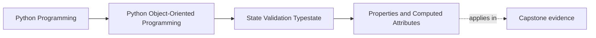

# Properties and Computed Attributes

<!-- page-maps:start -->
## Page Maps

<!-- page-maps:end -->

Read the first diagram as a placement map: this page is one concept inside its parent
module, not a detached essay, and the capstone is the pressure test for whether the
idea holds. Read the second diagram as the working rhythm for the page: name the
problem, study the example, identify the boundary, then carry one review question
forward.

## Why this lesson matters

Properties look like fields but behave like methods. That is useful only when the hidden
behavior stays honest.

Without that discipline, properties become a place where code hides:

- expensive work
- surprising side effects
- state-dependent failures
- behavior that should have stayed an explicit method

This lesson is about preserving attribute-style clarity without lying to the reader.

## What a good property feels like

A good property feels like reading a fact that is:

- local to the object
- cheap to compute
- unsurprising
- free of side effects

If reading the attribute behaves like asking a simple question, a property may be a good
fit.

## What should stay a method

Keep an operation as a method when it:

- performs expensive work
- changes state
- touches I/O or infrastructure
- depends on extra parameters
- is better read as an action than a fact

The reader should not have to guess whether attribute access is secretly doing too much.

## Why computed attributes help

Computed attributes are useful when they:

- expose a derived fact cleanly
- keep invariant-related logic near the object
- remove noisy boilerplate from callers

That can improve readability a lot, especially for domain objects with simple derived
state.

## Common mistakes

- putting network or storage access behind a property
- hiding expensive recalculation behind innocent-looking attribute access
- using a property for an operation that should read like a verb
- allowing a property to raise state-related surprises that the surface does not hint at

The surface should help the reader, not ambush them.

## A practical test

Ask:

1. If I saw `obj.name` in a code review, would I expect this to be cheap and local?
2. Does reading it behave more like observing state than performing work?
3. Would a verb-like method name tell the truth better?

If the answer to the third question is yes, keep it a method.

## Review checklist

| Question | Good property | Better as method |
| --- | --- | --- |
| cheap and local? | yes | often no |
| side-effect free? | yes | not always |
| reads like a fact? | yes | no |
| hidden heavy work? | no | often yes |

## Capstone connection

In the capstone, review every property and ask whether it is:

- a clean derived fact
- or a disguised operation

This matters especially around state, derived summaries, and validation-relevant facts.

## Exit check

Leave this lesson only when you can do all of these:

- explain when a property is clearer than a method
- explain one case where a method should stay explicit
- identify one capstone attribute surface that should be reviewed for hidden work
