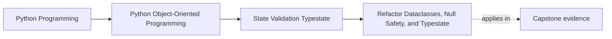

# Refactor Dataclasses, Null Safety, and Typestate

<!-- page-maps:start -->
## Page Maps

<!-- page-maps:end -->

Read the first diagram as a placement map: this page is one concept inside its parent
module, not a detached essay, and the capstone is the pressure test for whether the
idea holds. Read the second diagram as the working rhythm for the page: name the
problem, study the example, identify the boundary, then carry one review question
forward.

## Why this refactor matters

Module 03 is not really about isolated Python features. It is about turning state-handling
code into a model that is harder to misuse and easier to trust.

This refactor page exists to combine the module’s main moves:

- boundary validation
- honest dataclass use
- construction-time invariants
- explicit absence handling
- lifecycle-aware modeling
- typestate-aware APIs
- careful attribute surfaces

If those ideas stay separate, the learner leaves with trivia. If they come together, the
learner leaves with a design method.

## The starting design smell

A weak pre-refactor design usually looks like this:

- raw input becomes domain state too early
- objects are created before they are really valid
- `Optional` spreads because lifecycle is blurry
- dataclasses are used for convenience without semantic review
- all methods stay callable regardless of state

That design may run, but it makes trust and review difficult.

## The target shape

After a good Module 03 refactor, the design should feel like this:

- boundary input is validated before core object creation
- dataclasses are used where they clarify the model
- invariants are checked when objects come into existence
- absence is modeled deliberately instead of by habit
- lifecycle stages are named and enforced
- the API surface tells a stronger truth about legal operations

The target is not maximum abstraction. The target is stronger state honesty.

## A practical refactor order

Use this order when repairing a weak design:

1. separate boundary parsing from domain construction
2. identify the real invariants of each core object
3. remove fake optionality from required fields
4. distinguish true absence from earlier lifecycle state
5. model the lifecycle explicitly
6. tighten the public API around valid state transitions
7. only then add or keep supporting machinery that genuinely helps

This order matters because later improvements depend on earlier clarity.

## How to tell whether the refactor worked

Ask whether the design is now better at answering:

- can this object exist in this shape?
- what state is it in?
- which operations are legal now?
- is this field absent by meaning or by design weakness?
- where is input uncertainty resolved?

If those answers are still fuzzy, more feature use will not save the design.

## What not to preserve

Do not preserve weak patterns because they already exist.

Refactoring this module may require:

- removing casual optionals
- replacing partial objects with clearer states
- simplifying dataclass usage
- moving validation earlier
- making some operations impossible instead of merely discouraged

The module’s standard is not "works somehow." It is "teaches correct state ownership."

## Review checklist

| Question | Better answer after refactor |
| --- | --- |
| is raw input kept separate from core state long enough? | yes |
| do objects begin life valid? | yes |
| is absence modeled intentionally? | yes |
| are lifecycle stages explicit and enforceable? | yes |
| does the public API reflect legal state? | yes |

## Capstone connection

This page is the direct bridge from Module 03 into the capstone.

Use it when the capstone still has:

- half-ready objects
- fields that are optional for no honest reason
- lifecycle labels that do not affect the API
- dataclass convenience hiding weak state boundaries

If those problems remain, the module has not yet been absorbed deeply enough.

## Exit check

Leave this lesson only when you can do all of these:

- describe the target Module 03 design shape in your own words
- explain an order for refactoring a weak state model into a stronger one
- identify one capstone area that still needs this state-modeling refactor
